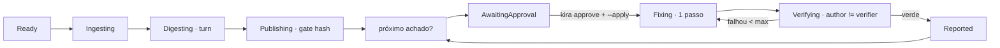

# Plano de implementação — Onda BR (`src/brain/`, o degrau "system design")

> **Data**: 13/Nov/2026 · **Fonte**: [`docs/kira-brain.md`](kira-brain.md) (o doc-pai) ·
> **Estado ancorado**: `main` com M1–M5 fechados (`ingest`/`posts`/`digest`/`publish`/`trust`).
>
> O **Brain** é o orquestrador que roda a escada como **grafo de estados em Rust**, reusando
> os módulos que já existem — ele **não reimplementa** nada de ingestão/digestão/emissão.
> Este documento transforma o desenho em **itens executáveis** (um PR por item), com escopo
> fechado e teste de aceite. Âncoras verificadas em 13/Nov/2026.

**Advertência honesta**: o Brain orquestra dois caminhos — o **onboarding** (read-only,
executável agora) e a **manutenção** (triage/fix, que depende do gate M2 e do `kira approve`
— bloqueados). O plano separa os dois e deixa claro o que entra na fila **já** e o que fica
atrás do gate.

---

## 1. Estado da main que a onda toca (âncoras verificadas)

| Módulo | Âncora (verificada) | Papel no Brain |
|---|---|---|
| `src/ingest/mod.rs` | `run()` (L118) — inventário → stack → índice → scan → facts.md | nó **Ingesting** |
| `src/post/mod.rs` | `run()` (L130) — o `turn` (fases `claim → generate → deliver`, L182–269) | nó **Digesting** (turno interno) |
| `src/publish/mod.rs` | `run()` — publica `.kira/wiki/` com gate `published_hash` | nó **Publishing** |
| `src/triage.rs` | `triage_live_llm` / `triage_file_llm` | nó **Triaging** (pós-M2) |
| `src/trust.rs` | `is_trusted(root)` — gate antes de mandar código ao modelo | pré-condição do `Digesting` |
| `src/store/posts.rs` | `post_claim`/`post_deliver` (lease) | estado do loop interno |
| `src/store/mod.rs` | `sessions` (schema) + migração por `PRAGMA user_version` | estado do grafo (nova tabela) |
| `src/guard/path.rs` | `Guard` (deny-list + confinamento) | proteção do `Fixing`/`Publishing` |
| `src/main.rs` | subcomandos `Ingest/Digest/Emit/Triage/…` | ganha `Brain` |

**Fato que ancora o desenho**: hoje o dev roda `ingest → digest → publish` à mão, e o
`briefing.md` até sugere o próximo comando (`kira publish` / `kira digest --resume`). O Brain
automatiza **essa sequência já existente** como um grafo, e só depois estende para a
manutenção (que ainda não existe).

---

## 2. Regras da onda (não negociáveis)

1. **Gates por PR**: `cargo fmt --check` → `clippy -D warnings` → `test` → `build` → CI 3 SOs.
2. **Branch**: `br/pr<n>-<slug>`. Um PR por item.
3. **Reuso, não reimplementação**: o Brain chama `ingest::run`, `post::run`, `publish::run`.
   Nenhuma lógica de ingestão/digestão migra para `src/brain/` (módulos por domínio, ADR-0022).
4. **Determinismo**: mesma entrada ⇒ mesmas transições de estado ⇒ mesmos artefatos.
5. **Read-only por padrão**: `kira brain` roda `ingest→digest→publish` sem `--apply`; qualquer
   escrita no mundo exige `--apply` **e** `kira approve` (ADR-0017).
6. **Dependências novas: nenhuma.** Env nova: nenhuma.
7. **`author ≠ verifier`**: o nó que gera nunca é o nó que aprova (lição dos vídeos).
8. **Fail-open por nó**: um nó que falha vira nota no briefing, nunca quebra o comando
   inteiro — exceto quando é pré-condição de segurança (`trust`).

---

## 3. O grafo de estados (contrato)



Estados em `enum BrainPhase` (ordem fixa), transições em função **pura** `next(state, event)`.
O caminho de **onboarding** (executável agora) é `Ready → Ingesting → Digesting → Publishing
→ Reported`. O caminho de **manutenção** (`Triaging → … → Verifying`) é o BR-3, atrás do M2.

---

## 4. Itens executáveis

### BR-1 — Esqueleto do Brain + caminho de onboarding (`kira brain`)

**Objetivo**: um `kira brain` que roda `ingest → digest → publish` como grafo de estados
determinístico, reusando os `run` existentes, com estado persistido (resume) e resumo final.

**Arquivos**:

- `src/brain/mod.rs` (**novo**) — `run(root, options)`: itera o grafo
  `Ready → Ingesting → Digesting → Publishing → Reported`; chama `ingest::run`,
  `post::run` (com `LlmBackend` do chamador), `publish::run`. `Digesting` só roda se
  `trust::is_trusted(root)` (senão registra a nota "rode `kira trust`" e segue — fail-open
  **não** vale para trust: sem trust, o Digesting é pulado, nunca forçado).
- `src/brain/state.rs` (**novo**) — `enum BrainPhase` + `next()` pura (testável sem I/O).
- `src/store/mod.rs` — migração v7: tabela `brain_run(id, root, phase, started_at,
  updated_at, apply, notes)`. Estado do grafo para `--resume` (não re-ingerir o que já foi).
- `src/main.rs` — subcomando `Brain { apply: bool, resume: bool, root }`.

**Aceite**:

- `kira brain` num repo demo ⇒ roda `ingest` (facts.md nasce), `digest` (posts no
  `.kira/drafts/`), `publish` (wiki publicado), na ordem, e imprime resumo.
- Duas execuções seguidas (sem `--resume`) ⇒ segunda é idempotente (digest byte-idêntico,
  posts no cache, publish recusa reescrever) — nada duplica.
- Sem `trust` ⇒ `Digesting` é pulado com nota; `ingest` roda normal (é read-only).
- `next()` cobre todas as transições legais e recusa as ilegais (teste de unidade).
- Gates verdes; nenhum import novo de `llm::*` fora dos call sites já existentes.

### BR-2 — Nó `Verifying` (determinístico, `author ≠ verifier`)

**Objetivo**: o Brain ganha um nó de verificação **separado do gerador**, na saída do
onboarding: confere que os posts publicados têm evidência real (âncoras `path:line`
resolvem no disco) e que nada vazou redação. É o "verifier" determinístico — **antes** de
qualquer verificação por LLM.

**Arquivos**:

- `src/brain/verify.rs` (**novo**) — `verify_anchors(post_text, root) -> Vec<AnchorMismatch>`:
  extrai as âncoras `caminho:linha` do post e checa se o arquivo existe e a linha não
  ultrapassa o tamanho. Reusa `context::repo::normalize_rel` (L283) para recusar `..`/absoluto.
- `src/brain/mod.rs` — `Publishing → Verifying → Reported`; mismatch vira nota no briefing
  (não erro) e o post é marcado `stale` no estado (para o `doctor` reportar).

**Aceite**:

- Post com âncora `src/lib.rs:99` que não existe ⇒ nota + post marcado `stale`.
- Post com âncora válida ⇒ passa, sem nota.
- Post **sem** âncora nenhuma (o dev apagou o front-matter à mão) ⇒ o `publish` já recusa
  antes (gate `published_hash`) — o verifier não é chamado.
- Duas execuções ⇒ mesmas notas, byte a byte.

### BR-3 — Caminho de manutenção (`Triaging → Fixing` + approve) — **pós-M2**

**Objetivo**: estender o grafo para `Triaging → AwaitingApproval → Fixing → Verifying`,
usando `triage` e o futuro `fix --apply` (PR27). **Fica atrás do gate M2** (20 bugs
rotulados, `--eval` ≥ 70%) e do `kira approve` (PR18) — mesma dependência da onda W5.

**Arquivos** (spec, não código agora): `src/brain/state.rs` (transições novas),
`docs/kira-w5-loop.md` (aprovar o desenho do loop), `src/main.rs` (`approve`).

**Aceite** (quando destravar): `kira brain --apply` para em `AwaitingApproval` antes de
qualquer escrita; `kira approve <id>` transiciona; `Verifying` roda com retry capado.

---

## 5. Decisões abertas para o dono (propostas, sem selo)

| # | Item | Proposta default |
|---|---|---|
| **B1** | O Brain é um comando novo (`kira brain`) ou vira o default do `kira loop` (W5)? | `kira brain` novo; o W5 continua o ciclo autônomo de manutenção |
| **B2** | Estado do grafo: tabela `brain_run` no store ou arquivo `.kira/brain.json`? | Tabela `brain_run` (store é a fonte de verdade, padrão do repo) |
| **B3** | Sem `trust`, o `Digesting` é pulado (fail-open) ou o Brain para? | **Pulado com nota** — `ingest`/`publish` são read-only e continuam |
| **B4** | Verifier determinístico (BR-2) já entra agora ou só com o caminho de manutenção? | **Agora** (BR-2) — fecha a ancoragem do onboarding antes do fix |
| **B5** | Verificação por LLM (checklist `Given/When/Then`) entra como BR-4 ou fica no loop W5? | Fica no **W5** (é julgamento, custa chamada — só no caminho de manutenção) |

---

## 6. Ordem de execução

```
BR-1 (esqueleto + onboarding) ──► BR-2 (verifier determinístico) ──► BR-3 (manutenção, pós-M2)
```

- **BR-1** e **BR-2** são independentes das ondas IG/SK/TE/TL — podem entrar na fila já.
- **BR-3** herda as dependências do W5 (gate M2 + PR18/PR27); não bloqueia BR-1/BR-2.

---

## 7. O que esta onda **não** faz

- **Não reimplementa** ingestão/digestão/emissão — só orquestra os `run` existentes.
- **Não** introduz framework de orquestração, MCP, subagente em runtime nem chamada de LLM
  nova fora dos call sites atuais (o `llm_allowlist` continua verde).
- **Não** escreve no mundo sem `--apply` + `kira approve`.
- **Não** promove o caminho de manutenção antes do gate M2 (20 bugs rotulados + `--eval` ≥ 70%).
