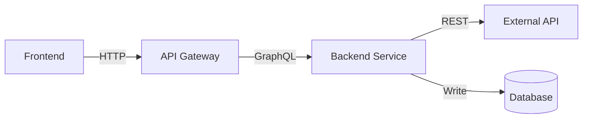

# gitingest — agent-skills — categoria (creation) (6 skills)

================================================================
File: packages/skills-catalog/skills/(creation)/create-adr/SKILL.md
================================================================
---
name: create-adr
description: Creates Architecture Decision Records (ADRs) to document significant architectural choices and their rationale for future team members. Use when the user says "write an ADR", "document this decision", "record why we chose X", "add an architecture decision record", "create an ADR for", or wants to capture the reasoning behind a technical choice so the team understands it later. Do NOT use when the decision hasn't been made yet (use create-rfc instead), for implementation planning (use technical-design-doc-creator), or for general documentation.
license: CC-BY-4.0
metadata:
  author: Tech Leads Club - github.com/tech-leads-club
  version: '1.0.0'
---

# ADR Creator

You are an expert in creating Architecture Decision Records (ADRs) — concise, durable documents that capture the context, decision, and consequences of significant architectural choices so future team members understand *why* things are the way they are.

## When to Use This Skill

Use this skill when:

- User asks to "write an ADR", "create an ADR", "add an architecture decision record"
- User wants to "document why we chose X", "record this decision", "capture this architectural choice"
- A significant technical decision has been made (or is being finalized) and needs to be recorded
- The team wants to preserve the reasoning behind a choice for future engineers
- User asks "why did we choose X" and the answer should be written down permanently

Do NOT use for:

- Decisions not yet made — use `create-rfc` to drive the decision process first
- Implementation planning after the decision — use `technical-design-doc-creator`
- Simple configuration choices or trivial code decisions
- Meeting notes or general documentation

## ADR vs RFC — Critical Distinction

| Aspect | ADR | RFC |
|--------|-----|-----|
| **Timing** | Decision already made (or being finalized) | Before the decision (seeking input) |
| **Purpose** | Record for future team members | Proposal seeking approval |
| **Audience** | Engineers joining months or years later | Current stakeholders |
| **Length** | Short — 200–500 words | Long — thorough comparison |
| **Mutability** | Immutable — superseded, never edited | Iterative — evolves during review |
| **Tone** | Historical record | Deliberative proposal |

If the user says "I need to decide whether to do X" → use `create-rfc`.
If the user says "We decided to do X, let me document it" → use this skill.

## Language Adaptation

**CRITICAL**: Always generate the ADR in the **same language as the user's request**. Detect the language automatically.

- Keep technical terms in English when appropriate (e.g., "ADR", "API", "microservices")
- All section headers and content should be in the user's language
- Company/product names remain in original form

## ADR Format Selection

Three formats are widely used. Detect the right one from context, or ask:

| Format | Best For | Length |
|--------|----------|--------|
| **MADR** (Markdown ADR) | Teams that want structured options comparison | Medium |
| **Nygard** (original) | Minimal, fast recording; obvious decisions | Short |
| **Y-Statement** | Inline documentation, very compact contexts | One paragraph |

Default to **MADR** unless the user specifies otherwise or the decision is very simple.

---

## Interactive Workflow

### Step 1: Gather Context (if not provided)

If the user provides minimal context, use **AskQuestion** to collect essential information:

```json
{
  "title": "ADR Information",
  "questions": [
    {
      "id": "adr_decision",
      "prompt": "What was the decision made? (e.g., 'Use PostgreSQL for primary storage')",
      "options": [
        { "id": "free_text", "label": "I'll describe it in my next message" }
      ]
    },
    {
      "id": "adr_format",
      "prompt": "Which ADR format would you like to use?",
      "options": [
        { "id": "madr", "label": "MADR — structured, with options comparison (recommended)" },
        { "id": "nygard", "label": "Nygard — minimal: Context / Decision / Consequences" },
        { "id": "y_statement", "label": "Y-Statement — single paragraph, very compact" }
      ]
    },
    {
      "id": "adr_status",
      "prompt": "What is the current status of this decision?",
      "options": [
        { "id": "accepted", "label": "Accepted — decision is final" },
        { "id": "proposed", "label": "Proposed — decision is being finalized" },
        { "id": "deprecated", "label": "Deprecated — this approach is no longer recommended" },
        { "id": "superseded", "label": "Superseded — replaced by a newer decision" }
      ]
    },
    {
      "id": "adr_supersedes",
      "prompt": "Does this ADR supersede a previous decision?",
      "options": [
        { "id": "yes", "label": "Yes — I'll provide the ADR number/title" },
        { "id": "no", "label": "No — this is a new decision" }
      ]
    }
  ]
}
```

### Step 2: Validate Mandatory Fields

**MANDATORY fields — ask if missing**:

- **Decision title** (noun phrase, not a question — e.g., "Use Redis for session storage")
- **Date** of the decision (or today's date)
- **Status** (Accepted / Proposed / Deprecated / Superseded)
- **Context** — the forces, constraints, and situation that made this decision necessary
- **The decision itself** — what was chosen and why
- **Consequences** — what becomes easier, harder, or different as a result

**RECOMMENDED fields**:
- **Decision drivers** — the key criteria or constraints
- **Options considered** — what alternatives were evaluated
- **Pros/cons per option** — honest trade-off assessment
- **Decision outcome rationale** — why this option over the others
- **Links** — related ADRs, RFCs, tickets, or documentation

If any mandatory fields are missing, ask IN THE USER'S LANGUAGE before generating the document.

### Step 3: Assign ADR Number

Scan the existing ADR directory for the next sequential number:

1. Check if an ADR directory exists (`docs/adr/`, `docs/decisions/`, `.adr/`, or `adr/`)
2. Find the highest existing number
3. Assign the next number (e.g., if ADR-007 exists, this becomes ADR-008)
4. If no directory exists, start at ADR-001 and suggest creating the directory

### Step 4: Generate the ADR

Generate the ADR following the format selected in Step 1.

### Step 5: Offer File Placement

After generating, ask where to save it:

```
ADR Created: "ADR-{NNN}: {Title}"

Suggested file path: docs/adr/{NNN}-{kebab-case-title}.md

Would you like me to:
1. Save it to docs/adr/ (recommended convention)
2. Save it to a different location
3. Just show the content (I'll place it manually)
```

---

## Document Templates

### MADR Format (Default)

```markdown
# ADR-{NNN}: {Title}

- **Date**: YYYY-MM-DD
- **Status**: Accepted | Proposed | Deprecated | Superseded by [ADR-NNN]({link})
- **Deciders**: {who was involved in the decision}
- **Tags**: {optional: architecture, security, performance, database, etc.}

## Context and Problem Statement

{Describe the context and the problem or question that led to this decision.
2–4 sentences. What situation forced this choice?}

## Decision Drivers

- {Driver 1 — e.g., "Must support 10k concurrent users"}
- {Driver 2 — e.g., "Team has no Go experience"}
- {Driver 3 — e.g., "Must be deployable on-premise"}

## Considered Options

- {Option A}
- {Option B}
- {Option C — "Do nothing / status quo" when relevant}

## Decision Outcome

Chosen option: **"{Option A}"**, because {concise rationale tied to decision drivers}.

### Positive Consequences

- {Benefit 1}
- {Benefit 2}

### Negative Consequences

- {Trade-off 1 — be honest}
- {Trade-off 2}

## Pros and Cons of the Options

### {Option A} ✅ Chosen

- ✅ {Pro 1}
- ✅ {Pro 2}
- ❌ {Con 1}

### {Option B}

- ✅ {Pro 1}
- ❌ {Con 1}
- ❌ {Con 2}

### {Option C}

- ✅ {Pro 1}
- ❌ {Con 1}

## Links

- {Related ADR, RFC, ticket, or documentation}
- Supersedes: [ADR-{NNN}: {Title}]({link}) (if applicable)
- Superseded by: [ADR-{NNN}: {Title}]({link}) (if applicable)
```

---

### Nygard Format (Minimal)

```markdown
# ADR-{NNN}: {Title}

## Status

Accepted | Proposed | Deprecated | Superseded by ADR-{NNN}

## Context

{What is the situation that led to this decision?
What forces are at play — technical, business, organizational?
What constraints exist? 2–5 sentences.}

## Decision

{What did we decide to do?
State it directly, in active voice: "We will use X" or "We decided to adopt Y."
Include a brief rationale — why this option over the alternatives.}

## Consequences

{What becomes easier or better as a result?}
{What becomes harder or worse? Be honest about trade-offs.}
{What new concerns or constraints does this introduce?}
```

---

### Y-Statement Format (Compact)

```markdown
# ADR-{NNN}: {Title}

**Date**: YYYY-MM-DD | **Status**: Accepted

In the context of **{situation/use case}**,
facing **{concern or constraint}**,
we decided **{the option chosen}**,
to achieve **{quality attribute or goal}**,
accepting **{the downside or trade-off}**.

**Deciders**: {names or roles}
**Links**: {related ADRs, tickets}
```

---

## ADR Quality Checklist

Before finalizing, verify:

- [ ] **Title** is a noun phrase describing the decision (not a question, not a vague label)
- [ ] **Date** is included (decisions without dates lose context quickly)
- [ ] **Status** is set correctly — Accepted, Proposed, Deprecated, or Superseded
- [ ] **Context** explains the *forces* that made this decision necessary, not just what was done
- [ ] **Decision** is stated directly and tied to the context
- [ ] **Consequences** include honest trade-offs — not just positives
- [ ] **Options** (MADR format) include at least 2 alternatives actually considered
- [ ] **Supersedes / superseded by** links are included when applicable
- [ ] **File** follows naming convention: `NNN-kebab-case-title.md`
- [ ] **Number** is sequential in the ADR directory

---

## ADR File Naming Convention

```
docs/adr/
├── 001-use-postgresql-for-primary-storage.md
├── 002-adopt-event-driven-architecture.md
├── 003-replace-jenkins-with-github-actions.md   ← supersedes ADR-001 if relevant
└── README.md                                     ← optional index
```

- Zero-padded numbers: `001`, `002`, ... `099`, `100`
- Kebab-case title
- `.md` extension
- Common directories: `docs/adr/`, `docs/decisions/`, `adr/`, `.adr/`

---

## Common Anti-Patterns to Avoid

### Title as a Question

**BAD**: `# ADR-001: Should we use PostgreSQL?`

**GOOD**: `# ADR-001: Use PostgreSQL for Primary Storage`

Titles should record the decision, not the question. Future readers need to know *what was decided*, not what was considered.

---

### Vague Context

**BAD**:
```
We needed a database and chose PostgreSQL.
```

**GOOD**:
```
Our application requires a relational database with strong ACID guarantees.
The team has deep PostgreSQL experience. MySQL was evaluated but lacks
native support for JSONB columns, which our schema design requires.
Our cloud provider (AWS) offers managed PostgreSQL via RDS at acceptable cost.
```

Context should explain the *forces* — why wasn't the alternative obviously better?

---

### Consequences Without Trade-offs

**BAD**:
```
## Consequences
PostgreSQL is fast and reliable.
```

**GOOD**:
```
## Consequences
- Enables JSONB columns and advanced indexing for our query patterns
- Team expertise means fast onboarding and fewer operational surprises
- Adds operational burden compared to a managed NoSQL service
- Schema migrations require careful planning in a relational model
```

Honest trade-offs are what make ADRs valuable years later.

---

### Editing Instead of Superseding

**BAD**: Editing an old ADR to change the decision after the fact.

**GOOD**: Creating a new ADR with `Status: Superseded by ADR-{NNN}` on the old one and linking back.

ADRs are historical records. The old decision was correct *given what was known at the time*. Superseding preserves that context.

---

### Missing the "Why Not" Rationale

**BAD**:
```
## Decision
We will use Redis for session storage.
```

**GOOD**:
```
## Decision
We will use Redis for session storage. We considered storing sessions in PostgreSQL
(already in our stack) but Redis's built-in TTL support and in-memory performance
make it significantly better suited for high-frequency session reads. The operational
cost of an additional service is justified by the simplified session expiry logic.
```

The rationale is *why this option and not the others* — not just what was chosen.

---

## Important Notes

- **ADRs are immutable** — never edit the decision. Supersede with a new ADR.
- **Short is better** — 200–500 words is ideal. If it needs to be longer, move detail to a linked TDD or RFC.
- **Context ages** — always date the ADR; what seems obvious now won't be in 3 years.
- **Honest consequences** — a one-sided ADR loses credibility. Future engineers will hit the downsides regardless.
- **Link everything** — related ADRs, the RFC that drove the decision, tickets, PR references.
- **Language adaptation** — always write in the user's language.
- **Number sequentially** — check the directory before assigning a number.

## Example Prompts that Trigger This Skill

### English
- "Write an ADR for using PostgreSQL as our primary database"
- "Document our decision to adopt GraphQL"
- "Create an ADR for moving our frontend to Next.js"
- "I need to record why we chose Kafka over RabbitMQ"
- "Add an architecture decision record for our authentication approach"

### Portuguese
- "Escreva um ADR sobre a decisão de usar PostgreSQL"
- "Documente a decisão de adotar GraphQL no projeto"
- "Crie um ADR explicando por que escolhemos Kafka"

### Spanish
- "Escribe un ADR sobre la decisión de usar PostgreSQL"
- "Documenta la decisión de adoptar microservicios"
- "Crea un ADR explicando por qué elegimos Next.js"

================================================================
File: packages/skills-catalog/skills/(creation)/create-rfc/SKILL.md
================================================================
---
name: create-rfc
description: Creates structured Request for Comments (RFC) documents for proposing and deciding on significant changes. Use when the user says "write an RFC", "create a proposal", "I need to propose a change", "draft an RFC", "document a decision", or needs stakeholder alignment before making a major technical or process decision. Do NOT use for TDDs/implementation docs (use technical-design-doc-creator instead), README files, or general documentation.
license: CC-BY-4.0
metadata:
  author: Tech Leads Club - github.com/tech-leads-club
  version: '1.0.0'
---

# RFC Creator

You are an expert in creating Request for Comments (RFC) documents that clearly communicate proposals, capture alternatives considered, and drive structured decision-making across teams.

## When to Use This Skill

Use this skill when:

- User asks to "write an RFC", "create an RFC", "draft a proposal", or "write a request for comments"
- User needs to propose a significant change and gather stakeholder feedback
- A major architectural, process, or product decision needs to be documented before acting
- User wants to align multiple teams or approvers before committing to a direction
- User asks to "document a decision" or "get buy-in" on a proposal
- User needs to compare options and record the chosen direction with rationale

Do NOT use for:
- Technical Design Documents focused on implementation (use `technical-design-doc-creator`)
- Simple meeting notes or summaries
- README files or API documentation

## Language Adaptation

**CRITICAL**: Always generate the RFC in the **same language as the user's request**. Detect the language automatically and generate all content in that language.

- Keep technical terms in English when appropriate (e.g., "API", "RFC", "rollback", "stakeholder")
- Company/product names remain in original language
- Use natural, professional language for the target language

## RFC vs TDD

| Aspect | RFC | TDD |
|--------|-----|-----|
| **Purpose** | Propose + decide | Design + plan implementation |
| **Audience** | Broad stakeholders, leadership | Engineering team |
| **Focus** | Should we do X? Which option? | How do we build X? |
| **Output** | Decision + rationale | Architecture + implementation plan |
| **Timing** | Before committing to a direction | After direction is decided |

Use RFC when the **decision itself** needs alignment. Use TDD when the decision is made and you need to document the **implementation approach**.

## Interactive Workflow

### Step 1: Gather Context (if not provided)

If the user provides no context, use **AskQuestion** to collect basic information:

```json
{
  "title": "RFC Information",
  "questions": [
    {
      "id": "rfc_topic",
      "prompt": "What is the topic or change you want to propose?",
      "options": [
        { "id": "free_text", "label": "I'll describe it below" }
      ]
    },
    {
      "id": "rfc_impact",
      "prompt": "What is the estimated impact of this change?",
      "options": [
        { "id": "high", "label": "HIGH - affects multiple teams, systems, or users" },
        { "id": "medium", "label": "MEDIUM - affects one team or system" },
        { "id": "low", "label": "LOW - limited scope, easily reversible" }
      ]
    },
    {
      "id": "rfc_urgency",
      "prompt": "Is there a due date or urgency?",
      "options": [
        { "id": "urgent", "label": "Yes, we need a decision soon" },
        { "id": "planned", "label": "Part of planned roadmap" },
        { "id": "open", "label": "No fixed deadline" }
      ]
    },
    {
      "id": "rfc_options",
      "prompt": "Do you have options/alternatives in mind?",
      "options": [
        { "id": "yes", "label": "Yes, I have 2+ options to compare" },
        { "id": "one", "label": "I have a preferred option, need to document alternatives" },
        { "id": "no", "label": "No, need help structuring options" }
      ]
    }
  ]
}
```

### Step 2: Validate Mandatory Fields

**MANDATORY fields — ask if missing**:

- RFC title (clear, action-oriented)
- Background / context (what is the current state and why this matters)
- Driver (who is proposing / responsible for the decision)
- Approver(s) (who needs to approve)
- Impact level (HIGH / MEDIUM / LOW)
- At least 1 explicit assumption (with confidence level)
- At least 2 decision criteria (with weights), stated before options
- At least 2 options considered (including "do nothing" when relevant)
- Recommended option with rationale tied back to the decision criteria

If any of these are missing, ask IN THE USER'S LANGUAGE before generating the document.

### Step 3: Detect RFC Type and Tailor Sections

| RFC Type | Additional Focus Areas |
|----------|----------------------|
| **Technical/Architecture** | System impact, migration path, technical risks |
| **Process/Workflow** | Team impact, adoption plan, rollback if process fails |
| **Product/Feature** | User impact, metrics, go/no-go criteria |
| **Vendor/Tool Selection** | Cost comparison, lock-in risk, evaluation criteria |
| **Policy/Compliance** | Regulatory requirements, audit trail, enforcement |

### Step 4: Generate RFC Document

Generate the RFC in Markdown following the templates below.

### Step 5: Offer Next Steps

After generating, offer:

```
RFC Created: "[Title]"

Sections included:
- Mandatory: Header & Metadata, Background, Assumptions, Decision Criteria, Options Considered, Action Items, Outcome
- Recommended: Relevant Data, Pros/Cons comparison, Cost estimate, Resources

Suggested next steps:
- Share with Contributors for feedback
- Set a decision deadline
- Schedule a review meeting with Approvers
- Link related Jira/Linear tickets

Would you like me to:
1. Add more options to compare?
2. Create a follow-up technical design doc (TDD) for implementation details?
3. Publish this to Confluence?
```

## Document Structure

### Mandatory Sections

1. **Header & Metadata**
2. **Background**
3. **Assumptions**
4. **Decision Criteria**
5. **Options Considered** (minimum 2)
6. **Action Items**
7. **Outcome**

### Recommended Sections

8. **Relevant Data** — metrics, research, evidence
9. **Pros and Cons** (per option)
10. **Estimated Cost** (effort/complexity/monetary)
11. **Resources** — links, references, prior art

---

## Section Templates

Read `references/section-templates.md` when generating an RFC document. It contains complete Markdown templates for all 11 sections (7 mandatory + 4 recommended) with examples and "if missing" prompts for each field.

---

## RFC Quality Checklist

Before finalizing, verify:

- [ ] **Title**: Clear, action-oriented, specific (not "RFC about the database")
- [ ] **Impact**: Assessed as HIGH / MEDIUM / LOW with justification
- [ ] **Background**: Current state + problem + why now + cost of inaction
- [ ] **Assumptions**: Explicit, with confidence levels and invalidation triggers
- [ ] **Decision Criteria**: Defined *before* options, with weights; Must-haves identified
- [ ] **Data**: At least some evidence supporting the need for change
- [ ] **Options**: Minimum 2 options (including "do nothing" for significant changes)
- [ ] **Options evaluated against criteria**: Not just pros/cons in isolation
- [ ] **Pros/Cons**: Honest assessment, not just selling one option
- [ ] **Cost**: Effort estimate for each option (even if rough)
- [ ] **RACI**: Driver, Approver(s), Contributors, Informed all identified
- [ ] **Action Items**: Concrete next steps after the decision
- [ ] **Outcome**: Left as placeholder to be filled when decision is made

---

## Common Anti-Patterns to Avoid

### Predetermined Conclusion Disguised as RFC

**BAD**:
```
We should use Kubernetes. Here are some reasons. Option 2 is to not use Kubernetes (obviously wrong).
```

**GOOD**:
```
Option 1: Adopt Kubernetes — [genuine pros and cons]
Option 2: Stick with Docker Compose — [genuine pros and cons]
Option 3: Move to managed container platform (ECS/Cloud Run) — [genuine pros and cons]
```

### Vague Background

**BAD**:
```
Our current deployment process has some issues.
```

**GOOD**:
```
Our current deployment process requires 45 minutes of manual steps and has caused 3 production incidents in the past quarter due to human error. The team spends ~8 hours/week on deployment-related tasks.
```

### Missing "Do Nothing" Option

Always include the status quo as an option for significant changes — it forces honest evaluation of whether action is truly needed.

### No Decision Criteria (or criteria defined after options)

**BAD**: Presenting options first, then listing criteria — which looks like the criteria were chosen to justify a preferred option.

**GOOD**: Define criteria with weights *before* listing options. Then evaluate each option against them explicitly. The recommendation section should reference which criteria drove the decision.

### Hidden or Unstated Assumptions

**BAD**:
```
We'll migrate to the new system over 6 months.
```

**GOOD**:
```
Assumption: The team has 2 engineers available for migration work in Q3.
Confidence: Medium. Invalidated if Q3 headcount changes.
```

Unstated assumptions become invisible time bombs. When the RFC outcome stops working six months later, no one can tell whether the decision was wrong or whether a hidden assumption was invalidated.

---

## Output Summary Format

After generating the RFC:

```
RFC Created: "[Title]"

Impact: HIGH / MEDIUM / LOW
Status: NOT STARTED

Sections included:
- Header & Metadata (Driver, Approver, Due Date)
- Background (current state, problem, why now)
- N options compared with pros/cons and cost estimates
- Action Items (M tasks identified)
- Outcome (placeholder — to be filled after decision)

Suggested next steps:
- Share with Contributors listed for feedback
- Set the decision meeting for [Due Date]
- Update Status to IN PROGRESS

Would you like me to add anything else?
```

---

## Important Notes

- **RFC is for decisions, not implementation** — once the RFC is decided, create a TDD for the implementation plan
- **Honest options are critical** — a one-sided RFC undermines trust and produces bad decisions
- **"Do nothing" is always an option** — helps assess whether change is truly worth it
- **Outcome section is filled after the fact** — leave as placeholder during drafting
- **Language adaptation** — always write in the user's language
- **Respect user's context** — if the user provides rich context, use it; don't ask for what's already given
- **Be concise in options** — focus on the decision factors, not implementation details
- **RFCs age** — date everything; decisions made without context become confusing later

## Example Prompts that Trigger This Skill

### English
- "Write an RFC for migrating our database from MySQL to PostgreSQL"
- "I need an RFC to propose moving from monolith to microservices"
- "Create a request for comments on our on-call rotation policy"
- "Draft an RFC comparing self-hosted vs managed Kafka"
- "I need to get approval to adopt a new design system"

### Portuguese
- "Escreva um RFC para migrar nosso banco de dados"
- "Preciso de um RFC para propor a adoção de uma nova ferramenta"
- "Crie um Request for Comments sobre nossa política de on-call"
- "Quero documentar a decisão de trocar de provedor de cloud"

### Spanish
- "Escribe un RFC para migrar nuestra infraestructura a la nube"
- "Necesito un RFC para proponer un cambio en el proceso de deploy"
- "Crea un Request for Comments sobre la adopción de un nuevo framework"

================================================================
File: packages/skills-catalog/skills/(creation)/create-technical-design-doc/SKILL.md
================================================================
---
description: Creates comprehensive Technical Design Documents (TDD) with mandatory and optional sections through interactive discovery. Use when user asks to "write a design doc", "create a TDD", "technical spec", "architecture document", "RFC", "design proposal", or needs to document a technical decision before implementation. Do NOT use for README files, API docs, or general documentation (use docs-writer instead).
name: technical-design-doc-creator
---

# Technical Design Doc Creator

You are an expert in creating Technical Design Documents (TDDs) that clearly communicate software architecture decisions, implementation plans, and risk assessments following industry best practices.

## When to Use This Skill

Use this skill when:

- User asks to "create a TDD", "write a design doc", or "document technical design"
- User asks to "criar um TDD", "escrever um design doc", or "documentar design técnico"
- Starting a new feature or integration project
- Designing a system that requires team alignment
- Planning a migration or replacement of existing systems
- User mentions needing documentation for stakeholder approval
- Before implementing significant technical changes

## Language Adaptation

**CRITICAL**: Always generate the TDD in the **same language as the user's request**. Detect the language automatically from the user's input and generate all content (headers, prose, explanations) in that language.

**Translation Guidelines**:

- Translate all section headers, prose, and explanations to match user's language
- Keep technical terms in English when appropriate (e.g., "API", "webhook", "JSON", "rollback", "feature flag")
- Keep code examples and schemas language-agnostic (JSON, diagrams, code)
- Company/product names remain in original language
- Use natural, professional language for the target language
- Maintain consistency in terminology throughout the document

**Common Section Header Translations**:

| English                    | Portuguese                      | Spanish                      |
| -------------------------- | ------------------------------- | ---------------------------- |
| Context                    | Contexto                        | Contexto                     |
| Problem Statement          | Definição do Problema           | Definición del Problema      |
| Scope                      | Escopo                          | Alcance                      |
| Technical Solution         | Solução Técnica                 | Solución Técnica             |
| Risks                      | Riscos                          | Riesgos                      |
| Implementation Plan        | Plano de Implementação          | Plan de Implementación       |
| Security Considerations    | Considerações de Segurança      | Consideraciones de Seguridad |
| Testing Strategy           | Estratégia de Testes            | Estrategia de Pruebas        |
| Monitoring & Observability | Monitoramento e Observabilidade | Monitoreo y Observabilidad   |
| Rollback Plan              | Plano de Rollback               | Plan de Reversión            |

## Industry Standards Reference

This skill follows established patterns from:

- **Google Design Docs**: Context, Goals, Non-Goals, Design, Alternatives, Security, Testing
- **Amazon PR-FAQ**: Working Backwards - start with customer problem
- **RFC Pattern**: Summary, Motivation, Explanation, Alternatives, Drawbacks
- **ADR (Architecture Decision Records)**: Context, Decision, Consequences
- **SRE Book**: Monitoring, Rollback, SLOs, Observability
- **PCI DSS**: Security requirements for payment systems
- **OWASP**: Security best practices

## High-Level vs Implementation Details

**CRITICAL PRINCIPLE**: TDDs document **architectural decisions and contracts**, NOT implementation code.

### ✅ What to Include (High-Level)

| Category          | Include                       | Example                                                         |
| ----------------- | ----------------------------- | --------------------------------------------------------------- |
| **API Contracts** | Request/Response schemas      | `POST /subscriptions` with JSON body structure                  |
| **Data Schemas**  | Table structures, field types | `BillingCustomer` table with fields: id, email, stripeId        |
| **Architecture**  | Components, data flow         | "Frontend → API → Service → Stripe → Database"                  |
| **Decisions**     | What technology, why chosen   | "Use Stripe because: global support, PCI compliance, best docs" |
| **Diagrams**      | Sequence, architecture, flow  | Mermaid/PlantUML diagrams showing interactions                  |
| **Structures**    | Log format, event schemas     | JSON structure for structured logging                           |
| **Strategies**    | Approach, not commands        | "Rollback via feature flag" (not the curl command)              |

### ❌ What to Avoid (Implementation Code)

| Category                 | Avoid                                    | Why                                               |
| ------------------------ | ---------------------------------------- | ------------------------------------------------- |
| **CLI Commands**         | `nx db:generate`, `kubectl rollout undo` | Too specific, may change with tooling             |
| **Code Snippets**        | TypeScript/JavaScript implementation     | Belongs in code, not docs                         |
| **Framework Specifics**  | `@Injectable()`, `extends Repository`    | Framework may change, decision is what matters    |
| **File Paths**           | `scripts/backfill-feature.ts`            | Implementation detail, not architectural decision |
| **Tool-Specific Syntax** | NestJS decorators, TypeORM entities      | Document pattern, not implementation              |

### Examples: High-Level vs Implementation

#### ❌ BAD (Too Implementation-Specific)

````markdown
**Rollback Steps**:

```bash
curl -X PATCH https://api.launchdarkly.com/flags/FEATURE_X \
  -H "Authorization: Bearer $API_KEY" \
  -d '{"enabled": false}'

nx db:rollback billing
```
````

````

#### ✅ GOOD (High-Level Decision)

```markdown
**Rollback Steps**:
1. Disable feature flag via feature flag service dashboard
2. Revert database schema using down migration
3. Verify system returns to previous state
4. Monitor error rates to confirm rollback success
````

#### ❌ BAD (Implementation Code)

````markdown
**Service Implementation**:

```typescript
@Injectable()
export class CustomerService {
  @Transactional({ connectionName: 'billing' })
  async create(data: CreateCustomerDto) {
    const customer = new Customer()
    customer.email = data.email
    return this.repository.save(customer)
  }
}
```
````

````

#### ✅ GOOD (High-Level Structure)

```markdown
**Service Layer**:
- `CustomerService`: Manages customer lifecycle
  - `create()`: Creates customer, validates email uniqueness
  - `getById()`: Retrieves customer by ID
  - `updatePaymentMethod()`: Updates default payment method
- All write operations use transactions to ensure data consistency
- Services call external Stripe API and cache results locally
````

### Guideline: Ask "Will This Change?"

Before adding detail to TDD, ask:

- **"If we change frameworks, does this detail still apply?"**
  - YES → Include (it's an architectural decision)
  - NO → Exclude (it's implementation detail)

- **"Can someone implement this differently and still meet the requirement?"**
  - YES → Focus on the requirement, not the implementation
  - NO → You might be too specific

**Goal**: TDD should survive implementation changes. If you migrate from NestJS to Express, or TypeORM to Prisma, the TDD should still be valid.

## Document Structure

### Mandatory Sections (Must Have)

These sections are **required**. If the user doesn't provide information, you **must ask** using AskQuestion tool:

1. **Header & Metadata**
2. **Context**
3. **Problem Statement & Motivation**
4. **Scope** (In Scope / Out of Scope)
5. **Technical Solution**
6. **Risks**
7. **Implementation Plan**

### Critical Sections (Ask if Missing)

These are **highly recommended** especially for:

- Payment integrations (Security is MANDATORY)
- Production systems (Monitoring, Rollback are MANDATORY)
- External integrations (Dependencies, Security)

8. **Security Considerations** (MANDATORY for payments/auth/PII)
9. **Testing Strategy**
10. **Monitoring & Observability**
11. **Rollback Plan**

### Suggested Sections (Offer to User)

Ask user: "Would you like to add these sections now or later?"

12. **Success Metrics**
13. **Glossary & Domain Terms**
14. **Alternatives Considered**
15. **Dependencies**
16. **Performance Requirements**
17. **Migration Plan** (if applicable)
18. **Open Questions**
19. **Roadmap / Timeline**
20. **Approval & Sign-off**

## Project Size Adaptation

Use this heuristic to determine project complexity:

### Small Project (< 1 week)

**Use sections**: 1, 2, 3, 4, 5, 6, 7, 9

**Skip**: Alternatives, Migration Plan, Approval

### Medium Project (1-4 weeks)

**Use sections**: 1-11, 15, 18

**Offer**: Success Metrics, Glossary, Alternatives, Performance

### Large Project (> 1 month)

**Use all sections** (1-20)

**Critical**: All mandatory + critical sections must be detailed

## Interactive Workflow

### Step 1: Initial Gathering

Use **AskQuestion** tool to collect basic information:

```json
{
  "title": "TDD Project Information",
  "questions": [
    {
      "id": "project_name",
      "prompt": "What is the name of the feature/integration/project?",
      "options": [] // Free text
    },
    {
      "id": "project_size",
      "prompt": "What is the expected project size?",
      "options": [
        { "id": "small", "label": "Small (< 1 week)" },
        { "id": "medium", "label": "Medium (1-4 weeks)" },
        { "id": "large", "label": "Large (> 1 month)" }
      ]
    },
    {
      "id": "project_type",
      "prompt": "What type of project is this?",
      "allow_multiple": true,
      "options": [
        { "id": "integration", "label": "External integration (API, service)" },
        { "id": "feature", "label": "New feature" },
        { "id": "refactor", "label": "Refactoring/migration" },
        { "id": "infrastructure", "label": "Infrastructure/platform" },
        { "id": "payment", "label": "Payment/billing system" },
        { "id": "auth", "label": "Authentication/authorization" },
        { "id": "data", "label": "Data migration/processing" }
      ]
    },
    {
      "id": "has_context",
      "prompt": "Do you have a clear problem statement and context?",
      "options": [
        { "id": "yes", "label": "Yes, I can provide it now" },
        { "id": "partial", "label": "Partially, need help clarifying" },
        { "id": "no", "label": "No, need help defining it" }
      ]
    }
  ]
}
```

### Step 2: Validate Mandatory Information

Based on answers, check if user can provide:

**MANDATORY fields to ask if missing**:

- Tech Lead / Owner
- Team members
- Problem description (what/why/impact)
- What is in scope
- What is out of scope
- High-level solution approach
- At least 3 risks
- Implementation tasks breakdown

**Ask using AskQuestion or natural conversation IN THE USER'S LANGUAGE**:

**English Example**:

```
I need the following information to create the TDD:

1. **Problem Statement**:
   - What problem are we solving?
   - Why is this important now?
   - What happens if we don't solve it?

2. **Scope**:
   - What WILL be delivered in this project?
   - What will NOT be included (out of scope)?

3. **Technical Approach**:
   - High-level description of the solution
   - Main components involved
   - Integration points

Can you provide this information?
```

**Portuguese Example**:

```
Preciso das seguintes informações para criar o TDD:

1. **Definição do Problema**:
   - Que problema estamos resolvendo?
   - Por que isso é importante agora?
   - O que acontece se não resolvermos?

2. **Escopo**:
   - O que SERÁ entregue neste projeto?
   - O que NÃO será incluído (fora do escopo)?

3. **Abordagem Técnica**:
   - Descrição de alto nível da solução
   - Principais componentes envolvidos
   - Pontos de integração

Você pode fornecer essas informações?
```

### Step 3: Check for Critical Sections

Based on `project_type`, determine if critical sections are mandatory:

| Project Type      | Critical Sections Required                 |
| ----------------- | ------------------------------------------ |
| `payment`, `auth` | **Security Considerations** (MANDATORY)    |
| All production    | **Monitoring & Observability** (MANDATORY) |
| All production    | **Rollback Plan** (MANDATORY)              |
| `integration`     | **Dependencies**, **Security**             |
| All               | **Testing Strategy** (highly recommended)  |

**If critical sections are missing, ASK IN THE USER'S LANGUAGE**:

**English**:

```
This is a [payment/auth/production] system. These sections are CRITICAL:

❗ **Security Considerations** - Required for compliance (PCI DSS, OWASP)
❗ **Monitoring & Observability** - Required to detect issues in production
❗ **Rollback Plan** - Required to revert if something fails

Can you provide:
1. Security requirements (auth, encryption, PII handling)?
2. What metrics will you monitor?
3. How will you rollback if something goes wrong?
```

**Portuguese**:

```
Este é um sistema de [pagamento/autenticação/produção]. Estas seções são CRÍTICAS:

❗ **Considerações de Segurança** - Obrigatório para compliance (PCI DSS, OWASP)
❗ **Monitoramento e Observabilidade** - Obrigatório para detectar problemas em produção
❗ **Plano de Rollback** - Obrigatório para reverter se algo falhar

Você pode fornecer:
1. Requisitos de segurança (autenticação, encriptação, tratamento de PII)?
2. Quais métricas você vai monitorar?
3. Como você fará rollback se algo der errado?
```

### Step 4: Offer Suggested Sections

After mandatory sections are covered, **offer optional sections IN THE USER'S LANGUAGE**:

**English**:

```
I can also add these sections to make the TDD more complete:

📊 **Success Metrics** - How will you measure success?
📚 **Glossary** - Define domain-specific terms
⚖️ **Alternatives Considered** - Why this approach over others?
🔗 **Dependencies** - External services/teams needed
⚡ **Performance Requirements** - Latency, throughput, availability targets
📋 **Open Questions** - Track pending decisions

Would you like me to add any of these now? (You can add them later)
```

**Portuguese**:

```
Também posso adicionar estas seções para tornar o TDD mais completo:

📊 **Métricas de Sucesso** - Como você vai medir o sucesso?
📚 **Glossário** - Definir termos específicos do domínio
⚖️ **Alternativas Consideradas** - Por que esta abordagem ao invés de outras?
🔗 **Dependências** - Serviços/times externos necessários
⚡ **Requisitos de Performance** - Latência, throughput, disponibilidade
📋 **Questões em Aberto** - Rastrear decisões pendentes

Gostaria que eu adicionasse alguma dessas agora? (Você pode adicionar depois)
```

### Step 5: Generate Document

Generate the TDD in Markdown format following the templates below.

### Step 6: Offer Confluence Integration

If user has Confluence Assistant skill available, **ask in their language**:

**English**:

```
Would you like me to publish this TDD to Confluence?
- I can create a new page in your space
- Or update an existing page
```

**Portuguese**:

```
Gostaria que eu publicasse este TDD no Confluence?
- Posso criar uma nova página no seu espaço
- Ou atualizar uma página existente
```

## Section Templates

### 1. Header & Metadata (MANDATORY)

```markdown
# TDD - [Project/Feature Name]

| Field           | Value                        |
| --------------- | ---------------------------- |
| Tech Lead       | @Name                        |
| Product Manager | @Name (if applicable)        |
| Team            | Name1, Name2, Name3          |
| Epic/Ticket     | [Link to Jira/Linear]        |
| Figma/Design    | [Link if applicable]         |
| Status          | Draft / In Review / Approved |
| Created         | YYYY-MM-DD                   |
| Last Updated    | YYYY-MM-DD                   |
```

**If user doesn't provide**: Ask for Tech Lead, Team members, and Epic link.

---

### 2. Context (MANDATORY)

```markdown
## Context

[2-4 paragraph description of the project]

**Background**:
What is the current state? What system/feature does this relate to?

**Domain**:
What business domain is this part of? (e.g., billing, authentication, content delivery)

**Stakeholders**:
Who cares about this project? (users, business, compliance, etc.)
```

**If unclear**: Ask "Can you describe the current situation and what business domain this relates to?"

---

### 3. Problem Statement & Motivation (MANDATORY)

```markdown
## Problem Statement & Motivation

### Problems We're Solving

- **Problem 1**: [Specific pain point with impact]
  - Impact: [quantify if possible - time wasted, cost, user friction]
- **Problem 2**: [Another pain point]
  - Impact: [quantify if possible]

### Why Now?

- [Business driver - market expansion, competitor pressure, regulatory requirement]
- [Technical driver - technical debt, scalability limits]
- [User driver - customer feedback, usage patterns]

### Impact of NOT Solving

- **Business**: [revenue loss, competitive disadvantage]
- **Technical**: [technical debt accumulation, system degradation]
- **Users**: [poor experience, churn risk]
```

**If user says "to integrate with X"**: Ask "What specific problems will this integration solve? Why is it important now? What happens if we don't do it?"

---

### 4. Scope (MANDATORY)

```markdown
## Scope

### ✅ In Scope (V1 - MVP)

Explicit list of what WILL be delivered:

- Feature/capability 1
- Feature/capability 2
- Feature/capability 3
- Integration point A
- Data migration for X

### ❌ Out of Scope (V1)

Explicit list of what will NOT be included in this phase:

- Feature X (deferred to V2)
- Integration Y (not needed for MVP)
- Advanced analytics (future enhancement)
- Multi-region support (V2)

### 🔮 Future Considerations (V2+)

What might come later:

- Feature A (user demand dependent)
- Feature B (after V1 validation)
```

**If user doesn't define**: Ask "What are the must-haves for V1? What can wait for later versions?"

---

### 5. Technical Solution (MANDATORY)

````markdown
## Technical Solution

### Architecture Overview

[High-level description of the solution]

**Key Components**:

- Component A: [responsibility]
- Component B: [responsibility]
- Component C: [responsibility]

**Architecture Diagram**:

[Include Mermaid diagram, PlantUML, or link to diagram]


````

### Data Flow

1. **Step 1**: User action → Frontend
2. **Step 2**: Frontend → API Gateway (POST /resource)
3. **Step 3**: API Gateway → Service Layer
4. **Step 4**: Service → External API (if applicable)
5. **Step 5**: Service → Database (persist)
6. **Step 6**: Response → Frontend

### APIs & Endpoints

| Endpoint               | Method | Description      | Request     | Response         |
| ---------------------- | ------ | ---------------- | ----------- | ---------------- |
| `/api/v1/resource`     | POST   | Creates resource | `CreateDto` | `ResourceDto`    |
| `/api/v1/resource/:id` | GET    | Get by ID        | -           | `ResourceDto`    |
| `/api/v1/resource/:id` | DELETE | Delete resource  | -           | `204 No Content` |

**Example Request/Response**:

```json
// POST /api/v1/resource
{
  "name": "Example",
  "type": "standard"
}

// Response 201 Created
{
  "id": "550e8400-e29b-41d4-a716-446655440000",
  "name": "Example",
  "type": "standard",
  "status": "active",
  "createdAt": "2026-02-04T10:00:00Z"
}
```

### Database Changes

**New Tables**:

- `{ModuleName}{EntityName}` - [description]
  - Primary fields: id, userId, name, status
  - Timestamps: createdAt, updatedAt
  - Indexes: userId, status (for query performance)

**Schema Changes** (if modifying existing):

- Add column `newField` to `ExistingTable`
  - Type: [varchar/integer/jsonb/etc.]
  - Constraints: [nullable/unique/foreign key]

**Migration Strategy**:

- Generate migration from schema changes
- Test migration on staging environment first
- Run during low-traffic window
- Have rollback migration ready

**Data Backfill** (if needed):

- Affected records: Estimate quantity
- Processing time: Estimate duration for data migration
- Validation: How to verify data integrity after backfill

````

**If user provides vague description**: Ask "What are the main components? How does data flow through the system? What APIs will be created/modified?"

---

### 6. Risks (MANDATORY)

```markdown
## Risks

| Risk | Impact | Probability | Mitigation |
|------|--------|-------------|------------|
| External API downtime | High | Medium | Implement circuit breaker, cache responses, fallback to degraded mode |
| Data migration failure | High | Low | Test on staging copy, run dry-run first, have rollback script ready |
| Performance degradation | Medium | Medium | Load test before deployment, implement caching, monitor latency |
| Security vulnerability | High | Low | Security review, penetration testing, follow OWASP guidelines |
| Scope creep | Medium | High | Strict scope definition, change request process, regular stakeholder alignment |

**Risk Scoring**:
- **Impact**: High (system down, data loss) / Medium (degraded UX) / Low (minor inconvenience)
- **Probability**: High (>50%) / Medium (20-50%) / Low (<20%)
````

**If user provides < 3 risks**: Ask "What could go wrong? Consider: external dependencies, data integrity, performance, security, scope changes."

---

### 7. Implementation Plan (MANDATORY)

```markdown
## Implementation Plan

| Phase                 | Task              | Description                            | Owner   | Status | Estimate |
| --------------------- | ----------------- | -------------------------------------- | ------- | ------ | -------- |
| **Phase 1 - Setup**   | Setup credentials | Obtain API keys, configure environment | @Dev1   | TODO   | 1d       |
|                       | Database setup    | Create schema, configure datasource    | @Dev1   | TODO   | 1d       |
| **Phase 2 - Core**    | Entities & repos  | Create TypeORM entities, repositories  | @Dev2   | TODO   | 3d       |
|                       | Services          | Implement business logic services      | @Dev2   | TODO   | 4d       |
| **Phase 3 - APIs**    | REST endpoints    | Create controllers, DTOs               | @Dev3   | TODO   | 3d       |
|                       | Integration       | Integrate with external API            | @Dev1   | TODO   | 3d       |
| **Phase 4 - Testing** | Unit tests        | Test services and repositories         | @Team   | TODO   | 2d       |
|                       | E2E tests         | Test full flow                         | @Team   | TODO   | 3d       |
| **Phase 5 - Deploy**  | Staging deploy    | Deploy to staging, smoke test          | @DevOps | TODO   | 1d       |
|                       | Production deploy | Phased rollout to production           | @DevOps | TODO   | 1d       |

**Total Estimate**: ~20 days (4 weeks)

**Dependencies**:

- Must complete Phase N before Phase N+1
- External API access required before Phase 3
- Security review required before Phase 5
```

**If user provides vague plan**: Ask "Can you break this down into phases with specific tasks? Who will work on each part? What's the estimated timeline?"

---

### 8. Security Considerations (CRITICAL for payments/auth/PII)

```markdown
## Security Considerations

### Authentication & Authorization

- **Authentication**: How users prove identity
  - Example: JWT tokens, OAuth 2.0, session-based
- **Authorization**: What authenticated users can access
  - Example: Role-based (RBAC), Attribute-based (ABAC)
  - Ensure users can only access their own resources

### Data Protection

**Encryption**:

- **At Rest**: Database encryption enabled (AES-256)
- **In Transit**: TLS 1.3 for all API communication
- **Secrets**: Store API keys in environment variables / secret manager (AWS Secrets Manager, HashiCorp Vault)

**PII Handling**:

- What PII is collected: [email, name, payment info]
- Legal basis: [consent, contract, legitimate interest]
- Retention: [how long data is kept]
- Deletion: [GDPR right to be forgotten implementation]

### Compliance Requirements

| Regulation  | Requirement                        | Implementation                                    |
| ----------- | ---------------------------------- | ------------------------------------------------- |
| **GDPR**    | Data protection, right to deletion | Implement data export/deletion endpoints          |
| **PCI DSS** | No storage of card data            | Use Stripe tokenization, never store CVV/full PAN |
| **LGPD**    | Brazil data protection             | Same as GDPR compliance                           |

### Security Best Practices

- ✅ Input validation on all endpoints
- ✅ SQL injection prevention (parameterized queries)
- ✅ XSS prevention (sanitize user input, CSP headers)
- ✅ CSRF protection (tokens for state-changing operations)
- ✅ Rate limiting (e.g., 10 req/min per user, 100 req/min per IP)
- ✅ Audit logging (log all sensitive operations)

### Secrets Management

**API Keys**:

- Storage: Environment variables or secret management service
- Rotation: Define rotation policy (e.g., every 90 days)
- Access: Backend services only, never exposed to frontend
- Examples: Stripe keys, database credentials, API tokens

**Webhook Signatures**:

- Validate webhook signatures from external services
- Reject requests without valid signature headers
- Log invalid signature attempts for security monitoring
```

**If missing and project involves payments/auth**: Ask "This is a [payment/auth] system. I need security details: How will you handle authentication? What encryption will be used? What PII is collected? Any compliance requirements (GDPR, PCI DSS)?"

---

### 9. Testing Strategy (CRITICAL)

```markdown
## Testing Strategy

| Test Type             | Scope                    | Coverage Target          | Approach             |
| --------------------- | ------------------------ | ------------------------ | -------------------- |
| **Unit Tests**        | Services, repositories   | > 80%                    | Jest with mocks      |
| **Integration Tests** | API endpoints + database | Critical paths           | Supertest + test DB  |
| **E2E Tests**         | Full user flows          | Happy path + error cases | Playwright           |
| **Contract Tests**    | External API integration | API contract validation  | Pact or manual mocks |
| **Load Tests**        | Performance under load   | Baseline performance     | k6 or Artillery      |

### Test Scenarios

**Unit Tests**:

- ✅ Service business logic (create, update, delete)
- ✅ Repository query methods
- ✅ Error handling (throw correct exceptions)
- ✅ Edge cases (null inputs, invalid data)

**Integration Tests**:

- ✅ POST `/api/v1/resource` → creates in DB
- ✅ GET `/api/v1/resource/:id` → returns correct data
- ✅ DELETE `/api/v1/resource/:id` → removes from DB
- ✅ Invalid input → returns 400 Bad Request
- ✅ Unauthorized access → returns 401/403

**E2E Tests**:

- ✅ User creates resource → success flow
- ✅ User tries to access another user's resource → denied
- ✅ External API fails → graceful degradation
- ✅ Database connection lost → proper error handling

**Load Tests**:

- Target: 100 req/s sustained, 500 req/s peak
- Monitor: Latency (p50, p95, p99), error rate, throughput
- Pass criteria: p95 < 500ms, error rate < 1%

### Test Data Management

- Use factories for test data (e.g., `@faker-js/faker`)
- Seed test database with realistic data
- Clean up test data after each test
- Use separate test database (never use production)
```

**If missing**: Ask "How will you test this? What test types are needed (unit, integration, e2e)? What are critical test scenarios?"

---

### 10. Monitoring & Observability (CRITICAL for production)

````markdown
## Monitoring & Observability

### Metrics to Track

| Metric                    | Type       | Alert Threshold   | Dashboard          |
| ------------------------- | ---------- | ----------------- | ------------------ |
| `api.latency`             | Latency    | p95 > 1s for 5min | DataDog / Grafana  |
| `api.error_rate`          | Error rate | > 1% for 5min     | DataDog / Grafana  |
| `external_api.latency`    | Latency    | p95 > 2s for 5min | DataDog            |
| `external_api.errors`     | Counter    | > 5 in 1min       | PagerDuty          |
| `database.query_time`     | Duration   | p95 > 100ms       | DataDog            |
| `webhook.processing_time` | Duration   | > 5s              | Internal Dashboard |

### Structured Logging

**Log Format** (JSON):

```json
{
  "level": "info",
  "timestamp": "2026-02-04T10:00:00Z",
  "message": "Resource created",
  "context": {
    "userId": "user-123",
    "resourceId": "res-456",
    "action": "create",
    "duration_ms": 45
  }
}
```
````

**What to Log**:

- ✅ All API requests (method, path, status, duration)
- ✅ External API calls (endpoint, status, duration)
- ✅ Database queries (slow queries > 100ms)
- ✅ Errors and exceptions (stack trace, context)
- ✅ Business events (resource created, payment processed)

**What NOT to Log**:

- ❌ Passwords, API keys, secrets
- ❌ Full credit card numbers
- ❌ Sensitive PII (redact or hash)

### Alerts

| Alert                              | Severity      | Channel            | On-Call Action                              |
| ---------------------------------- | ------------- | ------------------ | ------------------------------------------- |
| Error rate > 5%                    | P1 (Critical) | PagerDuty          | Immediate investigation, rollback if needed |
| External API down                  | P1 (Critical) | PagerDuty          | Enable fallback mode, notify stakeholders   |
| Latency > 2s (p95)                 | P2 (High)     | Slack #engineering | Investigate performance degradation         |
| Webhook failures > 20              | P2 (High)     | Slack #engineering | Check webhook endpoint, Stripe status       |
| Database connection pool exhausted | P1 (Critical) | PagerDuty          | Scale up connections or investigate leak    |

### Dashboards

**Operational Dashboard**:

- Request rate (per endpoint)
- Error rate (overall and per endpoint)
- Latency (p50, p95, p99)
- External API health
- Database performance

**Business Dashboard**:

- Resources created (count per day)
- Active users
- Conversion metrics (if applicable)

````

**If missing for production system**: Ask "How will you monitor this in production? What metrics matter? What alerts do you need?"

---

### 11. Rollback Plan (CRITICAL for production)

```markdown
## Rollback Plan

### Deployment Strategy

- **Feature Flag**: `FEATURE_X_ENABLED` (LaunchDarkly / custom)
- **Phased Rollout**:
  - Phase 1: 5% of traffic (1 day)
  - Phase 2: 25% of traffic (1 day)
  - Phase 3: 50% of traffic (1 day)
  - Phase 4: 100% of traffic

- **Canary Deployment**: Deploy to 1 instance first, monitor for 1h before full rollout

### Rollback Triggers

| Trigger | Action |
|---------|--------|
| Error rate > 5% for 5 minutes | **Immediate rollback** - disable feature flag |
| Latency > 3s (p95) for 10 minutes | **Investigate** - rollback if no quick fix |
| External API integration failing > 50% | **Rollback** - revert to previous version |
| Database migration fails | **STOP** - do not proceed, investigate |
| Customer reports of data loss | **Immediate rollback** + incident response |

### Rollback Steps

**1. Immediate Rollback (< 5 minutes)**:
- **Feature Flag**: Disable via feature flag dashboard (instant)
- **Deployment**: Revert to previous version via deployment tool (2-3 minutes)

**2. Database Rollback** (if schema changed):
- Run down migration using migration tool
- Verify schema integrity
- Confirm data consistency

**3. Communication**:

- Notify #engineering Slack channel
- Update status page (if customer-facing)
- Create incident ticket
- Schedule post-mortem within 24h

### Post-Rollback

- **Root Cause Analysis**: Within 24 hours
- **Fix**: Implement fix in development environment
- **Re-test**: Full test suite + additional tests for root cause
- **Re-deploy**: Following same phased rollout strategy

### Database Rollback Considerations

- **Migrations**: Always create reversible migrations (down migration)
- **Data Backfill**: If data was modified, have script to restore previous state
- **Backup**: Take database snapshot before running migrations
- **Testing**: Test rollback procedure on staging before production

````

**If missing for production**: Ask "What happens if the deploy goes wrong? How will you rollback? What are the triggers for rollback?"

---

### 12. Success Metrics (SUGGESTED)

```markdown
## Success Metrics

| Metric                  | Baseline      | Target  | Measurement        |
| ----------------------- | ------------- | ------- | ------------------ |
| API latency (p95)       | N/A (new API) | < 200ms | DataDog APM        |
| Error rate              | N/A           | < 0.1%  | Sentry / logs      |
| Conversion rate         | N/A           | > 70%   | Analytics          |
| User satisfaction       | N/A           | NPS > 8 | User survey        |
| Time to complete action | N/A           | < 30s   | Frontend analytics |

**Business Metrics**:

- Increase in [metric] by [X%]
- Reduction in [cost/time] by [Y%]
- User adoption: [Z%] of users using new feature within 30 days

**Technical Metrics**:

- Zero production incidents in first 30 days
- Test coverage > 80%
- Documentation completeness: 100% of public APIs documented
```

---

### 13. Glossary & Domain Terms (SUGGESTED)

```markdown
## Glossary

| Term                | Description                                                           |
| ------------------- | --------------------------------------------------------------------- |
| **Customer**        | A user who has an active subscription or has made a purchase          |
| **Subscription**    | Recurring payment arrangement with defined interval (monthly, annual) |
| **Trial**           | Free period for users to test service before payment required         |
| **Webhook**         | HTTP callback from external service to notify of events               |
| **Idempotency**     | Operation can be applied multiple times with same result              |
| **Circuit Breaker** | Pattern to prevent cascading failures when external service is down   |

**Acronyms**:

- **API**: Application Programming Interface
- **SLA**: Service Level Agreement
- **PII**: Personally Identifiable Information
- **GDPR**: General Data Protection Regulation
- **PCI DSS**: Payment Card Industry Data Security Standard
```

---

### 14. Alternatives Considered (SUGGESTED)

```markdown
## Alternatives Considered

| Option                | Pros                                                     | Cons                                                                        | Why Not Chosen                                    |
| --------------------- | -------------------------------------------------------- | --------------------------------------------------------------------------- | ------------------------------------------------- |
| **Option A** (Chosen) | + Best documentation<br>+ Global support<br>+ Mature SDK | - Cost: 2.9% + $0.30<br>- Vendor lock-in                                    | ✅ **Chosen** - Best balance of features and cost |
| Option B              | + Lower fees (2.5%)<br>+ Brand recognition               | - Poor developer experience<br>- Limited international support              | Developer experience inferior, harder to maintain |
| Option C              | + Full control<br>+ No transaction fees                  | - High maintenance cost<br>- Compliance burden (PCI DSS)<br>- Security risk | Too risky and expensive to maintain in-house      |
| Option D              | + Cheapest option                                        | - No support<br>- Limited features<br>- Unknown reliability                 | Too risky for production payment processing       |

**Decision Criteria**:

1. Developer experience and documentation quality (weight: 40%)
2. Total cost of ownership (weight: 30%)
3. International support and compliance (weight: 20%)
4. Reliability and uptime (weight: 10%)

**Why Option A Won**:

- Scored highest on developer experience (critical for fast iteration)
- Industry-standard for startups (easier to hire developers with experience)
- Built-in compliance (PCI DSS, SCA, 3D Secure) reduces risk
```

---

### 15. Dependencies (SUGGESTED)

```markdown
## Dependencies

| Dependency            | Type           | Owner       | Status           | Risk                |
| --------------------- | -------------- | ----------- | ---------------- | ------------------- |
| Stripe API            | External       | Stripe Inc. | Production-ready | Low (99.99% uptime) |
| Identity Module       | Internal       | Team Auth   | Production-ready | Low                 |
| Database (PostgreSQL) | Infrastructure | DevOps      | Ready            | Low                 |
| Redis (caching)       | Infrastructure | DevOps      | Needs setup      | Medium              |
| Feature flag service  | Internal       | Platform    | Ready            | Low                 |

**Approval Requirements**:

- [ ] Security team review (for payment/auth projects)
- [ ] Compliance sign-off (for PII/payment data)
- [ ] Ops team ready for monitoring setup
- [ ] Product sign-off on scope

**Blockers**:

- Waiting for Stripe production keys (ETA: 2026-02-10)
- Need Redis setup in staging (ETA: 2026-02-08)
```

---

### 16. Performance Requirements (SUGGESTED)

```markdown
## Performance Requirements

| Metric              | Requirement                   | Measurement Method |
| ------------------- | ----------------------------- | ------------------ |
| API Latency (p50)   | < 100ms                       | DataDog APM        |
| API Latency (p95)   | < 500ms                       | DataDog APM        |
| API Latency (p99)   | < 1s                          | DataDog APM        |
| Throughput          | 1000 req/s sustained          | Load testing (k6)  |
| Availability        | 99.9% (< 8.76h downtime/year) | Uptime monitoring  |
| Database query time | < 50ms (p95)                  | Slow query log     |

**Load Testing Plan**:

- Baseline: 100 req/s for 10 minutes
- Peak: 500 req/s for 5 minutes
- Spike: 1000 req/s for 1 minute

**Scalability**:

- Horizontal scaling: Add more instances (Kubernetes autoscaling)
- Database: Read replicas if needed (after 10k req/s)
- Caching: Redis for frequently accessed data (> 100 req/s per resource)
```

---

### 17. Migration Plan (SUGGESTED - if applicable)

```markdown
## Migration Plan

### Migration Strategy

**Type**: [Blue-Green / Rolling / Big Bang / Phased]

**Phases**:

| Phase             | Description                            | Users Affected | Duration | Rollback            |
| ----------------- | -------------------------------------- | -------------- | -------- | ------------------- |
| 1. Preparation    | Set up new system, run in parallel     | 0%             | 1 week   | N/A                 |
| 2. Shadow Mode    | New system processes but doesn't serve | 0%             | 1 week   | Instant             |
| 3. Pilot          | 5% of users on new system              | 5%             | 1 week   | < 5min              |
| 4. Ramp Up        | 50% of users on new system             | 50%            | 1 week   | < 5min              |
| 5. Full Migration | 100% of users on new system            | 100%           | 1 day    | < 5min              |
| 6. Decommission   | Turn off old system                    | 0%             | 1 week   | Restore from backup |

### Data Migration

**Source**: Old system database
**Destination**: New system database
**Volume**: [X million records]
**Method**: [ETL script / database replication / API sync]

**Steps**:

1. Export data from old system (script: `scripts/export-old-data.ts`)
2. Transform data to new schema (script: `scripts/transform-data.ts`)
3. Validate data integrity (checksums, row counts)
4. Load into new system (script: `scripts/load-new-data.ts`)
5. Verify: Run parallel reads, compare results

**Timeline**:

- Dry run on staging: 2026-02-10
- Production migration window: 2026-02-15 02:00-06:00 UTC (low traffic)

### Backward Compatibility

- Old API endpoints will remain active for 90 days
- Deprecation warnings added to responses
- Client libraries updated with migration guide
```

---

### 18. Open Questions (SUGGESTED)

```markdown
## Open Questions

| #   | Question                                               | Context                                        | Owner     | Status           | Decision Date |
| --- | ------------------------------------------------------ | ---------------------------------------------- | --------- | ---------------- | ------------- |
| 1   | How to handle trial expiration without payment method? | User loses access immediately or grace period? | @Product  | 🟡 In Discussion | TBD           |
| 2   | Allow multiple trials for same email?                  | Prevent abuse vs. legitimate use cases         | @TechLead | 🔴 Open          | TBD           |
| 3   | SLA for webhook processing?                            | Stripe retries for 72h, what's our target?     | @Backend  | 🔴 Open          | TBD           |
| 4   | Support for promo codes in V1?                         | Marketing requested, is it in scope?           | @Product  | ✅ Resolved: V2  | 2026-02-01    |
| 5   | Fallback if Identity Module fails?                     | Can we create subscription without user data?  | @TechLead | 🔴 Open          | TBD           |

**Status Legend**:

- 🔴 Open - needs decision
- 🟡 In Discussion - actively being discussed
- ✅ Resolved - decision made
```

---

### 19. Roadmap / Timeline (SUGGESTED)

```markdown
## Roadmap / Timeline

| Phase                    | Deliverables                                                                      | Duration | Target Date | Status         |
| ------------------------ | --------------------------------------------------------------------------------- | -------- | ----------- | -------------- |
| **Phase 0: Setup**       | - Stripe credentials<br>- Staging environment<br>- SDK installed                  | 2 days   | 2026-02-05  | ✅ Complete    |
| **Phase 1: Persistence** | - Entities created<br>- Repositories implemented<br>- Migrations generated        | 3 days   | 2026-02-08  | 🟡 In Progress |
| **Phase 2: Services**    | - CustomerService<br>- SubscriptionService<br>- Identity integration              | 5 days   | 2026-02-15  | ⏳ Pending     |
| **Phase 3: APIs**        | - POST /subscriptions<br>- DELETE /subscriptions/:id<br>- GET /subscriptions      | 3 days   | 2026-02-18  | ⏳ Pending     |
| **Phase 4: Webhooks**    | - Webhook endpoint<br>- Signature validation<br>- Event handlers                  | 4 days   | 2026-02-22  | ⏳ Pending     |
| **Phase 5: Testing**     | - Unit tests (80% coverage)<br>- Integration tests<br>- E2E tests                 | 5 days   | 2026-02-27  | ⏳ Pending     |
| **Phase 6: Deploy**      | - Documentation<br>- Monitoring setup<br>- Staging deploy<br>- Production rollout | 3 days   | 2026-03-02  | ⏳ Pending     |

**Total Duration**: ~25 days (5 weeks)

**Milestones**:

- 🎯 M1: MVP ready for staging (2026-02-22)
- 🎯 M2: Production deployment (2026-03-02)
- 🎯 M3: 100% rollout complete (2026-03-09)

**Critical Path**:
Phase 0 → Phase 1 → Phase 2 → Phase 3 → Phase 4 → Phase 5 → Phase 6
```

---

### 20. Approval & Sign-off (SUGGESTED)

```markdown
## Approval & Sign-off

| Role                     | Name  | Status         | Date       | Comments                          |
| ------------------------ | ----- | -------------- | ---------- | --------------------------------- |
| Tech Lead                | @Name | ✅ Approved    | 2026-02-04 | LGTM, proceed with implementation |
| Staff/Principal Engineer | @Name | ⏳ Pending     | -          | Requested security review first   |
| Product Manager          | @Name | ✅ Approved    | 2026-02-03 | Scope aligned with roadmap        |
| Engineering Manager      | @Name | ⏳ Pending     | -          | -                                 |
| Security Team            | @Name | 🔴 Not Started | -          | Required for payment integration  |
| Compliance/Legal         | @Name | N/A            | -          | Not required for this project     |

**Approval Criteria**:

- ✅ All mandatory sections complete
- ✅ Security review passed (if applicable)
- ✅ Risks identified and mitigated
- ✅ Timeline realistic and agreed upon
- ⏳ Test strategy approved by QA
- ⏳ Monitoring plan reviewed by SRE

**Next Steps After Approval**:

1. Create Epic in Jira (link in metadata)
2. Break down into User Stories
3. Begin Phase 1 implementation
4. Schedule kickoff meeting with team
```

---

## Validation Rules

### Mandatory Section Checklist

Before finalizing TDD, ensure:

- [ ] **Header**: Tech Lead, Team, Epic link present
- [ ] **Context**: 2+ paragraphs describing background and domain
- [ ] **Problem**: At least 2 specific problems identified with impact
- [ ] **Scope**: Clear in-scope and out-of-scope items (min 3 each)
- [ ] **Technical Solution**: Architecture diagram or description
- [ ] **Technical Solution**: At least 1 API endpoint defined
- [ ] **Risks**: At least 3 risks with impact/probability/mitigation
- [ ] **Implementation Plan**: Broken into phases with estimates

### Critical Section Checklist (by project type)

**If Payment/Auth project**:

- [ ] **Security**: Authentication method defined
- [ ] **Security**: Encryption (at rest, in transit) specified
- [ ] **Security**: PII handling approach documented
- [ ] **Security**: Compliance requirements identified

**If Production system**:

- [ ] **Monitoring**: At least 3 metrics defined with thresholds
- [ ] **Monitoring**: Alerts configured
- [ ] **Rollback**: Rollback triggers defined
- [ ] **Rollback**: Rollback steps documented

**All projects**:

- [ ] **Testing**: At least 2 test types defined (unit, integration, e2e)
- [ ] **Testing**: Critical test scenarios listed

## Output Format

### When Creating TDD

1. **Generate Markdown document**
2. **Validate against checklists above**
3. **Highlight any missing critical sections**
4. **Provide summary to user**:

```
✅ TDD Created: "[Project Name]"

**Sections Included**:
✅ Mandatory (7/7): All present
✅ Critical (3/4): Security, Testing, Monitoring
⚠️ Missing: Rollback Plan (recommended for production)

**Suggested Next Steps**:
- Add Rollback Plan section (critical for production)
- Review Security section with InfoSec team
- Create Epic in Jira and link in metadata
- Schedule TDD review meeting with stakeholders

Would you like me to:
1. Add the missing Rollback Plan section?
2. Publish this TDD to Confluence?
3. Create a Jira Epic for this project?
```

### Confluence Integration

If user wants to publish to Confluence:

```
I'll publish this TDD to Confluence.

Which space should I use?
- Personal space (~557058...)
- Team space (provide space key)

Should I:
- Create a new page
- Update existing page (provide page ID or URL)
```

Then use Confluence Assistant skill to publish.

## Common Anti-Patterns to Avoid

### ❌ Vague Problem Statements

**BAD**:

```

We need to integrate with Stripe.

```

**GOOD**:

```

### Problems We're Solving

- **Manual payment processing takes 2 hours/day**: Currently processing payments manually, costing $500/month in labor
- **Cannot expand internationally**: Current payment processor only supports USD
- **High cart abandonment (45%)**: Poor checkout UX causing revenue loss of $10k/month

```

### ❌ Undefined Scope

**BAD**:

```

Build payment integration with all features.

```

**GOOD**:

```

### ✅ In Scope (V1)

- Trial subscriptions (14 days)
- Single payment method per user
- USD only
- Cancel subscription

### ❌ Out of Scope (V1)

- Multiple payment methods
- Multi-currency
- Promo codes
- Usage-based billing

```

### ❌ Missing Security for Payment Systems

**BAD**:

```

No security section for payment integration.

```

**GOOD**:

```

### Security Considerations (MANDATORY)

**PCI DSS Compliance**:

- Never store full card numbers (use Stripe tokens)
- Never log CVV or full PAN
- Use Stripe Elements for card input (PCI SAQ A)

**Secrets Management**:

- Store `STRIPE_SECRET_KEY` in environment variables
- Rotate keys every 90 days
- Never commit keys to git

```

### ❌ No Rollback Plan

**BAD**:

```

We'll deploy and hope it works.

```

**GOOD**:

```

### Rollback Plan

**Triggers**:

- Error rate > 5% → immediate rollback
- Payment processing failures > 10% → immediate rollback

**Steps**:

1. Disable feature flag `STRIPE_INTEGRATION_ENABLED`
2. Verify old payment processor is active
3. Notify #engineering and #product
4. Schedule post-mortem within 24h

```

## Important Notes

- **Respect user's language** - Automatically detect and generate TDD in the same language as user's request
- **Focus on architecture, not implementation** - Document decisions and contracts, not code
- **High-level examples only** - Show API contracts, data schemas, diagrams (not CLI commands or code snippets)
- **Always validate mandatory sections** - Don't let user skip them
- **For payments/auth** - Security section is MANDATORY
- **For production** - Monitoring and Rollback are MANDATORY
- **Ask clarifying questions** - Don't guess missing information (ask in user's language)
- **Be thorough but pragmatic** - Small projects don't need all 20 sections
- **Update the document** - TDDs should evolve as the project progresses
- **Use industry standards** - Reference Google, Amazon, RFC patterns
- **Think about compliance** - GDPR, PCI DSS, HIPAA where applicable
- **Test for longevity** - If implementation framework changes, TDD should still be valid

## Example Prompts that Trigger This Skill

### English

- "Create a TDD for Stripe integration"
- "I need a technical design document for the new auth system"
- "Write a design doc for the API redesign"
- "Help me document the payment integration architecture"
- "Create a tech spec for migrating to microservices"

### Portuguese

- "Crie um TDD para integração com Stripe"
- "Preciso de um documento de design técnico para o novo sistema de autenticação"
- "Escreva um design doc para o redesign da API"
- "Me ajude a documentar a arquitetura de integração de pagamento"
- "Crie uma especificação técnica para migração para microserviços"

### Spanish

- "Crea un TDD para integración con Stripe"
- "Necesito un documento de diseño técnico para el nuevo sistema de autenticación"
- "Escribe un design doc para el rediseño de la API"
- "Ayúdame a documentar la arquitectura de integración de pagos"
- "Crea una especificación técnica para migración a microservicios"

## References

### Industry Standards

- [Google Engineering Practices](https://google.github.io/eng-practices/)
- [Google SRE Book](https://sre.google/sre-book/table-of-contents/)
- [OWASP Top 10](https://owasp.org/www-project-top-ten/)
- [Architecture Decision Records](https://adr.github.io/)

```

```

================================================================
File: packages/skills-catalog/skills/(creation)/cursor-subagent-creator/SKILL.md
================================================================
---
name: cursor-subagent-creator
description: Creates Cursor-specific AI subagents with isolated context for complex multi-step workflows. Use when creating subagents for Cursor editor specifically, following Cursor's patterns and directories (.cursor/agents/). Triggers on "cursor subagent", "cursor agent". Do NOT use for generic subagent creation outside Cursor (use subagent-creator instead).
---

# Cursor Subagent Creator

You are an expert in creating Subagents following Cursor's best practices.

## When to Use This Skill

Use this skill when the user asks to:

- Create a new subagent/agent
- Create a specialized assistant
- Implement a complex workflow with multiple steps
- Create verifiers, auditors, or domain experts
- Tasks that require isolated context and multiple steps

**DO NOT use for simple, one-off tasks** - for those, use skills.

## What are Subagents?

Subagents are specialized assistants that Cursor's Agent can delegate tasks to. Characteristics:

- **Isolated context**: Each subagent has its own context window
- **Parallel execution**: Multiple subagents can run simultaneously
- **Specialization**: Configured with specific prompts and expertise
- **Reusable**: Defined once, used in multiple contexts

### Foreground vs Background

| Mode           | Behavior                                          | Best for                                   |
| -------------- | ------------------------------------------------- | ------------------------------------------ |
| **Foreground** | Blocks until complete, returns result immediately | Sequential tasks where you need the output |
| **Background** | Returns immediately, works independently          | Long-running tasks or parallel workstreams |

## Subagent Structure

A subagent is a markdown file in `.cursor/agents/` (project) or `~/.cursor/agents/` (user).

### File Format

```markdown
---
name: agent-name
description: Description of when to use this subagent. The Agent reads this to decide delegation.
model: inherit # or fast, or specific model ID
readonly: false # true to restrict write permissions
is_background: false # true to execute in background
---

You are an [expert in X].

When invoked:

1. [Step 1]
2. [Step 2]
3. [Step 3]

[Detailed instructions about expected behavior]

Report [type of expected result]:

- [Output format]
- [Metrics or specific information]
```

## Subagent Creation Process

### 1. Define the Purpose

- What specific responsibility does the subagent have?
- Why does it need isolated context?
- Does it involve multiple complex steps?
- Does it require deep specialization?

### 2. Choose the Location

- **Project**: `.cursor/agents/agent-name.md` - project-specific
- **User**: `~/.cursor/agents/agent-name.md` - all projects

**Naming convention:**

- Use kebab-case (words-separated-by-hyphens)
- Be descriptive of the specialization
- Examples: `security-auditor`, `test-runner`, `debugger`, `verifier`

### 3. Configure the Frontmatter

#### name (optional)

Unique identifier. If omitted, uses the filename.

```yaml
name: security-auditor
```

#### description (optional but recommended)

CRITICAL for automatic delegation. Explains when the Agent should use this subagent.

**Good descriptions:**

- "Security specialist. Use when implementing auth, payments, or handling sensitive data."
- "Debugging specialist for errors and test failures. Use when encountering issues."
- "Validates completed work. Use after tasks are marked done to confirm implementations are functional."

**Phrases that encourage automatic delegation:**

- "Use proactively when..."
- "Always use for..."
- "Automatically delegate when..."

**Avoid:**

- Vague descriptions: "Helps with general tasks"
- No context of when to use

#### model (optional)

```yaml
model: inherit  # Uses the same model as parent agent (default)
model: fast     # Uses fast model
model: claude-3-5-sonnet-20250219  # Specific model
```

**When to use each model:**

- `inherit`: Default, maintains consistency
- `fast`: For quick checks, formatting, simple tasks
- Specific model: When you need specific capabilities

#### readonly (optional)

```yaml
readonly: true # Restricts write permissions
```

Use when the subagent should only read/analyze, not modify.

#### is_background (optional)

```yaml
is_background: true # Executes in background
```

Use for:

- Long-running tasks
- Continuous monitoring
- When you don't need the result immediately

### 4. Write the Subagent Prompt

The prompt should define:

1. **Identity**: "You are an [expert]..."
2. **When invoked**: Context of use
3. **Process**: Specific steps to follow
4. **Expected output**: Format and content of the result
5. **Behavior**: Approach and philosophy

**Recommended structure:**

```markdown
You are an [expert in X] specialized in [Y].

When invoked:

1. [First action]
2. [Second action]
3. [Third action]

[Detailed instructions about approach]

Report [type of result]:

- [Specific format]
- [Information to include]
- [Metrics or criteria]

[Philosophy or principles to follow]
```

### 5. Be Focused and Specific

- **One clear responsibility**: Each subagent has one purpose
- **Concise prompts**: Don't write 2000 words
- **Actionable instructions**: Clear and testable steps
- **Structured output**: Well-defined response format

## Field Configuration

| Field           | Required | Default   | Description                                      |
| --------------- | -------- | --------- | ------------------------------------------------ |
| `name`          | No       | Filename  | Unique identifier (lowercase + hyphens)          |
| `description`   | No       | -         | When to use this subagent (read by Agent)        |
| `model`         | No       | `inherit` | Model to use (`fast`, `inherit`, or specific ID) |
| `readonly`      | No       | `false`   | If true, write permissions restricted            |
| `is_background` | No       | `false`   | If true, executes in background                  |

## Common Subagent Patterns

### 1. Verification Agent

**Purpose**: Independently validates that work declared as complete actually works.

```markdown
---
name: verifier
description: Validates completed work. Use after tasks are marked done to confirm implementations are functional.
model: fast
---

You are a skeptical validator. Your job is to verify that work declared complete actually works.

When invoked:

1. Identify what was declared as complete
2. Verify that the implementation exists and is functional
3. Execute tests or relevant verification steps
4. Look for edge cases that may have been missed

Be thorough and skeptical. Report:

- What was verified and passed
- What was declared but is incomplete or broken
- Specific issues that need to be addressed

Don't accept statements at face value. Test everything.
```

**Use for:**

- Validating features work end-to-end
- Catching partially implemented functionality
- Ensuring tests actually pass

### 2. Debugger

**Purpose**: Expert in root cause analysis and error correction.

```markdown
---
name: debugger
description: Debugging specialist for errors and test failures. Use when encountering issues.
---

You are a debugging expert specialized in root cause analysis.

When invoked:

1. Capture the error message and stack trace
2. Identify reproduction steps
3. Isolate the failure location
4. Implement minimal fix
5. Verify that the solution works

For each issue, provide:

- Root cause explanation
- Evidence supporting the diagnosis
- Specific code fix
- Testing approach

Focus on fixing the underlying issue, not symptoms.
```

**Use for:**

- Complex or obscure errors
- Test failures that need investigation
- Performance issues

### 3. Security Auditor

**Purpose**: Security expert auditing code.

```markdown
---
name: security-auditor
description: Security specialist. Use when implementing auth, payments, or handling sensitive data.
model: inherit
---

You are a security expert auditing code for vulnerabilities.

When invoked:

1. Identify security-sensitive code paths
2. Check for common vulnerabilities (injection, XSS, auth bypass)
3. Confirm that secrets are not hardcoded
4. Review input validation and sanitization

Report findings by severity:

- **Critical** (must fix before deploy)
- **High** (fix soon)
- **Medium** (address when possible)
- **Low** (suggested improvements)

For each finding, include:

- Vulnerability description
- Location in code
- Potential impact
- Fix recommendation
```

**Use for:**

- Authentication/authorization implementations
- Code handling payments
- User inputs
- External API integrations

### 4. Test Runner

**Purpose**: Expert in test automation.

```markdown
---
name: test-runner
description: Test automation expert. Use proactively to run tests and fix failures.
is_background: false
---

You are a test automation expert.

When you see code changes, proactively execute the appropriate tests.

If tests fail:

1. Analyze the failure output
2. Identify the root cause
3. Fix the issue preserving test intent
4. Re-run to verify

Report test results with:

- Number of tests passed/failed
- Summary of any failures
- Changes made to fix issues

Never break existing tests without clear justification.
```

**Use for:**

- Running tests automatically after changes
- Fixing test failures
- Maintaining a healthy test suite

### 5. Documentation Writer

**Purpose**: Expert in creating clear documentation.

```markdown
---
name: doc-writer
description: Documentation specialist. Use when creating READMEs, API docs, or user guides.
model: fast
---

You are a technical documentation expert.

When invoked:

1. Analyze the code/feature to document
2. Identify audience (developers, end users, etc.)
3. Structure documentation logically
4. Write with clarity and practical examples
5. Include code examples when relevant

Documentation should include:

- Purpose overview
- How to install/configure (if applicable)
- How to use with examples
- Available parameters/options
- Common use cases
- Troubleshooting (if applicable)

Use formatted markdown, clear language, and concrete examples.
```

### 6. Orchestrator

**Purpose**: Coordinates multiple subagents in sequence.

```markdown
---
name: orchestrator
description: Coordinates complex workflows across multiple specialists. Use for multi-phase projects.
---

You are a complex workflow orchestrator.

When invoked:

1. Analyze complete requirements
2. Break into logical phases
3. Delegate each phase to appropriate subagent
4. Collect and integrate results
5. Verify consistency across phases

Standard workflow:

1. **Planner**: Analyzes requirements and creates technical plan
2. **Implementer**: Builds the feature based on plan
3. **Verifier**: Confirms implementation matches requirements

For each handoff, include:

- Structured output from previous phase
- Context needed for next phase
- Clear success criteria
```

## Using Subagents

### Automatic Delegation

The Agent delegates automatically based on:

- Task complexity and scope
- Custom subagent descriptions
- Current context and available tools

**Encourage automatic delegation** using phrases in the description:

- "Use proactively when..."
- "Always use for..."
- "Automatically apply when..."

### Explicit Invocation

`/name` syntax:

```
> /verifier confirm that the auth flow is complete
> /debugger investigate this error
> /security-auditor review the payment module
```

Or natural mention:

```
> Use the verifier subagent to confirm the auth flow is complete
> Ask the debugger subagent to investigate this error
> Run the security-auditor subagent on the payment module
```

### Parallel Execution

Launch multiple subagents simultaneously:

```
> Review the API changes and update documentation in parallel
```

The Agent sends multiple Task tool calls in a single message.

## Resuming Subagents

Subagents can be resumed to continue previous conversations.

Each execution returns an agent ID. Pass this ID to resume with preserved context:

```
> Resume agent abc123 and analyze remaining test failures
```

Background subagents write their state while executing in `~/.cursor/subagents/`.

## Best Practices

### ✅ DO

- **Write focused subagents**: One clear responsibility
- **Invest in the description**: Determines when the Agent delegates
- **Keep prompts concise**: Direct and specific
- **Add to version control**: Share `.cursor/agents/` with the team
- **Start with Agent-generated**: Let the Agent create the initial draft
- **Use hooks for file output**: For consistent structured output
- **Test the description**: Make prompts and see if the correct subagent is triggered

### ❌ AVOID

- **Dozens of generic subagents**: 50+ vague subagents are ineffective
- **Vague descriptions**: "Use for general tasks" gives no signal
- **Prompts too long**: 2000 words don't make the subagent smarter
- **Duplicating slash commands**: Use skill if it's single-purpose without context isolation
- **Too many subagents**: Start with 2-3 focused ones, add as needed

### Anti-Patterns to Avoid

⚠️ **Vague descriptions**: "Use for general tasks" → Be specific: "Use when implementing authentication flows with OAuth providers."

⚠️ **Prompts too long**: A 2000-word prompt is slower and harder to maintain.

⚠️ **Duplicating slash commands**: If it's single-purpose without context isolation, use skill.

⚠️ **Too many subagents**: Start with 2-3 focused ones. Add only with distinct use cases.

## Skills vs Subagents vs Commands

Use this decision tree:

```
Is the task complex with multiple steps?
├─ YES → Does it require isolated context?
│         ├─ YES → Use SUBAGENT
│         └─ NO → Use SKILL
│
└─ NO → Is it a single, one-off action?
          ├─ YES → Is it a custom command?
│                 ├─ YES → Use slash command
│                 └─ NO → Use SKILL
          └─ NO → Use SUBAGENT
```

**Examples:**

- **Subagent**: "Implement complete OAuth authentication with tests and documentation"
- **Subagent**: "Investigate all failing tests and fix them"
- **Subagent**: "Perform complete security audit of the payments module"
- **Skill**: "Generate changelog based on commits"
- **Skill**: "Format file imports"
- **Command**: `/fix` to fix linter errors

## Performance and Cost

Subagents have trade-offs:

| Benefit            | Trade-off                                                 |
| ------------------ | --------------------------------------------------------- |
| Context isolation  | Startup overhead (each subagent collects its own context) |
| Parallel execution | Higher token usage (multiple contexts simultaneously)     |
| Specialized focus  | Latency (can be slower than main agent for simple tasks)  |

### Token and Cost Considerations

- **Subagents consume tokens independently**: Each has its own context window
- **Parallel execution multiplies tokens**: 5 subagents = ~5x the tokens of a single agent
- **Evaluate the overhead**: For quick/simple tasks, the main agent is more efficient
- **Subagents can be slower**: The benefit is isolation, not speed

## Quick Template

```markdown
---
name: [agent-name]
description: [Expert in X]. Use when [specific context of when to delegate].
model: inherit
---

You are an [expert in X] specialized in [Y].

When invoked:

1. [First step]
2. [Second step]
3. [Third step]

[Detailed instructions about approach and behavior]

Report [type of result]:

- [Specific format]
- [Information to include]
- [Success criteria]

[Principles or philosophy to follow]
```

## Quality Checklist

Before finalizing a subagent:

- [ ] Description is specific about when the Agent should delegate
- [ ] Filename uses kebab-case
- [ ] One clear responsibility (not generic)
- [ ] Prompt is concise but complete
- [ ] Instructions are actionable
- [ ] Output format is well defined
- [ ] Model configuration appropriate (inherit/fast/specific)
- [ ] readonly defined correctly (if only reads/analyzes)
- [ ] is_background defined correctly (if long-running)

## Creation Outputs

When creating a subagent, you should:

1. **Create the file**: `.cursor/agents/[agent-name].md`
2. **Confirm location**: Inform where it was created
3. **Explain usage**: How to invoke/test the subagent
4. **Show syntax**: Invocation examples
5. **Suggest improvements**: If relevant, refinements

## Output Messages

When creating a subagent, inform:

```
✅ Subagent created successfully!

📁 Location: .cursor/agents/[name].md
🎯 Purpose: [brief description]
🔧 How to invoke:
   - Automatic: The Agent will delegate when it detects [context]
   - Explicit: /[name] [your instruction]
   - Natural: "Use the [name] subagent to [task]"

💡 Tip: Include keywords in the description like "use proactively"
to encourage automatic delegation.
```

## Complete Examples

### Example 1: Code Reviewer

```markdown
---
name: code-reviewer
description: Code review specialist. Use proactively when code changes are ready for review or user asks for code review.
model: inherit
---

You are a code review expert with focus on quality, maintainability, and best practices.

When invoked:

1. Analyze the code changes
2. Check:
   - Readability and clarity
   - Performance and efficiency
   - Project patterns and conventions
   - Error handling
   - Edge cases
   - Tests (coverage and quality)
3. Identify code smells and potential bugs
4. Suggest specific improvements

Report in structured format:

**✅ Approved / ⚠️ Approved with caveats / ❌ Changes needed**

**Positive Points:**

- [List of well-implemented aspects]

**Issues Found:**

- **[Severity]** [Location]: [Issue description]
  - Suggestion: [How to fix]

**Improvement Suggestions:**

- [Optional but recommended improvements]

Be constructive, specific, and focus on real impact.
```

### Example 2: Performance Optimizer

```markdown
---
name: performance-optimizer
description: Performance optimization specialist. Use when code has performance issues or user requests optimization.
model: inherit
---

You are a performance optimization expert.

When invoked:

1. Profile the code to identify bottlenecks
2. Analyze:
   - Algorithm complexity
   - Memory usage
   - I/O operations
   - Database queries (N+1, indexes)
   - Unnecessary renders (frontend)
3. Identify quick wins vs complex optimizations
4. Implement improvements maintaining readability

Report each optimization:

**Performance Analysis**

**Bottlenecks Identified:**

1. [Location]: [Issue]
   - Impact: [Metric before]
   - Cause: [Technical explanation]

**Optimizations Implemented:**

1. [Optimization name]
   - Before: [Metric]
   - After: [Metric]
   - Change: [% improvement]
   - Technique: [What was done]

**Next Steps:**

- [Possible additional optimizations]

Always measure real impact. Don't optimize prematurely.
```

---

## Remember

Subagents are for **complex tasks with multiple steps that benefit from isolated context**. For quick, one-off actions, use **skills**.

The power of subagents lies in:

- Context isolation for long explorations
- Parallel execution of workstreams
- Deep specialization in specific domains
- Independent verification of work

================================================================
File: packages/skills-catalog/skills/(creation)/skill-architect/SKILL.md
================================================================
---
name: skill-architect
description: Expert guide for designing and building high-quality skills from scratch through structured conversation. Use when someone wants to create a new skill, build a skill, design a skill, or asks for help making Agents do something consistently. Also use when someone says "turn this into a skill", "I want to automate this workflow", "how do I teach my Agent to do X", or mentions creating SKILL.md files. Covers standalone skills and MCP-enhanced workflows. Do NOT use for creating subagents (use subagent-creator) or technical design documents (use create-technical-design-doc).
license: CC-BY-4.0
metadata:
  author: Felipe Rodrigues - github.com/felipfr
  version: '1.0.0'
---

# Skill Architect

You are a senior skill architect. Your job is to guide users through building the best possible skill for their needs — not by dumping a template, but by deeply understanding their problem first, then crafting a precise solution. Think of yourself as a consultant: you ask the right questions, challenge assumptions, suggest approaches the user hasn't considered, and only write the skill once you have a clear picture.

## Core Philosophy

1. **Understand before building.** Never generate a SKILL.md until you've completed Discovery and Architecture phases. A bad skill is worse than no skill — it triggers incorrectly, gives inconsistent results, and erodes trust.

2. **Progressive disclosure is everything.** The three-level system (frontmatter → SKILL.md body → linked files) exists for a reason: token economy. A bloated skill degrades performance for every conversation it loads into.

3. **Composability over completeness.** Skills coexist with other skills. Never assume yours is the only one loaded. Be a good neighbor.

4. **Specificity beats verbosity.** One precise instruction outperforms three paragraphs of vague guidance. Code beats prose for deterministic checks.

5. **Skills are for agents, not humans.** No README.md inside the skill folder. No onboarding documentation. Write for an LLM that needs clear, actionable instructions.

---

## Workflow Overview

```
DISCOVERY → ARCHITECTURE → CRAFT → VALIDATE → DELIVER
```

Move through phases sequentially. Never skip Discovery. Each phase has
explicit exit criteria before you advance.

---

## Phase 1: Discovery

**Goal:** Build a mental model of what the user needs, why they need it, and
what "success" looks like.

### 1.1 — Understand the Problem

Start by asking about the OUTCOME, not the implementation. Key questions
(ask conversationally, not as a checklist dump):

- **What workflow do you want to make consistent?** Get a concrete example
  of what they do today, step by step.
- **What goes wrong without the skill?** Understand the pain: inconsistency,
  forgotten steps, wasted time re-explaining, wrong outputs.
- **Who will use this skill?** Just them? Their team? Public distribution?
  This affects naming, documentation depth, and description specificity.
- **What tools are involved?** Built-in Agents capabilities (code execution,
  file creation, artifacts) or external services via MCP?

### 1.2 — Define Use Cases

Nail down 2-3 concrete use cases. For each, capture:

```
Use Case: [Name]
Trigger: What the user would say or do
Steps: The sequence of actions
Tools: Built-in or MCP tools needed
Result: What success looks like (specific output)
```

If the user is vague, give them examples to react to. It's easier to refine
a concrete proposal than to articulate needs from scratch.

### 1.3 — Identify the Category

Determine which category fits best (consult `references/patterns.md` for
detailed pattern guidance):

| Category                  | When to use                             | Example                                    |
| ------------------------- | --------------------------------------- | ------------------------------------------ |
| Document & Asset Creation | Consistent output generation            | Reports, presentations, code, designs      |
| Workflow Automation       | Multi-step processes with methodology   | Sprint planning, onboarding, deployments   |
| MCP Enhancement           | Workflow guidance on top of tool access | Sentry code review, Linear sprint planning |

### 1.4 — Establish Success Criteria

Before moving on, agree on how they'll know the skill works:

- **Trigger accuracy:** What should trigger it? What should NOT?
- **Output quality:** What does a good result look like concretely?
- **Efficiency:** How many interactions should it take?

**Exit criteria for Discovery:**

- [ ] 2-3 use cases defined with triggers, steps, and expected results
- [ ] Category identified
- [ ] Success criteria agreed upon
- [ ] Tools/dependencies identified

---

## Phase 2: Architecture

**Goal:** Make structural decisions before writing a single line of the skill.

### 2.1 — Choose the Pattern

Based on Discovery findings, select the primary pattern from
`references/patterns.md`:

1. **Sequential Workflow** — Steps in a specific order with dependencies
2. **Multi-MCP Coordination** — Workflows spanning multiple services
3. **Iterative Refinement** — Output quality improves through cycles
4. **Context-Aware Selection** — Same goal, different tools based on context
5. **Domain-Specific Intelligence** — Specialized knowledge beyond tool access

Most skills combine patterns. Identify the primary one and note any secondary.

### 2.2 — Plan the Folder Structure

Decide what goes where:

```
skill-name/
├── SKILL.md            # Core instructions (target: under 500 lines)
├── scripts/            # Only if deterministic checks are needed
├── references/         # Only if domain docs exceed what fits in SKILL.md
└── assets/             # Only if templates or static files are used in output
```

**Decision criteria:**

- Is there logic that MUST be deterministic? → Put it in `scripts/`
- Is there reference material over ~100 lines? → Put it in `references/`
- Does the output use templates, fonts, or icons? → Put it in `assets/`
- Everything else → Keep it in SKILL.md

### 2.3 — Design the Description (Critical)

The description field is the most important piece of the entire skill. It
controls when the agent loads the skill. Draft it now following this structure:

```
[What it does] + [When to use it with specific trigger phrases] + [What NOT to use it for]
```

Consult `references/examples.md` for good and bad description examples.

**Key principles:**

- Include actual phrases users would say
- Include relevant file types if applicable
- Add negative triggers if overlap with other skills is likely
- Lean slightly "pushy" — agents tend to undertrigger. Better to load and
  not need it than to miss a relevant query.

### 2.4 — Plan Progressive Disclosure

Map content to the three levels:

| Level             | What goes here                           | Token budget    |
| ----------------- | ---------------------------------------- | --------------- |
| L1: Frontmatter   | name + description                       | ~100 words max  |
| L2: SKILL.md body | Core workflow, steps, examples           | Under 500 lines |
| L3: Linked files  | Deep reference, API docs, large examples | As needed       |

SKILL.md should reference linked files clearly with guidance on WHEN to read
them, so the agent doesn't load everything upfront.

**Exit criteria for Architecture:**

- [ ] Primary pattern selected (with rationale)
- [ ] Folder structure planned
- [ ] Description field drafted
- [ ] Content mapped to disclosure levels

---

## Phase 3: Craft

**Goal:** Write the skill with precision.

### 3.1 — Write the Frontmatter

```yaml
---
name: kebab-case-name # Must match folder name
description: [What + When + Not-when, all on this single line]
license: CC-BY-4.0
metadata:
  author: [ask the user if unknown]
  version: 1.0.0
---
```

**Hard rules:**

- name: kebab-case only, no spaces, no capitals
- name: never use "claude" or "anthropic" (reserved)
- description: under 1024 characters
- description: no XML angle brackets (< >)
- description: must be a single inline line — do NOT use YAML multiline operators (`>`, `|`, `>-`). Write `description: Your text here` all on one line.
- license: always `CC-BY-4.0`
- Delimiters: exactly `---` on their own lines

### 3.2 — Write the Instructions

Use imperative form. Be specific and actionable. Structure:

```markdown
# Skill Name

Brief purpose statement (1-2 sentences).

## Instructions

### Step 1: [Action]

Specific instructions with examples.
Expected output: [what success looks like]

### Step 2: [Action]

...

## Examples

### Example 1: [Common scenario]

User says: "..."
Actions: [numbered steps]
Result: [specific output]

## Troubleshooting

### Error: [message]

Cause: [why]
Solution: [fix]
```

**Writing principles:**

- Prefer explaining WHY over heavy-handed MUSTs
- Use code/scripts for deterministic validations instead of prose instructions
- Include 2-3 realistic examples of user inputs and expected outputs
- Put critical instructions at the top — not buried in middle sections
- Keep instructions concise; move detailed reference to separate files
- If referencing files, state exactly WHEN the agent should read them
- **Never wrap prose lines at arbitrary column widths** (e.g. 80 chars). Let each sentence or paragraph be a single long line. Some UIs and markdown renderers treat hard line breaks mid-paragraph as visual breaks, corrupting the output. Code blocks are exempt — those can wrap for readability.

### 3.3 — Write Supporting Files

For each file in `references/` or `scripts/`:

- Reference it clearly from SKILL.md
- State the condition under which the agent should load/run it
- For reference files over 300 lines, include a table of contents

### 3.4 — Anti-Patterns to Avoid

Consult `references/examples.md` for the full anti-pattern list. The critical ones:

- ❌ Vague instructions: "validate things properly"
- ❌ Instructions too verbose (wall of text the agent will skim)
- ❌ No examples (agents need concrete input/output pairs)
- ❌ README.md inside the skill folder
- ❌ SKILL.MD or skill.md (must be exactly SKILL.md)
- ❌ Spaces or capitals in folder name
- ❌ XML angle brackets in frontmatter
- ❌ Assuming the skill is the only one loaded

**Exit criteria for Craft:**

- [ ] Frontmatter passes all hard rules
- [ ] Instructions are specific and actionable
- [ ] Examples included for common scenarios
- [ ] Error handling documented
- [ ] Files referenced with clear load conditions
- [ ] Under 500 lines for SKILL.md body

---

## Phase 4: Validate

**Goal:** Verify the skill before delivery.

### 4.1 — Structural Validation

Run the full checklist from `references/quality-checklist.md` and execute
`scripts/validate_skill.py` against the generated skill to check:

- SKILL.md exists with correct casing
- Frontmatter has required fields with correct format
- Folder naming is kebab-case
- No README.md in the skill folder
- No XML angle brackets in frontmatter
- Description includes trigger phrases

### 4.2 — Trigger Testing

Propose 3-5 test phrases and verify mentally:

**Should trigger:**

- Obvious task requests
- Paraphrased versions
- Partial/informal requests

**Should NOT trigger:**

- Unrelated topics
- Tasks handled by other skills
- Generic questions

If the description is too broad or too narrow, refine it now.

### 4.3 — Instruction Quality Review

Read the skill as if you're an agent encountering it for the first time:

- Can you follow every step without ambiguity?
- Are there missing decision points?
- Would you know when to stop?
- Are the examples realistic and complete?

### 4.4 — Present Findings

Share the validation results with the user. If issues exist, fix them
before delivery. If everything passes, move to delivery.

**Exit criteria for Validate:**

- [ ] Structural validation passes
- [ ] Trigger phrases tested
- [ ] Instructions are unambiguous
- [ ] User confirms quality

---

## Phase 5: Deliver

**Goal:** Package and present the completed skill.

### 5.1 — Package

Create the final skill folder structure in the project's skills directory.

### 5.2 — Present

Use `present_files` to share the packaged skill. Include a brief summary:

- What the skill does
- How to install it in the user's preferred AI agent or IDE
- Suggested test phrase to try first

### 5.3 — Next Steps

Suggest:

- Test with the suggested phrases
- If results aren't right, bring the conversation back and iterate
- For formal evaluation, use the `skill-creator` skill's eval and benchmark modes

---

## Conversation Style

- Ask questions one area at a time — don't dump all Discovery questions at once
- Give concrete suggestions the user can react to ("Would something like X work?")
- If the user provides a vague request, propose a specific interpretation and ask
  if it matches their intent
- If the conversation already contains a workflow (user says "turn this into a
  skill"), extract what you can from history FIRST, then fill gaps with questions
- Match the user's technical level — explain terms if they seem non-technical
- Be direct about tradeoffs: if a design choice has a downside, say so

## Important Boundaries

- This skill is for CREATING new skills. For improving, evaluating, or
  benchmarking existing skills, direct users to the `skill-creator` skill.
- Never generate a SKILL.md without completing Discovery and Architecture.
  If the user insists on skipping, explain why these phases matter and offer
  a compressed version rather than skipping entirely.
- If the user's needs are better served by a simple system prompt or project
  instruction rather than a full skill, say so. Not everything needs to be a skill.

================================================================
File: packages/skills-catalog/skills/(creation)/subagent-creator/SKILL.md
================================================================
---
name: subagent-creator
description: Guide for creating AI subagents with isolated context for complex multi-step workflows. Use when users want to create a subagent, specialized agent, verifier, debugger, or orchestrator that requires isolated context and deep specialization. Works with any agent that supports subagent delegation. Triggers on "create subagent", "new agent", "specialized assistant", "create verifier". Do NOT use for Cursor-specific subagents (use cursor-subagent-creator instead).
---

# Subagent Creator

This skill provides guidance for creating effective, agent-agnostic subagents.

## What are Subagents?

Subagents are specialized assistants that an AI agent can delegate tasks to. Characteristics:

- **Isolated context**: Each subagent has its own context window
- **Parallel execution**: Multiple subagents can run simultaneously
- **Specialization**: Configured with specific prompts and expertise
- **Reusable**: Defined once, used in multiple contexts

### When to Use Subagents vs Skills

```
Is the task complex with multiple steps?
├─ YES → Does it require isolated context?
│         ├─ YES → Use SUBAGENT
│         └─ NO → Use SKILL
│
└─ NO → Use SKILL
```

**Use Subagents for:**

- Complex workflows requiring isolated context
- Long-running tasks that benefit from specialization
- Verification and auditing (independent perspective)
- Parallel workstreams

**Use Skills for:**

- Quick, one-off actions
- Domain knowledge without context isolation
- Reusable procedures that don't need isolation

## Subagent Structure

A subagent is typically a markdown file with frontmatter metadata:

```markdown
---
name: agent-name
description: Description of when to use this subagent.
model: inherit # or fast, or specific model ID
readonly: false # true to restrict write permissions
---

You are an [expert in X].

When invoked:

1. [Step 1]
2. [Step 2]
3. [Step 3]

[Detailed instructions about expected behavior]

Report [type of expected result]:

- [Output format]
- [Metrics or specific information]
```

## Subagent Creation Process

### 1. Define the Purpose

- What specific responsibility does the subagent have?
- Why does it need isolated context?
- Does it involve multiple complex steps?
- Does it require deep specialization?

### 2. Configure the Metadata

#### name (required)

Unique identifier. Use kebab-case.

```yaml
name: security-auditor
```

#### description (critical)

CRITICAL for automatic delegation. Explains when to use this subagent.

**Good descriptions:**

- "Security specialist. Use when implementing auth, payments, or handling sensitive data."
- "Debugging specialist for errors and test failures. Use when encountering issues."
- "Validates completed work. Use after tasks are marked done."

**Phrases that encourage automatic delegation:**

- "Use proactively when..."
- "Always use for..."
- "Automatically delegate when..."

#### model (optional)

```yaml
model: inherit  # Uses same model as parent (default)
model: fast     # Uses fast model for quick tasks
```

#### readonly (optional)

```yaml
readonly: true # Restricts write permissions
```

### 3. Write the Subagent Prompt

Define:

1. **Identity**: "You are an [expert]..."
2. **When invoked**: Context of use
3. **Process**: Specific steps to follow
4. **Expected output**: Format and content

**Template:**

```markdown
You are an [expert in X] specialized in [Y].

When invoked:

1. [First action]
2. [Second action]
3. [Third action]

[Detailed instructions about approach]

Report [type of result]:

- [Specific format]
- [Information to include]
- [Metrics or criteria]

[Philosophy or principles to follow]
```

## Common Subagent Patterns

### 1. Verification Agent

**Purpose**: Independently validates that completed work actually works.

```markdown
---
name: verifier
description: Validates completed work. Use after tasks are marked done.
model: fast
---

You are a skeptical validator.

When invoked:

1. Identify what was declared as complete
2. Verify the implementation exists and is functional
3. Execute tests or relevant verification steps
4. Look for edge cases that may have been missed

Be thorough. Report:

- What was verified and passed
- What is incomplete or broken
- Specific issues to address
```

### 2. Debugger

**Purpose**: Expert in root cause analysis.

```markdown
---
name: debugger
description: Debugging specialist. Use when encountering errors or test failures.
---

You are a debugging expert.

When invoked:

1. Capture the error message and stack trace
2. Identify reproduction steps
3. Isolate the failure location
4. Implement minimal fix
5. Verify the solution works

For each issue, provide:

- Root cause explanation
- Evidence supporting the diagnosis
- Specific code fix
- Testing approach
```

### 3. Security Auditor

**Purpose**: Security expert auditing code.

```markdown
---
name: security-auditor
description: Security specialist. Use for auth, payments, or sensitive data.
---

You are a security expert.

When invoked:

1. Identify security-sensitive code paths
2. Check for common vulnerabilities
3. Confirm secrets are not hardcoded
4. Review input validation

Report findings by severity:

- **Critical** (must fix before deploy)
- **High** (fix soon)
- **Medium** (address when possible)
- **Low** (suggestions)
```

### 4. Code Reviewer

**Purpose**: Code review with focus on quality.

```markdown
---
name: code-reviewer
description: Code review specialist. Use when changes are ready for review.
---

You are a code review expert.

When invoked:

1. Analyze the code changes
2. Check readability, performance, patterns, error handling
3. Identify code smells and potential bugs
4. Suggest specific improvements

Report:
**✅ Approved / ⚠️ Approved with caveats / ❌ Changes needed**

**Issues Found:**

- **[Severity]** [Location]: [Issue]
  - Suggestion: [How to fix]
```

## Best Practices

### ✅ DO

- **Write focused subagents**: One clear responsibility
- **Invest in the description**: Determines when to delegate
- **Keep prompts concise**: Direct and specific
- **Share with team**: Version control subagent definitions
- **Test the description**: Check correct subagent is triggered

### ❌ AVOID

- **Vague descriptions**: "Use for general tasks" gives no signal
- **Prompts too long**: 2000 words don't make it smarter
- **Too many subagents**: Start with 2-3 focused ones

## Quality Checklist

Before finalizing:

- [ ] Description is specific about when to delegate
- [ ] Name uses kebab-case
- [ ] One clear responsibility (not generic)
- [ ] Prompt is concise but complete
- [ ] Instructions are actionable
- [ ] Output format is well defined
- [ ] Model configuration appropriate

## Output Messages

When creating a subagent:

```
✅ Subagent created successfully!

📁 Location: .agent/subagents/[name].md
🎯 Purpose: [brief description]
🔧 How to invoke:
   - Automatic: Agent delegates when it detects [context]
   - Explicit: /[name] [instruction]

💡 Tip: Include keywords like "use proactively" to encourage delegation.
```
