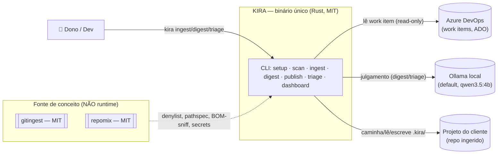
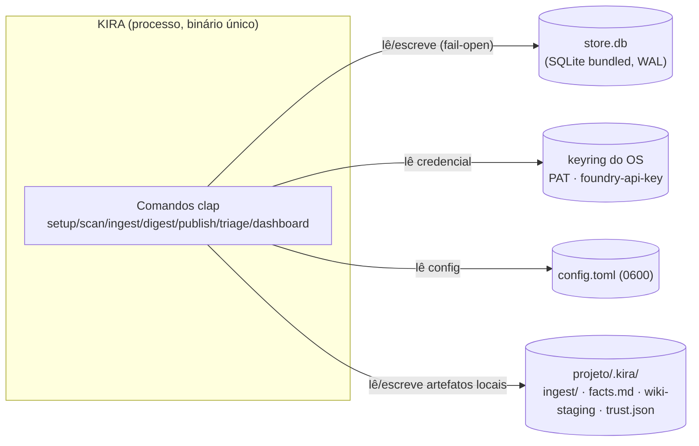

# Plano — Reaproveitamento de repomix + gitingest na ingestão do KIRA (com C4)

> **Data**: 13/Nov/2026 · **Pedido**: avaliar se faz sentido reaproveitar a lógica dos
> repositórios dos snapshots para melhorar a *ingestão do projeto*.
> **Estado ancorado**: `main` com M1/M2/M3 fechados (`kira ingest`/`posts`/`digest`).
> **Evidência**: snapshots reais em `C:\Users\Serginho\Downloads\` (repomix + gitingest),
> lidos e reancorados nesta revisão — ver seção 8.

---

## 1. Veredito (resumo executivo)

**Sim, faz sentido — com escopo fechado.** O gitingest **já foi absorvido** na onda M (a
denylist do `src/context/ignore.rs` é derivada do `DEFAULT_IGNORE_PATTERNS` dele). O valor
marginal **novo** está no **repomix**, e a leitura dos snapshots reais revelou **um achado
de bug que a análise anterior não tinha**: o sniff de binário do KIRA
(`ignore::looks_binary` = `amostra contém NUL`) classifica **texto UTF-16/UTF-32 como
binário** — o repomix resolve isso com BOM-aware sniff (`fileRead.ts::hasTextBom`).

Fecham-se **sete** lacunas, em três níveis de prioridade:

1. **IG-0 (bug)** — BOM-aware sniff de binário (repomix `fileRead.ts`).
2. **IG-1** — Cascade de ignore (`.gitignore`/`.ignore`/`.kiraignore`) — estrutura do
   repomix, semântica de negação `!` do gitingest (`pathspec`).
3. **IG-2** — Binários na árvore (repomix lista o caminho, omite o conteúdo).
4. **IG-3** — Detector de segredos (repomix `securityCheck.ts`/Secretlint — conceito).
5. **IG-4** — Ranking git-aware (repomix `sortByChanges`) — backlog.
6. **IG-5** — Estimativa de tokens no digest (`chars/4`, do gitingest P6).
7. **IG-6** — Orçamento total de bytes da caminhada (gitingest P4).

O resto do repomix (compressão por strip-comments/Tree-sitter, `input.processors`,
tokenização BPE, hard-fail de `--token-budget`, clone remoto) e o **codeingest** inteiro
são **rejeitados** — seção 4.3.

---

## 2. O que o KIRA já tem (baseline, âncoras verificadas 13/Nov)

| Capacidade | Onde já está no KIRA | Status |
|---|---|---|
| Denylist por linguagem (~150 padrões) | `src/context/ignore.rs::DEFAULT_IGNORE_PATTERNS` (L39) | **feito** (M1, atribuição ao gitingest) |
| Sniff de binário (NUL) | `src/context/ignore.rs::looks_binary` (L299) + `inventory.rs::read_probe` (L225) | **feito, mas com bug** (não reconhece BOM — IG-0) |
| Orçamento da caminhada (profundidade + nº arquivos) | `inventory.rs::Budget {max_depth:20, max_files:5000}` (L26) | **feito** (falta total de bytes — IG-6) |
| Detecção de stack por marcador | `src/stack.rs::detect` (L160) | **feito** (M1) |
| Arquivos-chave (README → manifesto → entrypoint) | `ingest/digest.rs::select_key_files` (L66) | **feito** |
| Digest determinístico (sem timestamp) | `ingest/digest.rs::render` (L98) | **feito** |
| Redação na escrita (máscara) | `ingest/mod.rs::read_for_digest` (L231) + `src/redact.rs` | **feito** (máscara; **não** detecção) |
| Índice FTS5 incremental | `src/context/index.rs::reindex` (L84) | **feito** |

---

## 3. Diagramas C4

### 3.1 C4 · Nível 1 — Contexto do sistema



### 3.2 C4 · Nível 2 — Containers



### 3.3 C4 · Nível 3 — Componente: pipeline de ingestão (`kira ingest`)

```mermaid
flowchart TB
    CLI[Command::Ingest] --> INV[inventory::walk\numa caminhada, determinística]
    INV --> IGN[context::ignore\nis_ignored_dir/file · sniff binário]
    INV --> STK[stack::detect\nmarcador na raiz]
    INV --> IDX[context::reindex\nFTS5 incremental, redigido]
    CLI --> SCAN[scan::run\nfindings.json (opcional, rede)]
    CLI --> SEL[digest::select_key_files]
    SEL --> RDR[digest::render\npuro, ordenado]
    RDR --> OUT[.kira/facts.md\n.inventory.json]

    subgraph Novos["Candidatos (lacunas — seção 4)"]
        BOM[🎯 IG-0 BOM-aware sniff]
        GITC[🎯 IG-1 cascade de ignore]
        BIN[🎯 IG-2 binários na árvore]
        SEC[🎯 IG-3 detector de segredos]
        GITR[🎯 IG-4 ranking git-aware]
        TOK[🎯 IG-5 estimativa de tokens]
        BYT[🎯 IG-6 orçamento total de bytes]
    end

    BOM -.-> IGN
    GITC -.-> IGN
    BIN -.-> INV
    SEC -.-> INV
    GITR -.-> SEL
    TOK -.-> RDR
    BYT -.-> INV
```

---

## 4. Avaliação: o que vale trazer e o que é rejeitado

### 4.1 Tabela comparativa (repomix × gitingest × codeingest × KIRA)

| Capacidade | gitingest | repomix | codeingest | KIRA hoje | Veredito |
|---|---|---|---|---|---|
| Denylist de padrões | ✅ (rica) | ⚠️ (só JS/build) | ⚠️ (pequena) | ✅ (a melhor, do gitingest) | — |
| Honrar `.gitignore` | ✅ (`pathspec`, com `!`) | ⚠️ (sem `!`; avisa e pula) | ❌ | ❌ | **IG-1** |
| **BOM-aware sniff de binário** | ❌ | ✅ (`hasTextBom`) | ❌ | ❌ (NUL puro) | **IG-0 (bug)** |
| Binários na árvore | ❌ | ✅ | ❌ | ❌ (só contagem) | **IG-2** |
| Detector de segredos | ❌ | ✅ (Secretlint) | ❌ | ❌ (só máscara) | **IG-3** |
| Ranking git-aware | ❌ | ✅ (`sortByChanges`) | ❌ | ❌ | **IG-4** |
| Estimativa de tokens | ✅ (BPE, rede) | ✅ (BPE) | ❌ | ❌ | **IG-5** (chars/4) |
| Orçamento total de bytes | ✅ (500 MB) | ✅ (maxFileSize 50 MB) | ⚠️ (1 MB/file) | ⚠️ parcial | **IG-6** |
| Allowlist de extensões | ❌ | ❌ | ✅ | ❌ (denylist) | **rejeita** (ADR-0038) |
| removeComments (strip-comments) | ❌ | ✅ | ❌ | ❌ | **rejeita** |
| Compressão Tree-sitter | ❌ | ✅ | ❌ | ❌ | **rejeita** |
| `input.processors` | ❌ | ✅ | ❌ | ⚠️ (`scan` já spawna) | **rejeita** |
| Token budget hard-fail | ❌ | ✅ | ❌ | ❌ (nota, não erro) | **rejeita** |
| BPE no runtime | ✅ | ✅ | ❌ | ❌ (chars/4) | **rejeita** |
| Clone remoto / URL | ✅ | ✅ | ❌ | ❌ (local-first/ADO) | **rejeita** |

### 4.2 Os sete itens (o plano de verdade)

| # | Ideia (fonte, âncora real) | Onde cai | Prioridade | Aceite |
|---|---|---|---|---|
| **IG-0** | **BOM-aware sniff de binário** — `hasTextBom` (UTF-8/16 BE+LE/32 BE+LE/GB18030) + NUL-probe com isenção de BOM (repomix `src/core/file/fileRead.ts` L10889–10960) | `ignore.rs::looks_binary`, `inventory.rs::read_probe` | **Alta (bug real)** | arquivo UTF-16 LE (fixture `pnpm-audit-real.json`) deixa de ser classificado como binário; é indexado e entra no digest |
| **IG-1** | **Cascade de ignore** — prioridade `.kiraignore` > `.ignore` > `.gitignore` (aninhado) > default; deferred para os control files (repomix `fileSearch.ts` L11052–11196); negação `!` e gitwildmatch via `pathspec` (gitingest — o repomix **não** implementa `!`) | `ignore.rs` + `inventory.rs` + `index.rs` | **Alta** | arquivo ignorado pelo dev não entra no índice/digest; negação ressuscita; sem `.gitignore` ⇒ byte-idêntico ao de hoje |
| **IG-2** | **Binários na árvore** — lista o caminho, omite o conteúdo (repomix `fileRead.ts` + tree) | `inventory.rs` (+`binary_paths`), `digest.rs` | **Média** | `logo.png [binário]` na árvore; sem conteúdo; idempotente |
| **IG-3** | **Detector de segredos** — relata caminho + nº de linhas, nunca o valor (repomix `securityCheck.ts`/Secretlint, conceito) | `ingest/mod.rs` → `.kira/ingest/secrets.json`; reusa `redact` | **Alta (segurança)** | nunca ecoa o segredo; arquivo limpo ⇒ seção ausente |
| **IG-4** | **Ranking git-aware** — mais alterados primeiro, `--no-git` desliga (repomix `gitCommand.ts`/`sortByChanges`) | `digest.rs::select_key_files` | **Backlog** | sem git ⇒ ranking atual byte a byte |
| **IG-5** | **Estimativa de tokens** no digest (`chars/4`, determinístico) | `digest.rs::render` | **Média** | nota no digest; byte-idêntico entre execuções |
| **IG-6** | **Orçamento total de bytes** da caminhada (mede bytes de arquivo lido, não do diretório) | `inventory.rs::Budget` | **Baixa** | estourou ⇒ "árvore parcial" + contagem determinística |

### 4.3 O que NÃO vale (rejeitado, com justificativa)

| Ideia | Por que não |
|---|---|
| **codeingest** (inteiro) | `codeingest.py` usa **allowlist de extensões** (`TEXT_EXTENSIONS`, L140) + `fnmatch` — exatamente o que o ADR-0038 rejeitou ("não cobre stack desconhecida"). Ferramenta toy (1 arquivo); nada a trazer. |
| **repomix `defaultIgnore.ts`** | **menos completo** que o `DEFAULT_IGNORE_PATTERNS` do gitingest (que o KIRA já copiou): só cobre JS/build/runtime, sem Java/Swift/.NET/Dart/Terraform. Copiar seria **regressão**. |
| **removeComments (`@repomix/strip-comments`)** | dependência por perfil de linguagem; comentário carrega sinal de triage (o `why` mora ali). O digest é índice, não dump (ADR-0038). O dedup contíguo (PR38) já corta ruído repetido. |
| **Compressão por Tree-sitter** (`output.compress`) | gramática por linguagem = dependência pesada; viola "sem dependência nova sem justificar". Backlog pós-M2. |
| **`input.processors`** | spawn de comando arbitrário por glob (`npx` baixa da rede no primeiro uso); o `scan` já orquestra as ferramentas que importam (CLI-first). |
| **Tokenização BPE** (`gpt-tokenizer`, `o200k_base`) | rede/BPE no runtime; `chars/4` basta para nota (ADR-0023). |
| **`--token-budget` hard-fail** | o KIRA manda "orçamento estourado vira nota, nunca erro" (ADR-0038); o ledger do PR34 já mede pack × teto. |
| **Clone remoto / sparse-checkout / URL** | KIRA é local-first e ADO-based; problema deles, não nosso. |
| **`splitOutput`** | digest já tem teto de 200 k chars + 30 k/post (ADR-0038). |

### 4.4 Snapshot dos demais repositórios (fora de escopo para "ingestão")

Os snapshots de **OpenHands, Aider, github-semantic-search-mcp, ai-memory, compozy,
gsd-2, rtk e caveman** são ferramentas de *agente/codificação/memória/compressão de
contexto* — não de *ingestão de repositório*. Relevantes para ondas futuras (loop W5,
compressão de contexto do `digest`), não para este plano. `ai-jail` segue **proibido**
(GPL-3.0 — conceito sim, código não). O `caveman` já foi classificado como camada
complementar no ADR-0038 (compressor do que sobe ao modelo, pós-ingestão).

---

## 5. Plano de implementação (onda IG — ingestão v2)

> Um item = um PR; gates `cargo fmt --check` → `clippy -D warnings` → `cargo test` →
> `cargo build` → CI 3 SOs; nenhuma dependência nova; redação na escrita; fail-open.
> **Ordem**: IG-0 → IG-1 → IG-2 → IG-3 (os quatro tocam `ignore.rs`/`inventory.rs`) →
> IG-5 → IG-6 → IG-4 (backlog).

### IG-0 — BOM-aware sniff de binário (bug)

- **Objetivo**: `looks_binary` passa a reconhecer BOM de texto (UTF-8/UTF-16/UTF-32/GB18030)
  e **isenta** o NUL-probe nesses casos — texto UTF-16 sprinkles NUL e hoje vira binário,
  sumindo do índice e do inventário. Mesma família do bug do ADR-0023-P1, mas no sniff.
- **Arquivos**: `src/context/ignore.rs::looks_binary` (nova `has_text_bom`), teste com a
  fixture real `tests/fixtures/scan/pnpm-audit-real.json` (UTF-16 LE) como caso canônico.
- **Aceite**: UTF-16 LE decodifica (não vira binário) e entra no índice/inventário; PNG/ELF
  continuam binários; dois `ingest` ⇒ byte-idêntico.

### IG-1 — Cascade de ignore (`.gitignore`/`.ignore`/`.kiraignore`)

- **Objetivo**: prioridade `.kiraignore` > `.ignore` > `.gitignore` (aninhado, mais
  profundo vence) > default; negação `!` no subconjunto gitwildmatch em Rust puro
  (a gramática do gitingest/`pathspec`, **não** a do repomix — que avisa e pula `!`).
- **Arquivos**: `ignore.rs` (novo `load_ignore_rules`), `inventory.rs` (regras no
  `filter_entry`), `index.rs` (mesmas regras — teste de política única).
- **Aceite**: `.gitignore` com `*.secret.txt` ⇒ fora do inventário/índice/digest; `!keep.txt`
  ressuscita; sem arquivo de ignore ⇒ comportamento de hoje (gate M1 não regride).

### IG-2 — Binários na árvore · IG-3 — Detector de segredos · IG-5 — tokens · IG-6 — bytes

Detalhados na seção 4.2. IG-4 (git-aware) entra como backlog até um repo real justificar.

---

## 6. Decisões abertas para o dono (propostas, sem selo)

| # | Item | Proposta default |
|---|---|---|
| **G1** | IG-1: nome do arquivo extra | `.kiraignore` (análogo ao `.repomixignore`, sob o namespace do KIRA) |
| **G2** | IG-1: honrar `.gitignore` por default? | **Sim**, com `--no-gitignore` |
| **G3** | IG-3: escrever `secrets.json` no disco ou só nota? | **Escrever** (`.kira/` é local; trilha auditável) |
| **G4** | IG-4 entra na fila agora ou backlog? | **Backlog** |
| **G5** | IG-5: `chars/4` ou `chars/3`? | **chars/4** (referência do repomix; PT-BR denso justifica revisar depois) |
| **G6** | IG-6: teto de bytes | **128 MB** (constante; acima de repo real, bem abaixo do `target/` de 4,5 GB) |

---

## 7. Consequências

- **Positivas**: fim do bug de sniff (IG-0 é comprovado no fluxo real); ingestão respeita a
  intenção do dev; árvore completa com binários; **encontra** segredo em vez de só mascarar;
  digest com régua de token para calibrar o `digest`.
- **Negativas**: +5 a 7 PRs na fila; IG-0..IG-3 tocam `ignore.rs`/`inventory.rs` juntos
  (ordem fixa para não rebasear); tabela copiada precisa de atribuição no cabeçalho.
- **Não muda**: shape do digest, gate M1/M2, redação, fail-open, local-first, "orçamento
  estourado vira nota".
- **Licença**: gitingest e repomix são **MIT** (compatível). codeingest é MIT também, mas
  não há o que copiar. `ai-jail` (GPL) permanece proibido.

## 8. Evidência dos snapshots (reancorada nesta revisão)

| Snapshot (`C:\Users\Serginho\Downloads\`) | Ferramenta | O que confirmei |
|---|---|---|
| `repomix-output-yamadashy-repomix.md` / `yamadashy-repomix-8a5edab282632443.txt` | repomix (MIT) | `fileRead.ts` (BOM-sniff L10889), `fileSearch.ts` (ignore sem `!` L11028), `defaultIgnore.ts` (só JS/build), `securityCheck.ts` (Secretlint, batch 50), `fileManipulate.ts` (strip-comments) |
| `repomix-output-coderamp-labs-gitingest.md` / `coderamp-labs-gitingest-8a5edab282632443.txt` | gitingest (MIT) | `config.py`/`ingestion.py`/`ignore_patterns.py`/`git_utils.py` — confirma o ADR-0023 (pathspec com `!`, P1–P6) |
| `shubhdotai-codeingest-8a5edab282632443.txt` | codeingest (MIT) | allowlist de extensões + `fnmatch` — toy, rejeitado (ADR-0038) |

Mudanças desta revisão vs. a v1: **adicionado IG-0** (bug de BOM no sniff, visto no
`fileRead.ts` real); **corrigida a fonte da negação `!`** (é do gitingest, não do repomix);
**reclassificado o `defaultIgnore.ts` do repomix** como *inferior* ao do gitingest
(nada a copiar); **adicionado codeingest** à tabela de rejeição.
