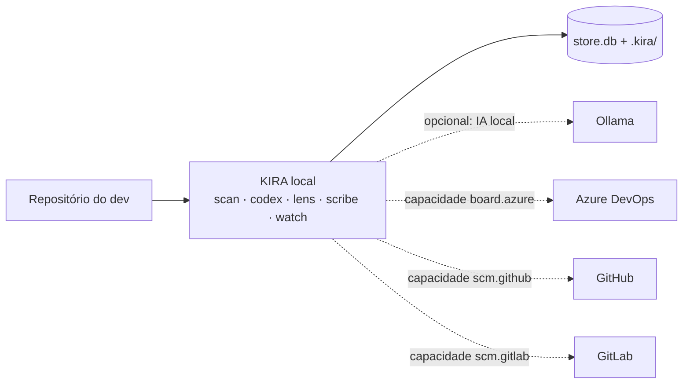
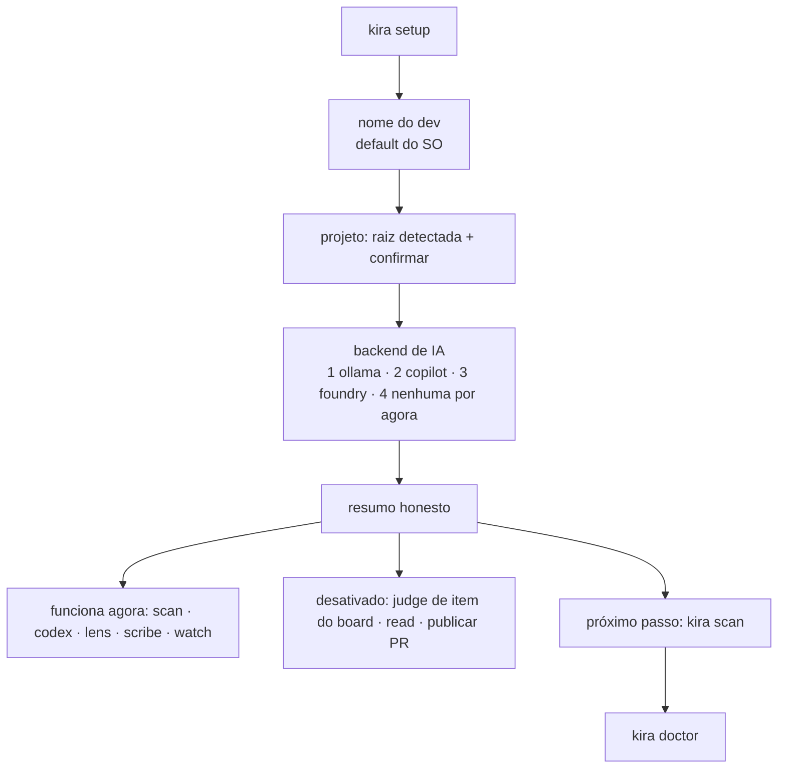
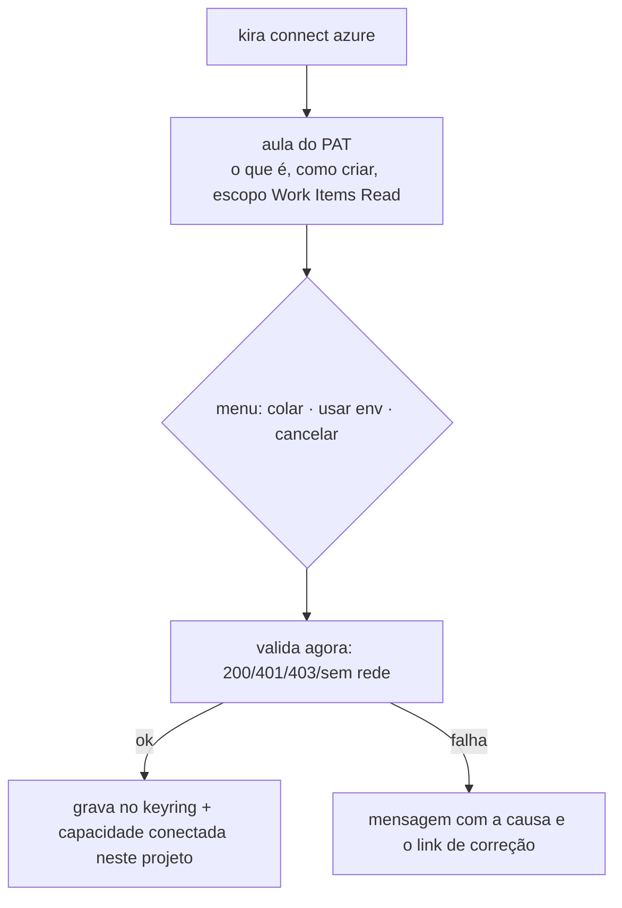

# KIRA — as jornadas (local-first, com capacidades)

> Levantado do binário e **reescrito** em 12/Nov/2026 após a decisão do ADR-0030: o KIRA é
> **local-first**; integrações são **capacidades** conectadas quando o dev quiser.

## Princípio

A fonte da verdade é o **repositório local do dev**. Board, GitHub, GitLab e qualquer serviço externo
são **capacidades opcionais**. Nenhuma jornada local pede credencial; nenhuma conexão acontece sem o
dev mandar (`kira connect`).

## Matriz de capacidades (é contrato de teste, não documentação)

| Jornada | Capacidade | IA | Sem capacidade |
|---|---|---|---|
| J1 `scan` | — | — | roda |
| J3 `codex` (wiki) | — | — | roda |
| J4 `lens` (context) | — | — | roda |
| J6 `scribe` (pr draft) | — | — | roda (markdown local) |
| J8 `watch` (dashboard) | — | — | roda |
| J5 `judge --file` | — | obrigatório | `precisa de backend de IA — kira setup --backend ollama` |
| J5 `judge <id>` | `board.azure` | obrigatório | `precisa de board.azure — kira connect azure` |
| J9 `read` (inspect) | `board.azure` | — | idem |
| Publicar PR / issue | `scm.github`/`scm.gitlab` | — | `precisa de scm.github — kira connect github` |
| J7 `verdict` (eval) | — | obrigatório | erro acionável, nunca medição parcial |
| J10 `sentinel` | — | obrigatório | bloqueado pelo gate M2 |

## MVP — o que é "KIRA cru"

**MVP = as 5 jornadas que rodam com zero credencial**, mais o julgamento local com `--file`:

| # | Jornada | Por que é MVP |
|---|---|---|
| J1 | `scan` | é a percepção: sem isso o KIRA não tem o que dizer |
| J4 | `lens` | mostra o que iria ao modelo; é o "ver antes de pagar" |
| J5 | `judge --file` | o julgamento local — o coração, provado offline |
| J6 | `scribe` | entrega o artefato que o dev usa (PR em markdown) |
| J8 | `watch` | é onde o dev vê o estado sem rodar comando |
| J3 | `codex` | memória: sem wiki, o KIRA não aprende entre execuções |

**Pós-MVP (capacidade)**: J9 `read` e `judge <id>` (board.azure), publicação em GitHub/GitLab,
J7 `verdict` (precisa do gold set do dono), J10 `sentinel` (gate M2).
**Pós-MVP (conveniência)**: J2 `profile`/`note`/`history` — funcionam hoje, mas não são o motivo de instalar.

---

## J0 — Onboarding (local-first, zero PAT)

- **Não pede PAT.** Credencial nasce em `kira connect <provider>`.
- "Nenhuma IA por agora" é opção explícita e o default quando Ollama não existe.
- O resumo separa **pronto** de **pulado** e sempre diz o comando de retomada.

## J-C — Conectar capacidade (novo)

`kira connect github` / `kira connect gitlab` seguem o mesmo desenho (token com escopo mínimo:
ler issues, abrir PR; nunca push em branch protegida).

---

## J1 — Percepção: `scan`

Igual ao desenho anterior: stacks (node/dotnet), workspace pnpm dobrado no root, resolução de
ferramenta no PATH (PATHEXT no Windows), parse tolerante (BOM/UTF-16 — `src/scan/decode.rs`,
M7 ✅), finding com fingerprint,
saída determinística. **Zero rede, zero credencial.**

## J3 — Conhecimento: `codex` (wiki)

`list` · `show` · `decision` · `reindex` · `search` · `forget` · `promote`.
Conhecimento, não log; redação antes de escrever; `forget` apaga do disco **e** do índice.

## J4 — Contexto: `lens`

Monta o pack (findings + wiki + trechos de código) com teto por fonte, `CHARS_PER_TOKEN=3`.
`--explain` mostra por que cada item entrou; `--json` para avaliação. **Zero token.**

## J5 — Julgamento: `judge`

Duas portas, ambas explícitas:
- `judge --file item.json` — **offline**, precisa só de backend de IA (é o caminho do MVP).
- `judge <id>` — precisa de `board.azure` conectado.

Caro nunca é default, nunca fallback silencioso; fail-closed.

## J6 — Escrita: `scribe` (pr draft)

Gera o markdown do PR do que já se sabe (Contexto, Causa raiz, Mudança, Evidências, Riscos, Checklist),
com `—` onde falta dado. **Não abre PR, não faz push.** Publicar é capacidade `scm.*`.

## J7 — Medição: `verdict` (`--eval`)

Compara contra gold.json por similaridade determinística (limiar 0,50) e basename de arquivo; aborta
em caso de falha; exit 0/1. Sem LLM juiz.

## J8 — Vigilância: `watch` (dashboard)

4 painéis read-only, provado por hash do store. Agora ganha **um campo de capacidades** (o que está
conectado / desativado) — é o que evita o dev achar que "não funciona".

## J9 — Inspeção viva: `read` (inspect)

Capacidade `board.azure`. 401/403/404 com causa provável.

## J2 — Identidade e trilha

`profile` · `note` · `history`. Local, sem capacidade.

## J10 — Autonomia: `sentinel`

Spec em `docs/kira-w5-loop.md`, bloqueada pelo gate M2. Sem o número, fica em modo sugestão.

---

## Resumo por dependência

| Precisa de… | Jornadas |
|---|---|
| **nada** | J0, J1, J2, J3, J4, J6, J8 |
| **backend de IA** | J5 (`--file`), J7, J10 |
| **board.azure** | J5 (`<id>`), J9 |
| **scm.github / scm.gitlab** | publicar PR/issue |