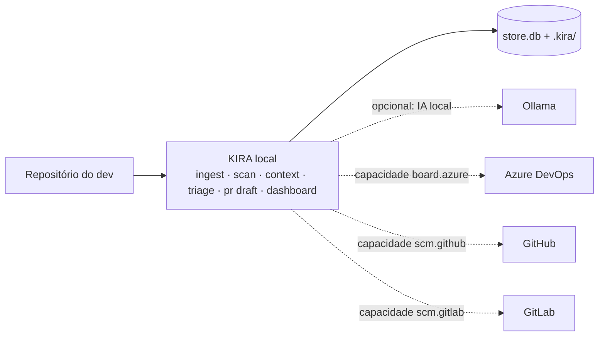
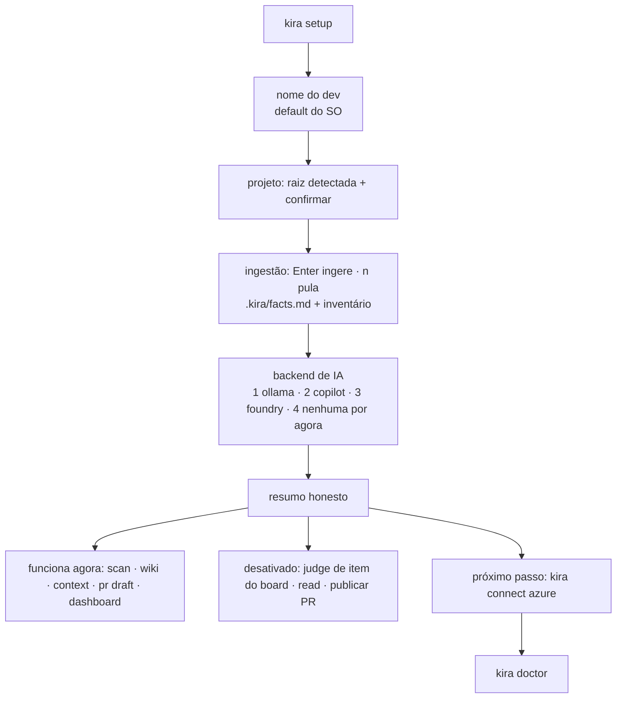
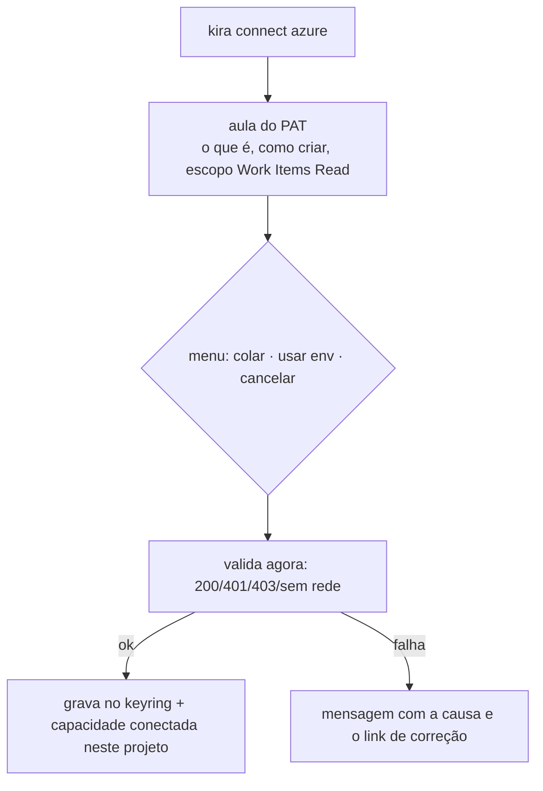

# KIRA — as jornadas (local-first, com capacidades)

> Levantado do binário e **reescrito** em 12/Nov/2026 após o ADR-0030 (local-first; integrações
> são **capacidades**). **Revisado em 16/Nov/2026 (M8)**: vocabulário canônico do
> [`nomenclatura.md`](nomenclatura.md) — `codex`/`lens`/`scribe`/`watch`/`judge`/`read` viram
> `wiki`/`context`/`pr draft`/`dashboard`/`triage`/`inspect` — e as jornadas da onda M
> (`ingest` → `trust` → `digest` → `publish`) registradas onde elas existem no código.

## Princípio

A fonte da verdade é o **repositório local do dev**. Board, GitHub, GitLab e qualquer serviço externo
são **capacidades opcionais**. Nenhuma jornada local pede credencial; nenhuma conexão acontece sem o
dev mandar (`kira connect`).

## Matriz de capacidades (é contrato de teste, não documentação)

| Jornada | Capacidade | IA | Sem capacidade |
|---|---|---|---|
| `setup` | — | — | roda (a etapa de IA é opcional: "nenhuma por agora") |
| `ingest` | — | — | roda — lê o repo e escreve `.kira/facts.md` + inventário |
| `scan` | — | — | roda (determinístico, zero rede) |
| `trust` | — | — | roda — o aceite local que libera o `digest` |
| `digest` | — | **obrigatório** | `precisa de backend de IA — kira setup --backend ollama` (e de `kira trust`) |
| `publish` | — | — | roda — escreve `.kira/wiki/` (local; nunca no repo do dev) |
| `context` | — | — | roda (`--explain`/`--json`, zero token) |
| `wiki` | — | — | roda (`list`/`show`/`search`/`reindex`/`promote`) |
| `triage --file` | — | **obrigatório** | `precisa de backend de IA` |
| `triage <id>` | `board.azure` | **obrigatório** | `precisa de board.azure — kira connect azure` |
| `inspect <id>` | `board.azure` | — | idem |
| `pr draft` | — | — | roda (markdown local) |
| `dashboard` | — | — | roda (leitura pura, provado por hash) |
| `loop` / `schedule` / `approve` / `audit` | — | — | rodam (o `digest` dentro do loop é pulado sem IA/trust, com nota) |
| `rea` | — | — | roda **se** o binário `rea` existir (`KIRA_REA_BIN` ou PATH); ausente ⇒ "instale o rea", sem spawn |
| `eval` | — | **obrigatório** | erro acionável, nunca medição parcial |
| `brain` / `sentinel` | — | **obrigatório** | bloqueado pelo gate M2 |
| Publicar PR / issue | `scm.github`/`scm.gitlab` | — | `precisa de scm.github — kira connect github` |

## MVP — o que é "KIRA cru"

**MVP = as jornadas que rodam com zero credencial**, incluindo a cadeia local completa
(ingest → digest → publish) quando houver Ollama:

| # | Jornada | Por que é MVP |
|---|---|---|
| J0 | `setup` | onboarding: nome → projeto → **ingestão** → IA → resumo |
| J1 | `ingest` + `scan` | é a percepção: sem fatos o KIRA não tem o que dizer |
| J2 | `trust` | o aceite do dono; sem ele o `digest` **não** roda |
| J3 | `digest` (com IA) | é o julgamento local com backend da máquina |
| J4 | `publish` + `wiki` | memória: sem wiki o KIRA não aprende entre execuções |
| J5 | `context` | mostra o que iria ao modelo; é o "ver antes de pagar" |
| J6 | `triage --file` | o julgamento por item, provado offline |
| J7 | `pr draft` | entrega o artefato que o dev usa (PR em markdown) |
| J8 | `dashboard` | onde o dev vê o estado sem rodar comando |

**Pós-MVP (capacidade)**: `inspect <id>` e `triage <id>` (board.azure), publicação em GitHub/GitLab.
**Pós-MVP (medição)**: `eval` sobre o gold do dono, `brain`/`sentinel` (gate M2).
**Conveniência**: `profile` · `note` · `history` — funcionam hoje, mas não são o motivo de instalar.

---

## J0 — Onboarding (local-first, zero PAT)

- **Não pede PAT.** Credencial nasce em `kira connect <provider>`.
- A ingestão roda no setup com o `scan` **desligado** (scan é rede/lento, ingest é local): o
  projeto sai legível e `kira scan` continua um comando à parte. `--skip ingest` desliga e
  `--yes` ingere sem perguntar (M6).
- "Nenhuma IA por agora" é opção explícita e o default quando Ollama não existe.
- O resumo separa **pronto** de **pulado**, diz o que a ingestão fez e aponta o próximo comando.

## J-C — Conectar capacidade

`kira connect github` / `kira connect gitlab` seguem o mesmo desenho (token com escopo mínimo:
ler issues, abrir PR; nunca push em branch protegida).

---

## J1 — Percepção: `ingest` e `scan`

- **`ingest`** — lê os fatos do repositório **sem LLM** e escreve `.kira/facts.md` +
  `.kira/ingest/inventory.json`. É o que o `digest` e o packer consomem.
- **`scan`** — stacks (node/dotnet), workspace pnpm dobrado no root, resolução de ferramenta no
  PATH (PATHEXT no Windows), **BOM/UTF-16 tolerados** (`src/scan/decode.rs`, entregue no M7),
  finding com fingerprint, saída determinística. **Zero rede, zero credencial.**

## J2 — Aceite: `trust`

O `digest` só roda em repositório aceito; sem aceite o ciclo **não** falha — ele diz
`digest pulado: repositório não aceito — rode kira trust`. É a fronteira entre "o KIRA pode olhar"
e "o KIRA pode falar".

## J3 — Julgamento local: `digest`

Transforma os fatos determinísticos em posts (prosa + diagrama) com o backend da máquina, atrás de
trust, orçamento e cache. Post que falha vira estado `failed`; nada é truncado pela metade. Um 429
do provedor abre 5 min de silêncio e o último resultado bom continua visível, marcado `stale`.

## J4 — Conhecimento publicado: `publish` e `wiki`

- **`publish`** — promove os rascunhos para `.kira/wiki/<slug>.md` com front-matter e índice
  derivado; gate por `source_hash`/`published_hash` (publicar duas vezes é idempotente).
- **`wiki`** — `list` · `show` · `decision` · `reindex` · `search` · `forget` · `promote`.
  Conhecimento, não log; redação antes de escrever; `forget` apaga do disco **e** do índice.

## J5 — Contexto: `context`

Monta o pack (findings + wiki + trechos de código) com teto por fonte e perfil de token
(`budget`/`balanced`/`quality`). `--explain` mostra por que cada item entrou; `--json` para
avaliação. **Zero token.**

## J6 — Julgamento por item: `triage`

Duas portas, ambas explícitas:
- `triage --file item.json` — **offline**, precisa só de backend de IA (é o caminho do MVP);
- `triage <id>` — precisa de `board.azure` conectado.

Caro nunca é default, nunca fallback silencioso; fail-closed.

## J7 — Escrita: `pr draft`

Gera o markdown do PR do que já se sabe (Contexto, Causa raiz, Mudança, Evidências, Riscos, Checklist),
com `—` onde falta dado. **Não abre PR, não faz push.** Publicar é capacidade `scm.*`.

## J8 — Medição: `eval`

Compara contra `gold.json` por similaridade determinística (limiar 0,50) e basename de arquivo;
aborta em caso de falha; exit 0/1. Sem LLM juiz. O lote de referência é
`tests/fixtures/triage_gold/` (20 bugs reais).

## J9 — Vigilância: `dashboard`

Painéis read-only, provado por hash do store. Mostra o que está conectado / desativado — é o que
evita o dev achar que "não funciona".

## J10 — Inspeção viva: `inspect`

Capacidade `board.azure`. 401/403/404 com causa provável.

## J11 — Identidade e trilha

`profile` · `note` · `history` · `audit`. Local, sem capacidade. O `audit --weekly` resume sessões,
fila de posts, aprovações e orçamento da janela.

## J12 — Autonomia: `loop`, `schedule`, `approve` e o que vem depois

- **`loop`** — o turno do binário: `ingest → digest (se trusted) → publish`, tudo local. `--once`
  para CI e `--scheduled` para rodar só as fases vencidas.
- **`schedule`** — cadência por fase (`add`/`list`/`rm`/`enable`/`disable`); cron interno, **sem
  daemon**: só roda com o KIRA vivo.
- **`approve`/`approvals`** — o círculo de aprovação: toda escrita no mundo nasce `pending` e só
  `kira approve <id>` destrava. Fail-closed.
- **`brain` / `sentinel`** — orquestrador interno e autonomia plena: desenhados, bloqueados pelo
  gate M2. Sem o número, fica em modo sugestão.

---

## Resumo por dependência

| Precisa de… | Jornadas |
|---|---|
| **nada** | J0, J1, J2 (`trust`), J4 (`publish`/`wiki`), J5 (`context`), J7 (`pr draft`), J9 (`dashboard`), J11, J12 (`loop`/`schedule`/`approve`/`audit`) |
| **backend de IA** | J3 (`digest`), J6 (`triage --file`), J8 (`eval`), J12 (`brain`/`sentinel`) |
| **board.azure** | J6 (`triage <id>`), J10 (`inspect <id>`) |
| **scm.github / scm.gitlab** | publicar PR/issue |
