# KIRA — as jornadas (mapa completo, do binário real)

> Levantado em 12/Nov/2026 a partir do `kira --help` e de cada subcomando (não de memória).
> Fonte viva: `src/main.rs` (clap). Toda jornada aqui é **read-only por padrão** — escrita no mundo
> exige `--apply` + `approval` humano.

## 0. Mapa geral (quem alimenta quem)

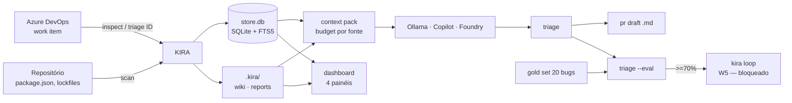

**Artefatos**: `store.db` (sessões, findings, episódios, índice FTS5) e `.kira/` (wiki em markdown,
relatórios). Nada disso vai para o git por padrão (`PR37` fechará o mecanismo do `.gitignore`).

---

## J0 — Onboarding: virar um dev com KIRA configurado

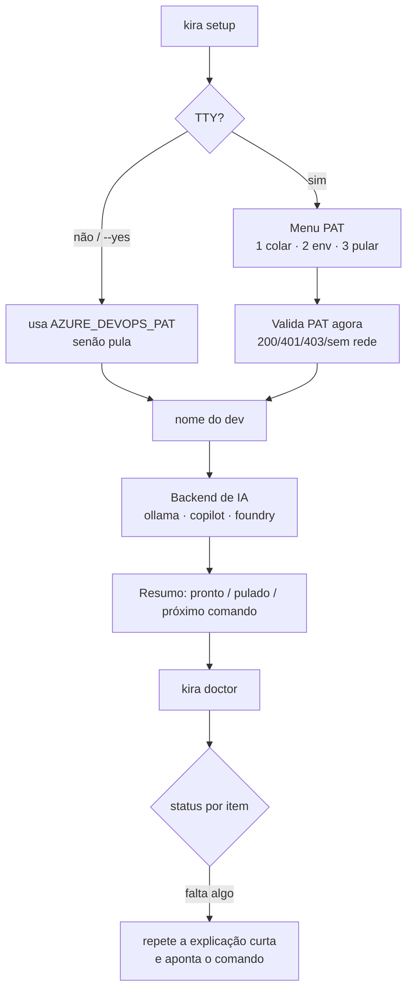

- **Ensina antes de pedir** (ADR-0025): PAT é explicado como "senha descartável de leitura".
- **Nunca bloqueia**: todo passo tem "pular", e o resumo diz o que foi pulado e como retomar.
- **Falhas**: 401 (token expirado/copiado errado), 403 (falta escopo `Work Items → Read`), sem rede
  ⇒ salva e manda validar depois com `doctor`.

## J1 — Percepção: o que o projeto tem de errado

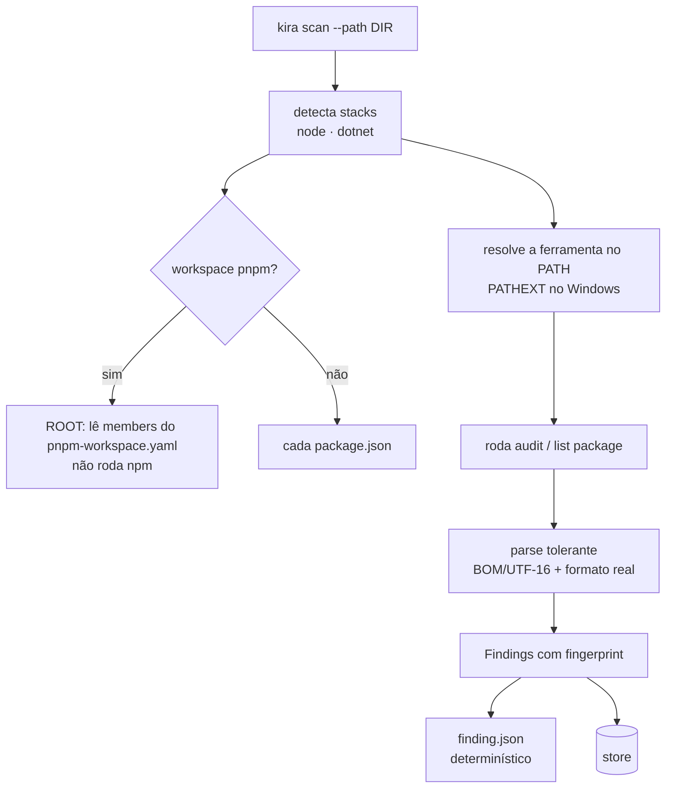

- **Determinístico**: mesma entrada ⇒ mesmo JSON (sem LLM nesta fase).
- **Falhas**: ferramenta ausente ⇒ erro acionável (não silêncio); formato inesperado ⇒ erro de parse,
  nunca "0 achados" mentiroso.

## J2 — Memória do projeto (identidade e trilha)

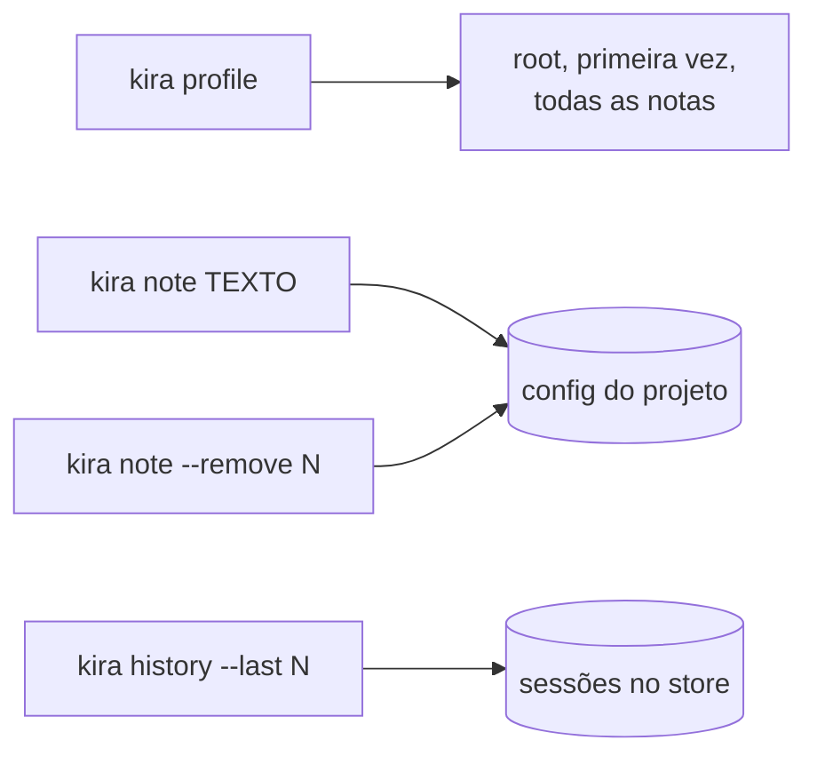

## J3 — Conhecimento: a wiki que aprende

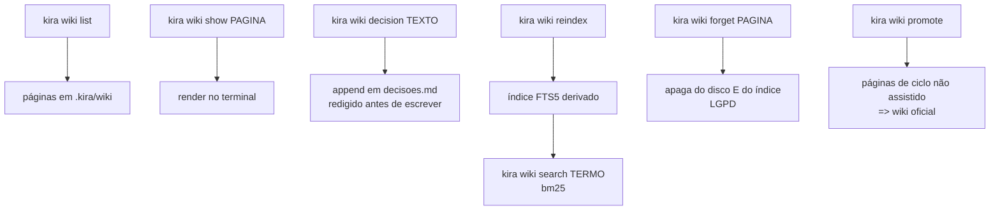

- A wiki é **conhecimento**, não log de chat: episódio vazio não é gravado.
- `forget` apaga de verdade (disco + índice) — direito ao esquecimento.

## J4 — Contexto: o que chegaria ao modelo

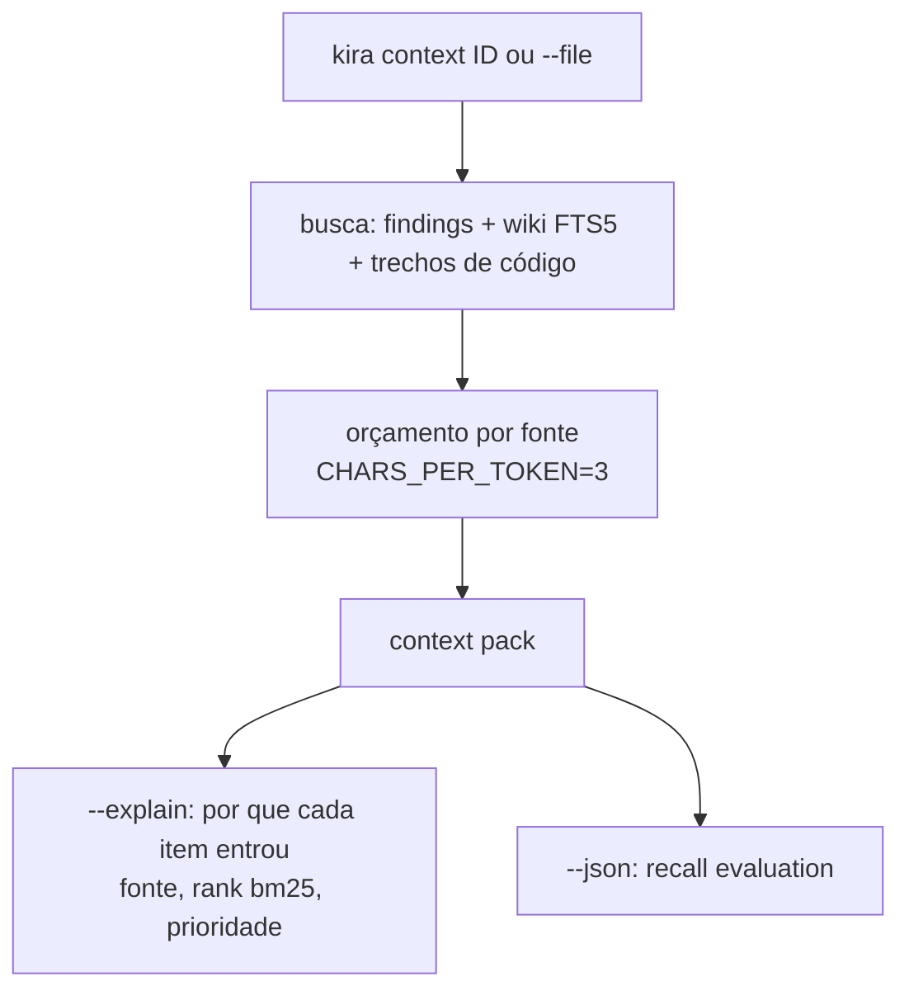

- **Zero token, zero rede**: é o "ver antes de pagar". Fail-open se índice ausente ⇒ grep + aviso.

## J5 — Julgamento: o triage

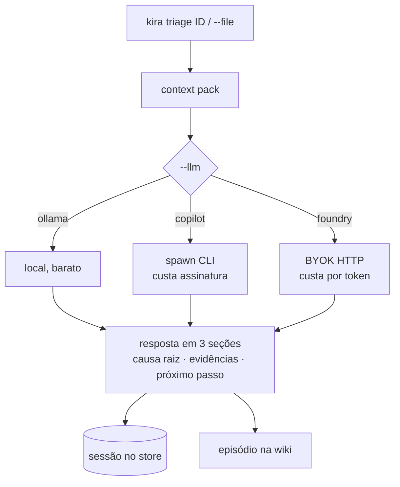

- **Caro nunca implícito**: sem fallback silencioso entre backends (ADR-0019/0020).
- **Fail-closed**: backend indisponível ⇒ erro acionável, nunca resposta vazia fingindo sucesso.
- **Isolamento**: segredo e PII são redigidos antes de qualquer prompt.

## J6 — Escrita: o PR em markdown

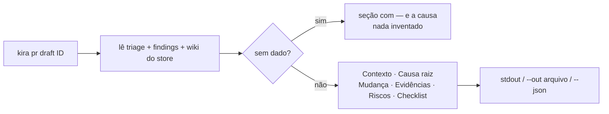

- **Sem rede, sem LLM**: só reorganiza o que já foi apurado, com evidência citada (`path:linha`).
- Não abre PR, não faz push: **merge e abertura são humanos**.

## J7 — Medição: o gate M2

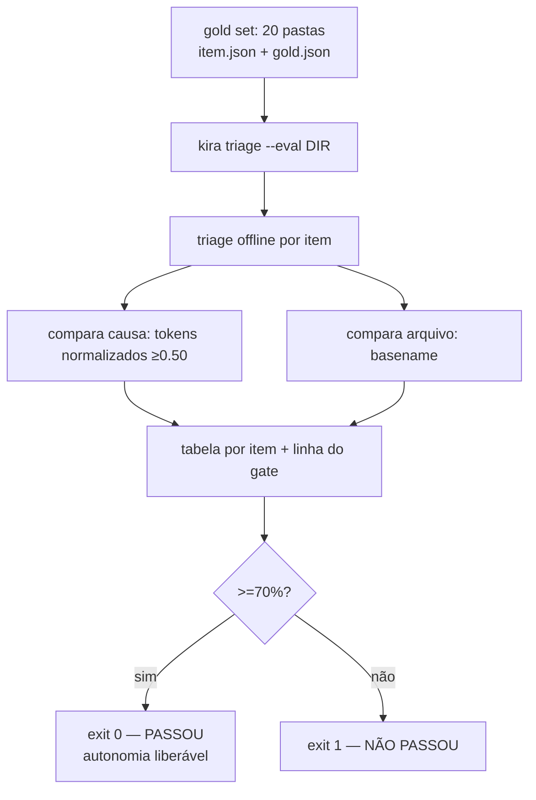

- **Sem LLM juiz**: métrica determinística e auditável. Item que falha aborta a medição (nunca parcial).
- `--seed` cria 3 fixtures sintéticas para testar o instrumento antes de rotular os 20.

## J8 — Vigilância: o dashboard

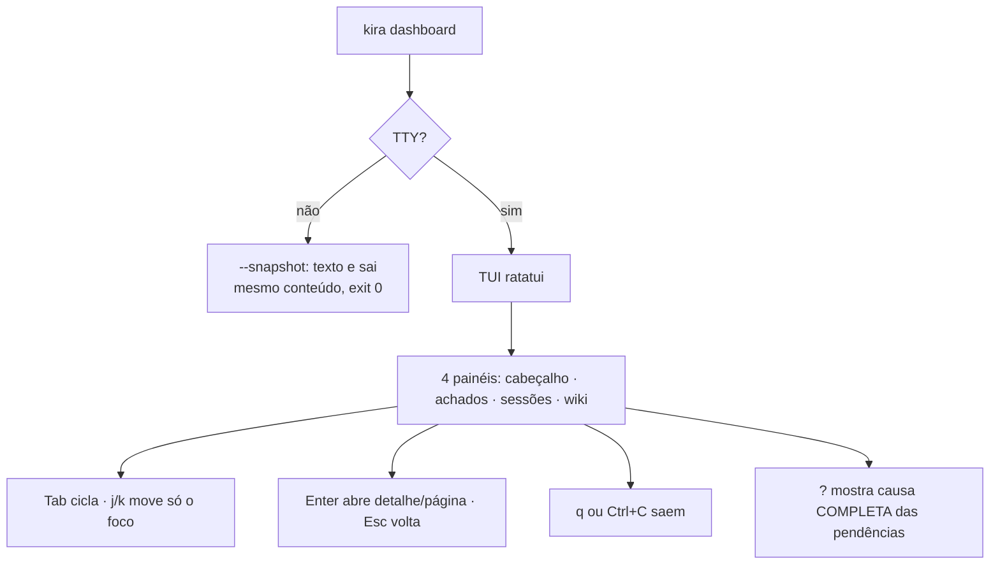

- **Read-only provado por hash do store** nos testes: uma tecla não escreve nada.

## J9 — Inspeção viva (Azure DevOps)

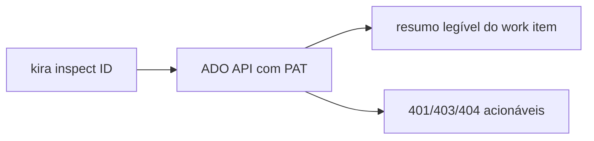

## J10 — Autonomia (desenhada, bloqueada)

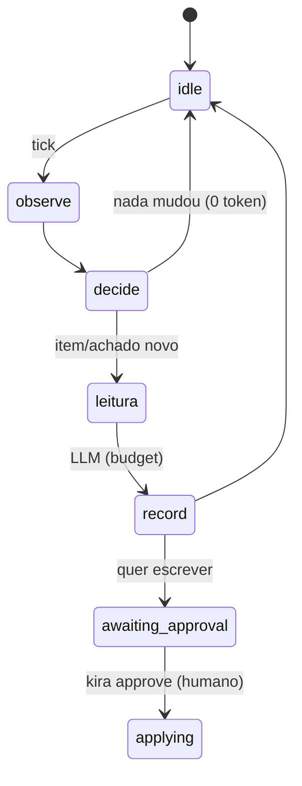

- Spec completa: `docs/kira-w5-loop.md`. **Bloqueada pelo gate M2** (J7 ≥70%). Sem ele, o loop fica
  em **modo sugestão**: produz `pr draft` e relatório, nunca abre PR.
- Watchdogs: budget/dia verificado antes de cada transição, backoff após 3 ciclos sem novidade,
  `loop.lock` contra instância dupla, `kira loop stop` como kill switch.

---

## Resumo: 11 jornadas, 4 tipos

| Tipo | Jornadas | Característica |
|---|---|---|
| **Configuração** | J0, J9 | fala com o mundo (ADO), ensina e valida |
| **Percepção** | J1, J2, J3, J4 | 0 token, determinística |
| **Julgamento e escrita** | J5, J6 | consome token; caro é explícito |
| **Controle** | J7, J8, J10 | mede, vigia, e só age com aprovação |
