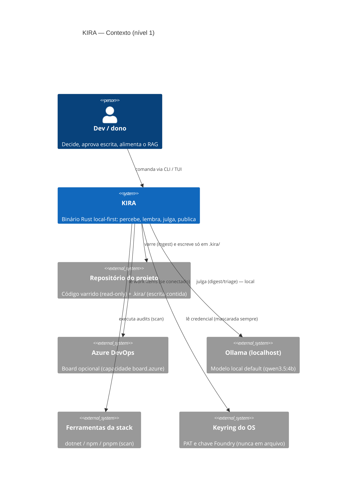
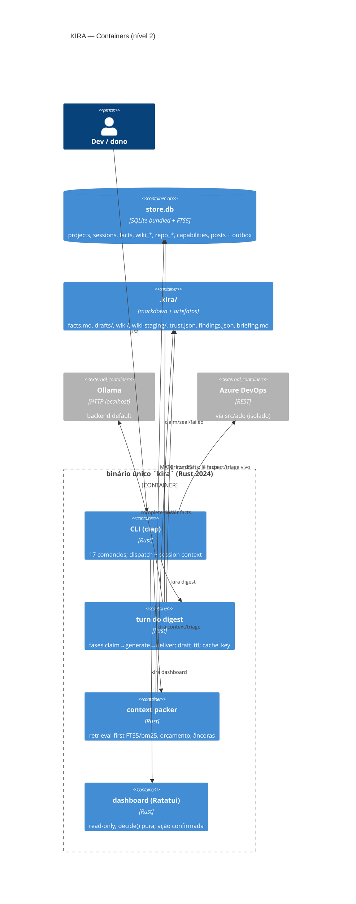
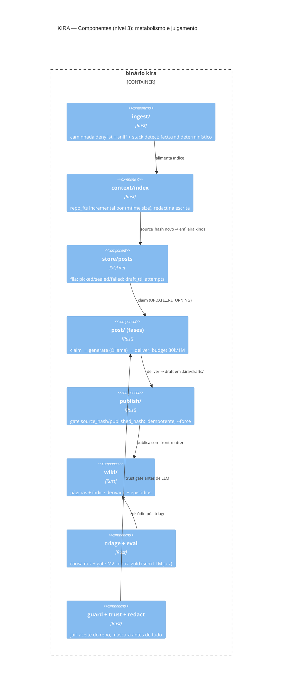
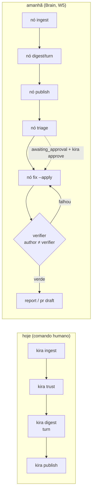

# Mapa completo do KIRA — C4, nomenclatura canônica e wikis de engenharia

- **Data**: 13/Nov/2026 · **Base**: `kira @ 4a30051`
- **Nomenclatura**: glossário canônico selado em [`nomenclatura.md`](nomenclatura.md)
  (`ingest` · `digest` · `publish` · `turn`/`phase` · `draft_ttl` · `failed` ·
  `brain`). Nomes de **estaleiro** (`Hermes`, `Delta`, Kombai) ficam fora dos
  diagramas por regra (§2, nota "Estaleiro não é sistema"). Diagramas em Mermaid
  (C4) — renderizam no GitHub.
- **Público-alvo duplo**: dev sênior que vai manter o código **e** outro dev que
  vai ouvir uma apresentação de 10 minutos (roteiro na §11).

---

## 1. O que existe hoje, em uma linha por onda

| Onda | Estado | O que entregou (PRs reais no git) |
|---|---|---|
| W1 segurança/erros | ✅ | `redact`, `guard/path`, taxonomia de erro (PR1–4) |
| W2 prompts/eval | ✅ | packer v1, prompt de triage versionado, `LlmBackend` (PR5–8) |
| W2.5 wiki | ✅ | `.kira/wiki` + FTS5 + episódios + promote/forget (PR28–32) |
| W2-fix | ✅ | correções do 1º uso real (wiki local, formato de triage) |
| W3 flywheel | ✅ | `scan` determinístico + `pr draft` (PR9–10) |
| W4 Devin-lite | ✅ | copilot spawn (PR11), install verificado, smoke local |
| W2-bis gate M2 | ✅ código / ❌ medição | `kira triage --eval` existe; **gold vazio** |
| W5 loop/autonomia | ❌ | PR15–19 desenhados, nenhum implementado |
| W6 TUI | ✅ (read-only) | dashboard Ratatui, `decide()` pura (PR21–26 parciais) |
| Onda TE | proposta | cache de raciocínio/economia (PR34–43) |
| Onda TL | proposta | piso/veredito/custódia (PR44–51) |
| **Onda M** | ✅ M1–M3, M5 | `ingest` (#84), posts+trust (#85), `digest` (#86), `publish` (#87) |
| **Renames ADR-0039** | ✅ | emit→publish, digest.md→facts.md, digest/→drafts/, postage_until→draft_ttl, Dead→Failed (#89–#95) |
| IG → SK → TE → TL → W5 (Brain) | abertas | ordem consolidada em `kira-brain.md` §7 |

## 2. C4 — Nível 1 (Contexto)

> **Estaleiro não é sistema (regra selada em `nomenclatura.md` §4)**: Kombai
> (ferramenta de design do dono) e Hermes/Delta (agentes de build) **constroem**
> o KIRA junto com o dono — nenhum deles participa da execução. Por isso não
> aparecem em nenhum nível do C4: o diagrama descreve apenas o binário rodando e
> os sistemas com que ele fala. Os designs do frontend futuro vivem no README
> como prints do dono, não como componente.

## 3. C4 — Nível 2 (Containers)

## 4. C4 — Nível 3 (Componentes do metabolismo + julgamento)

## 5. Fluxo principal hoje (metabolismo) e amanhã (Brain)

## 6. Wiki de engenharia — KIRA

**O que é**: organismo de conhecimento por projeto; binário único Rust,
local-first, sem daemon. **Memórias**: `store.db` (sessões/fatos/fila/índices) +
`.kira/wiki` (markdown fonte de verdade; índice FTS5 derivado e descartável) +
keyring (só segredo). **Metabolismo**: `ingest` (fatos, sem LLM, byte-determinístico)
→ `digest` (turn com fases claim/generate/deliver, `draft_ttl` 120 s, cache_key
`(input_hash, prompt_version, model, lang)`, budget 30 k/post + 1 M/run) →
`publish` (gate por hash; nunca sobrescreve editado sem `--force`). **Imune**:
redact na escrita do índice, prompt delimitado, jail de caminho, trust gate,
read-only default, TUI com confirmação e hash de store no e2e. **Julgamento**:
Ollama default; caro só explícito e nunca fallback; gate M2 medido contra gold
do dono, sem LLM juiz. **Invariante-mestra**: mesma entrada = mesma saída byte a
byte em tudo que não passa por LLM; o que passa por LLM é identificado por
`(model, prompt_version, input_hash)` e orçado. **O que falta para pulsar
sozinho**: Brain/loop/agenda/approve (W5), contador de chamadas (P0 da
auditoria), docker, gold.

## 7. Wiki de engenharia — agent-skills

**O que é**: registry seguro de 94 skills (14 categorias) para 19 agentes; CLI
(Ink/React), MCP com progressive disclosure, marketplace SSG; monorepo Nx.
**Engenharia-nota**: cadeia de custódia por SHA-256 único compartilhado
(registry → lockfile → verificação MCP); Snyk Agent Scan bloqueante com cache
incremental; instalador defense-in-depth com symlink guard (`lstat`, ELOOP,
junctions); validação editorial de skill (triggers/anti-triggers, semver,
autor, ≤500 linhas). **Diferencial vs KIRA**: eles empacotam *conhecimento de
domínio alheio* com custódia de supply chain; o KIRA gera *conhecimento do
projeto* com determinismo e ciclo próprio. **O que o KIRA leva deles**: formato
de skill (SK), custódia de prompt (PR48), symlink guard (PR47), trigger evals
(aceite da SK).

## 8. Wiki de engenharia — harness-toolkit

**O que é**: governança de agentes via hooks do Cursor/Claude Code; runtime
global Bun/Node com zero deps; 18 eventos; 2 providers; decisões tipadas.
**Engenharia-nota**: floor de 8 regras avaliado *antes* de qualquer política
(nenhuma config alcança); `degrade` por capability do host; catálogo v15 de 25
rails com trade-off declarado e **docs gerados do catálogo** (drift reprova);
observabilidade em 3 planos JSONL com recusas atribuídas por regra + attestation
hash-chained; lessons com `path:symbol` que se aposentam sozinhas e efetividade
`helped n/m`; gate próprio de 20 passos; 139 ADs como changelog. **Diferencial
vs KIRA**: eles *reagem* ao editor com enforcement maduro e observabilidade
fina; o KIRA *age* por turno próprio com memória longa. **O que o KIRA leva
deles**: piso + veredito tipado (PR44), observation mode (aceite PR44), lessons
com refs/efetividade (PR46), `why` por decisão gravado na sessão, docs
atrelados a código (checker CI).

## 9. Diferencial consolidado (para o slide 4)

| | KIRA | agent-skills | harness-toolkit |
|---|---|---|---|
| Ciclo próprio sem humano no laço | ✅ (com guarda de aprovação) | ❌ | ❌ |
| Fila retomável com ttl + cache por hash | ✅ | ❌ | ❌ |
| Trust gate antes de enviar código ao modelo | ✅ | ❌ (escaneia skill de terceiros) | ❌ |
| Wiki viva com gate de publicação | ✅ | ❌ | ❌ |
| Determinismo contratual byte a byte | ✅ | parcial | parcial |
| Gate de acerto vs gold humano, sem LLM juiz | ✅ (desenhado) | ❌ (juízes LLM) | ❌ (mede execução) |
| Breadth de conhecimento empacotado | ❌ (SK vem) | ✅ 94 skills | ❌ |
| Enforcement em tiers + veredito tipado | ❌ (PR44) | ❌ | ✅ |
| Observabilidade atribuída por regra | ❌ (P0) | ❌ | ✅ |
| Local-first binário único, zero serviço | ✅ | ❌ (Node/CDN) | ⚠️ (runtime global) |

## 10. Onde cada desejo do dono mora no mapa

| Desejo | Onde mora hoje | Onde morará |
|---|---|---|
| varrer e gerar relatórios constantes | `ingest` + `digest` + `publish` + `briefing.md` | + kinds novos de post |
| RAG com meus textos | wiki/notes hoje (FTS5) | SK: `knowledge/` + `skill_fts` |
| skills/prompts com caveman/rtk | estudos (ADR-0038, docs rtk) | SK (formato) + compressão caveman no packer |
| Getting Started/storytelling | persona §6 (tom) | kind `getting-started` na SK |
| multithread na dose certa | — | scan paralelo (P1), digest pool pós-P0 |
| docker local | — | §6 da auditoria (container = agendador) |
| Frontend TUI / dashboard admin (futuro) | TUI read-only real | frontend futuro do dono; designs como prints no README (ferramenta de design não é componente — §2) |
| observabilidade | sessions/history/doctor/dashboard | P0 contador + `rule=` na sessão |

## 11. Roteiro de apresentação (10 min, 5 slides)

1. **Tese** (1 min): "um dev companheiro que vive no projeto" — persona §2.
2. **Metabolismo** (2 min): diagrama da §5 (hoje) + invariante byte a byte.
3. **Memória e imunidade** (2 min): C4 nível 2 + as 5 travas da §6 do mapa.
4. **Diferencial** (2 min): tabela da §9 — "eles são degraus; nós somos a escada".
5. **O que falta e a fila** (3 min): Brain/contador/docker/gold + P0–P7 da
   auditoria — terminar com o número que falta (gold), não com promessa.
