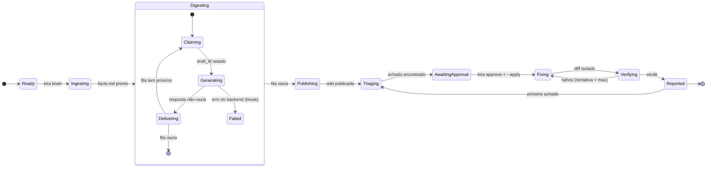
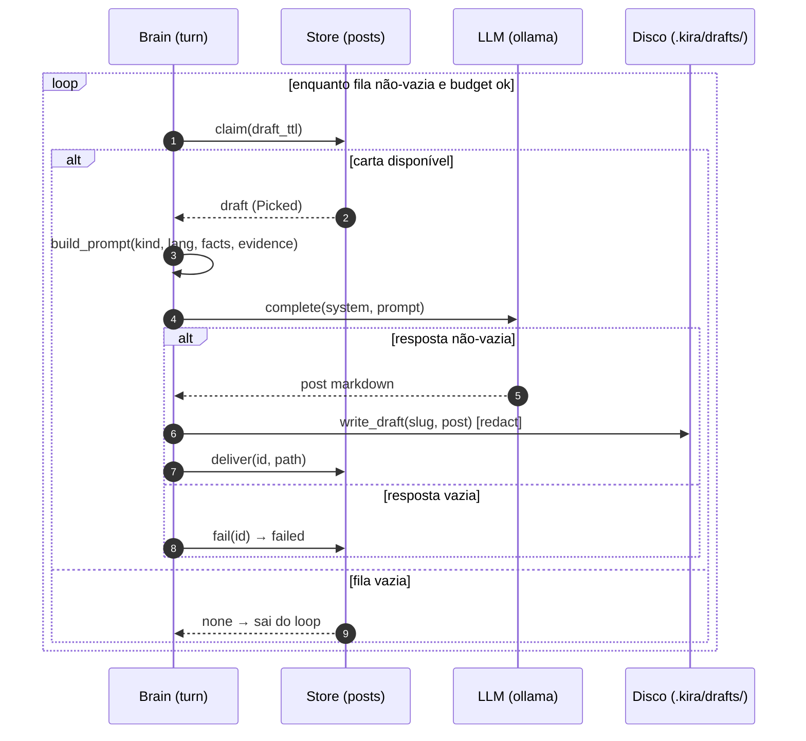

# Modelagem dos ciclos do KIRA (graph → turn → phase)

> **Data**: 13/Nov/2026 · **Fonte**: pesquisa sobre state machines / sequence / C4 dynamic
> (Mermaid, C4 model, stately.ai, loop→graph). **Resumo**: o jeito certo de desenhar um
> loop é como **máquina de estados**, não como `while(true)`.

---

## 1. A regra de ouro

Um loop de agente **não é** "o modelo continua falando". É **"o sistema transita de forma
controlada entre estados"**. Desenhar o turno como um `loop {}` esconde o que importa; a
prosa "e se precisar, volta" vira um **self-loop desenhado com a condição de saída** — que é
onde os processos reais se escondem.

- **Estado = substantivo** (`Claiming`, `Generating`, `Delivering`).
- **Transição = verbo + guarda** (`claimed`, `delivered`, `failed`).
- **Loop = self-loop ou estado composto, sempre com condição de saída** (senão roda para sempre).

A regra de produção (loop→graph): *comece com o loop; vire máquina de estados explícita
quando o fluxo ganha regras que o modelo não pode quebrar.* O KIRA **já está nesse ponto**:
o turno do digest tem `draft_ttl`, budget e retry capado — são regras, merecem estados.

---

## 2. Os 3 diagramas certos (e por que)

| Diagrama | Responde | Usar para | Mermaid |
|---|---|---|---|
| **State diagram** | "em que estado está, e qual é o próximo?" | o **graph** (estados do Brain) + o **turn** como estado composto + o **retry** como self-loop | `stateDiagram-v2` |
| **Sequence diagram** | "quem chamou quem, em que ordem?" | o **turn** em detalhe (as fases `claim → generate → deliver` com `loop`) | `sequenceDiagram` |
| **Flowchart** | "quais são os nós e arestas?" | a topologia de alto nível (já usado) | `flowchart` |

**Não usar C4 dynamic** para os ciclos: o próprio C4 diz "recommended? **no**" — dynamic é
para fluxo arquitetural (saga, checkout), não para algoritmo. Se você precisa de `alt`/`loop`
para explicar o cenário, está descrevendo um **algoritmo**, e aí o correto é o **sequence
diagram**. Regra: C4 estático (estrutura) + state/sequence (comportamento).

---

## 3. O graph (state diagram)

O grafo de estados do Brain, com o turno (`Digesting`) como **estado composto** e o retry
como self-loop com saída:

O que esse diagrama força a desenhar (e a prosa esconde):
- o **retry** `Verifying → Fixing` com a guarda `tentativa < max`;
- o **turno** como estado composto com as fases internas;
- a **saída do turno** (`Delivering → [*]` quando a fila esvazia) e a **falha** (`→ Failed`).

---

## 4. O turn (sequence diagram)

As fases do turno em detalhe, com o `loop` e a condição de saída:

O `loop` com `alt` mostra: a condição de saída (`fila vazia`/`budget`), o `draft_ttl` no
claim, o redact na escrita, e os dois desfechos da fase (`deliver` ou `failed`).

---

## 5. Convenção para o repo

1. **Estrutura (quem existe)** → C4 estático (contexto/container/componente), já em
   `docs/kira-brain.md`.
2. **Comportamento do graph (estados)** → `stateDiagram-v2` (seção 3), com estado composto
   para o turno e self-loop com guarda para o retry.
3. **Comportamento do turn (fases)** → `sequenceDiagram` (seção 4) com `loop`/`alt`.
4. **Cap**: ≤ ~15 estados por diagrama; se passar, vira estado composto (a regra do Mermaid
   e da literatura).
5. Tudo em **Mermaid dentro do `.md`** (é texto no repo, entra no git diff, renderiza no
   GitHub) — nunca PNG fora do repo.

Esses dois diagramas (seções 3 e 4) são os **canônicos dos ciclos** e entram no
`docs/kira-brain.md` quando o `src/brain/` for implementado.
