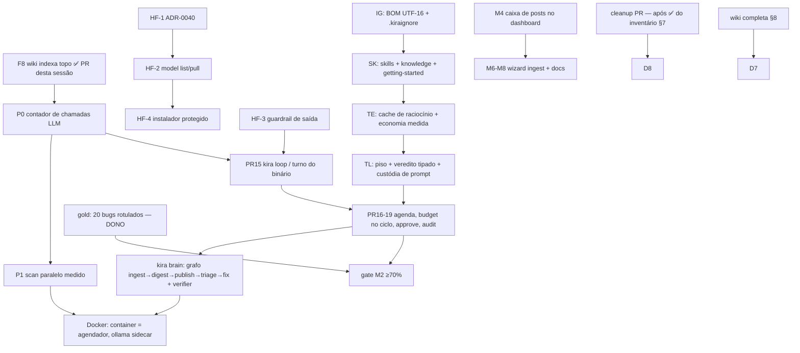

# Plano de finalização do KIRA — do metabolismo ao organismo autônomo (com a onda Hugging Face)

- **Data**: 13/Nov/2026 · **Base**: `kira @ 4a30051` + working tree (fix F8 implementado e verificado nesta sessão)
- **Fontes de verdade**: `AGENTS.md`, `docs/nomenclatura.md`, `docs/kira-brain.md`,
  `docs/auditoria-proposta-harness-autonomo.md`, `docs/mapa-completo-c4.md`,
  `docs/engenharia-anexos-cobertura.md`, `docs/BUILD-PROGRAM.md` (ledger de execução).
- **Regra de processo**: um item = um PR; gates `fmt --check` · `clippy -D warnings`
  · `test` · `build` · CI 3 SOs; ADR por decisão relevante; merge sempre humano;
  e2e de Windows no CI continua desligado de propósito (dono testa na mão).
- **Este doc é o plano; o BUILD-PROGRAM é o ledger.** Quando um item daqui vira
  PR, marca-se `[x]` lá e cita-se o PR aqui.

---

## 1. O que significa "KIRA pronto" (critérios de conclusão, mensuráveis)

| # | Critério | Como se mede |
|---|---|---|
| D1 | Harness local seguro | gates verdes + `security_probe` e2e + trust gate recusando digest sem aceite |
| D2 | Autonomia com guarda | `kira brain`/`loop` roda um tick completo offline em repo de fixture; escrita no mundo só após `awaiting_approval` + `kira approve`; 2 ticks sem mudança = estado idêntico no store |
| D3 | Observabilidade com número | `kira doctor` e dashboard mostram `chamadas LLM hoje: N/50`; recusas gravam `rule=`; 51ª chamada do dia falha com mensagem acionável |
| D4 | RAG do dono | textos dele em `~/.config/kira/knowledge/` (ou wiki hoje) recuperáveis no pack com âncora (`context --explain` mostra a fonte) |
| D5 | Casa | `docker compose up` (kira + ollama sidecar) varre repo de fixture e produz `facts.md` + post em `drafts/` sem toque humano |
| D6 | Medição | `kira triage --eval` ≥ 70% com os 20 bugs rotulados (exit 0) |
| D7 | Wiki completa | páginas fixas + getting-started + engenharia indexadas e buscáveis; bundle exportado |
| D8 | Repo limpo | `git status` sem untracked órfão; nenhum doc promete código inexistente |

## 2. Estado verificado hoje

**Pronto**: W1–W4, W2.5, W6-PR4 (TUI read-only), M1–M3+M5 (metabolismo),
renames ADR-0039, gate `--eval` (código), F8 (wiki indexa topo — PR desta
sessão), docs de auditoria/mapa/engenharia, 605+37 testes verdes.

**Aberto (com dependência)**: P0 contador LLM · HF-1..4 · P1 scan paralelo ·
IG (BOM/.kiraignore) · SK (skills/knowledge/getting-started) · TE (cache) ·
TL (piso/veredito/custódia) · W5 (PR15–19 + Brain) · Docker · M4/M6–M8 ·
gold (dono) · cleanup (aprovação do inventário §7) · PNGs do README (dono).

## 3. Onda HF — Hugging Face como CATÁLOGO, não como runtime (pedido do dono)

**Resposta às perguntas do dono, com lastro**:
- *"É possível Rust com Hugging Face?"* Sim: `candle` (ML da HF em Rust),
  `hf-hub`, `tokenizers`, `llama-cpp-2` existem e rodam GGUF in-process.
- *"Faz sentido acoplar?"* **Não como inferência**: binário único e leve é
  decisão selada (ADR-0030) e o `LlmBackend` já é plugável; acoplar candle/
  llama.cpp = dois runtimes para o mesmo trabalho, binário gigante, build
  pesado. **O desenho certo**: Ollama já baixa GGUF do Hub
  (`ollama pull hf.co/<repo>:Q4_K_M`) — o HF entra como **catálogo auditável**
  que o KIRA orquestra, nunca como motor.
- *"Instalar dependências no install.sh?"* Só com freio: detectar Ollama e
  falhar fechado com passo manual (nunca `curl | sh`, nunca instalar
  silenciosamente); download de modelo só com consentimento explícito
  (`--with-model`), tamanho em GB e disco livre checados antes.
- *"Guardrails?"* A camada cara já existe (trust, redact, jail). O que entra é
  **guardrail determinístico de saída** (puro Rust, zero dependência):
  front-matter obrigatório, teto de tamanho, scan de segredo no corpo via
  `redact`, recusa com nota — nada silencioso.

| Item | Escopo | Aceite | Tam. |
|---|---|---|---|
| **HF-1** ✅ **implementado (13/Nov, PR #102)**: `ADR-0040-hugging-face-catalogo-gguf.md` (catálogo via Ollama; alternativas candle/llama-cpp/hf-hub rejeitadas; consentimento + disco no pull; gate de admissão, piso Q4_K_M, Q2_K proibido) + linha no índice de ADRs (e registro retroativo da linha 0039 que faltava) | ADR aceito pelo dono; nenhuma linha de código | S |
| **HF-2** | `kira model list` (parse do `ollama list`, sem rede fora do localhost) + `kira model pull <hf-repo>` (flag `--yes` ou prompt interativo com tamanho GB + destino; checa disco; log de auditoria no store; fail-closed) | e2e com shim de `ollama`: pull sem `--yes` e sem TTY = erro acionável; list nunca vaza segredo | M |
| **HF-3** ✅ **implementado (13/Nov, `feat/hf3-digest-output-guard`)**: guardrail determinístico de saída no digest (`build_draft` + `guard_draft` puros em `src/post/mod.rs`): front-matter YAML obrigatório e bem-formado (slug/lang/generator), teto `DRAFT_CHAR_CAP` (30 k tokens × 3 = 90 000 chars — recusado, NUNCA truncado), corpo redigido via `redact` antes do disco; violação = nota acionável + estado `failed`. `publish` descasca o front-matter do rascunho (hash continua sobre o rascunho cru) | unit + e2e: post sem front-matter vira `failed` com nota; post com token fake é mascarado antes de gravar | M |
| **HF-4** | `scripts/install.sh` / `install.ps1` com a proteção da casa: nunca `curl|sh`; Ollama ausente ⇒ instrução manual e saída limpa; `--with-model <repo>` opt-in com consentimento+disco; SHA256SUMS verificado antes de tocar o sistema (fail-closed, como `release.yml`); smoke `kira doctor` | teste de shell em CI Linux: install sem Ollama sai 0 com instrução; com `--with-model` sem disco ⇒ recusa | M |
| **HF-5** | **Catálogo de especialistas + routing + gate de admissão de modelo** (detalhe abaixo): tabela `model_role` no config (kind/tarefa → tag Ollama), `cache_key` já leva `model` (cache correto por especialista), budget conta chamada de qualquer modelo, e **nenhum modelo entra no catálogo sem passar no gate de admissão** | `kira digest --kind security` usa a tag de security; `--eval` roda por modelo; probe de segurança por modelo+quant antes de promover; Q2_K recusado por política | M |

### HF-5 — especialistas, routing e o gate de admissão (o que a busca de 13/Nov ensinou)

**Taxonomia honesta** (nada de "especialista" por nome de modelo):

| Papel no KIRA | O que existe de fato no Hub (GGUF p/ Ollama) | Regra |
|---|---|---|
| Julgamento default (triage, posts gerais) | `qwen3.5:4b` (já default) | piso Q4_K_M |
| Auditoria de código/segurança (kinds `security`, c4 de backend) | fine-tunes coder da família Qwen (`Qwen2.5-Coder-7B-Instruct-GGUF` de quantizers conhecidos: bartowski/unsloth) | medido por `--eval` com gold de security antes de virar default do kind |
| Procedimentos de CLI/OS (Linux/Windows, comandos) | **o especialista é o skill, não o modelo**: SOP por OS vive no catálogo SK (frontmatter trigger/anti-trigger); o modelo coder *executa* o procedimento ancorado | skill casado por FTS5 antes do prompt (janela 4096) |
| Kinds estreitos/baratos (resumo, glossário) | 1–2 B instruct (Qwen3-1.7B GGUF Q4_K_M) | EMNLP 2026: Q2_K eleva sucesso de ataque em 1–2 B ⇒ **Q2 proibido por política**; probe roda no GGUF, não no FP16 |
| Classificador de prompt-injection (guardrail "de verdade") | existe (família deberta-v3), mas **não roda no Ollama** e exigiria runtime próprio | **rejeitado hoje**: guardrail continua puro Rust (HF-3); revisitado só se virar sidecar aprovado por ADR |

**Gate de admissão de modelo** (nenhum tag entra no catálogo sem):
1. proveniência: só quantizers conhecidos (bartowski, unsloth, oficial) + SHA-256
   conferido contra o model card (HF não escaneia binário de tensor — Pillar,
   ICLR 2026: GGUF envenenado passou em todo scan automático da plataforma);
2. `ollama show --template` comparado com o template known-good (backdoors de
   chat-template são determinísticos e inspecionáveis);
3. Ollama ≥ **0.17.1** no `doctor` (CVE-2026-7482 "Bleeding Llama": GGUF
   craftado vazava heap via `/api/create`; o KIRA nunca sobe blob por
   `/api/create` — só `ollama pull hf.co/...`);
4. probes: `security_probe` e2e + `--eval` do kind rodados **no GGUF quantizado
   que vai pro ar** (quantização quebra safety de formato — medir no FP16 não
   vale);
5. budget: chamada de especialista conta no mesmo `max_llm_calls_per_day`.

**Economia de token com especialistas**: kinds estreitos em 1–2 B (baratos),
julgamento em 4 B, auditoria em 7 B só quando o finding é critical/high — a
escala de custo segue a severidade, e o `cache_key=(input_hash, prompt_version,
model, lang)` garante que trocar de especialista regenera em vez de servir
cache errado. **"Arquivos de ouro"** = grounding ancorado (`path:linha`) +
skill casado + guardrail HF-3 + verifier determinístico (`author ≠ verifier`) +
front-matter: o especialista escreve, o código confere.

### 3.1 Stack de modelos em 3 fases (decisão do dono, 13/Nov): 2060 6 GB → Ollama Cloud → Foundry no lançamento

| Fase | Backend | Como entra no KIRA | Regra dura |
|---|---|---|---|
| **1. Local (hoje, default)** | Ollama localhost na **RTX 2060 6 GB** | já existe (`src/llm/ollama.rs`, `KIRA_OLLAMA_URL`/`KIRA_MODEL`) | default eterno; nada de cloud implícito |
| **2. Ollama Cloud (testes)** | (a) `ollama signin` + tags `*:cloud` pelo server local — **zero código novo**; (b) API direta `https://ollama.com/api` com `Authorization: Bearer` — item **OC-1** abaixo | routing por kind; `--llm`/`KIRA_LLM` explícito no modo (b) | cloud = **caro**: nunca implícito, nunca fallback silencioso (mesma classe de ADR-0019/0020); código só sai da máquina com trust + escolha explícita; doctor avisa "egresso de dados neste run" quando tag `*:cloud` ou URL não-local |
| **3. Foundry (lançamento/empresa)** | BYOK Microsoft Foundry (ADR-0020, já implementado: superfícies v1/legada, body modes) | endpoint/deployment no config; chave só env/keyring | política da empresa; learning desligado; caro explícito |

**OC-1 — Ollama Cloud direto (PR pequeno, gates completos)**: se
`KIRA_OLLAMA_URL` apontar para host não-local e houver `OLLAMA_API_KEY` (env)
ou entrada no keyring, o backend Ollama acrescenta `Authorization: Bearer`;
sem chave e URL não-local ⇒ erro acionável ("defina OLLAMA_API_KEY ou use
localhost"), nunca request anônimo que falha confuso. Chave nunca em log/
`Debug`/store (máscara no `doctor`). Teste com o fake server já existente
(`spawn_fake_ollama`): asserts do header sem vazar o valor. Modo (a)
(`signin`) não toca código: o server local autentica — mas o **aviso de
egresso** no doctor/digest vale para os dois modos (cloud processa o prompt;
não treina com ele, porém ele *sai* da máquina).

**PR20 promovido (perfil de hardware, acaba com o chute de modelo)**: detectar
VRAM via `nvidia-smi` resolvido no PATH (mesmo estilo `binresolve` das
ferramentas de scan; ausente ⇒ perfil CPU) e recomendar tag por perfil:
6 GB ⇒ `qwen3.5:4b` Q4_K_M com `KIRA_NUM_CTX=4096`; 8 GB ⇒ 7 B Q4 com ctx
menor; CPU ⇒ 1–2 B. `kira doctor` imprime o perfil efetivo (VRAM, modelo,
ctx) — é o PR20 do BUILD-PROGRAM subindo de prioridade por decisão do dono.

**"Melhor output com o pior modelo" — a pilha de compensação (é isso que o
KIRA é)**: modelo fraco não produz ouro sozinho; produz texto confiante. O que
compensa, em ordem de cheap-first: (1) grounding ancorado (`path:linha`,
facts determinísticos) — o modelo interpreta, não lembra; (2) skills com SOP
por OS/stack (onda SK) — procedimento certo mesmo com modelo pequeno;
(3) guardrail HF-3 + prompt delimitado — formato garantido por código;
(4) verifier determinístico (`author ≠ verifier`) — o rascunho só publica se o
código conferir; (5) compressão caveman do que sobe — mais sinal por token na
janela curta da 2060; (6) **gate por modelo**: `kira triage --eval` roda por
backend/tag — se a 4B local passar de 70% no gold, ela É o modelo de produção;
kinds que reprovarem sobem na **matriz de escalonamento** (local → cloud
`*:cloud` → Foundry) só sob flag explícita e budget, com o delta medido no
`--eval`, nunca por vibe.

## 4. Ordem consolidada de execução (dependências reais)

**Princípio da escada** (`kira-brain.md` §7): cada degrau só sobe quando o de
baixo é determinístico. Por isso P0 antes de paralelismo no digest, TL antes do
Brain, gold antes de declarar autonomia.

## 5. Pacote autonomia + observabilidade (detalhe de aceite)

| Item | Aceite específico |
|---|---|
| **P0** contador LLM | tabela `llm_calls(run, backend, model, tokens_est, at)`; `digest`/`triage` gravam; `doctor` e dashboard mostram `N/50`; 51ª chamada recusa com "limite diário atingido — retome amanhã ou ajuste max_llm_calls_per_day" |
| **P1** scan paralelo | `std::thread::scope` com um thread por ferramenta resolvida; findings **byte-idênticos** (ordem por fingerprint); e2e com dois shims que dormem 2 s: wall-time < 3,5 s prova concorrência; sem rayon |
| **PR15** loop | tick = ingest→(digest se trusted)→publish; 2 ticks sem mudança ⇒ store idêntico (anti-PR-inócuo); `--once` para CI |
| **PR16** agenda | `kira schedule add|list|rm` opt-in; aviso "só roda com o KIRA vivo" |
| **PR17** budget no ciclo | cheque ANTES de cada transição; 429 ⇒ 5 min de silêncio; último bom marcado `stale` |
| **PR18** approve | `awaiting_approval` no store; `kira approve <id>` humano; sem approve, `--apply` é inerte |
| **PR19** audit | `kira audit --weekly` resume sessões/recusas/posts sem blog |
| **Docker** | `docker/Dockerfile` multi-stage + `docker/compose.yml` (kira + ollama sidecar) + `docker/kira-tick.sh` (cron dentro do container chama o tick); volumes `~/.config/kira` e `.kira/`; trust continua valendo dentro; aceite: compose varre fixture offline e produz facts+draft |

## 6. Pacote conhecimento (IG → SK → TE) e a intenção final do dono

- **IG** ✅ **implementado (13/Nov, M7)**: BOM/UTF-16 no scan (`src/scan/decode.rs`
  nos call sites de `node.rs`/`dotnet.rs` + fixture UTF-16LE parseando pelo extrator
  real) + `.gitignore` aninhado (`src/context/gitignore.rs`, subset gitwildmatch sem
  dependência: negação, ancoragem, dir-only, `**`, ancestral excluído não
  re-incluível) honrado no índice e no grep — remove a promessa stale das jornadas
  (F3). *Nota: o plano dizia `.kiraignore`; foi entregue como `.gitignore` (o
  aceite literal do M7 no BUILD-PROGRAM); o matcher é reaproveitável se o dono
  quiser um arquivo próprio depois.*
- **SK**: skills bundled + `.kira/skills/` com frontmatter (trigger/anti-trigger,
  semver, autor — formato do agent-skills reimplementado) + **trigger evals** no
  aceite; `~/.config/kira/knowledge/` para os textos do dono (`knowledge_fts`);
  prioridade do pack `brief → findings → skills → knowledge → wiki → repo`;
  **caveman** entra como compressão do que já foi recuperado (camada
  complementar, ADR-0038); **rtk** fica como referência de engenharia de
  prompt/skill; kind de post **`getting-started`** com tom de storytelling
  (persona §6) — é a "versão KIRA" do Getting Started na wiki.
- **TE**: cache de raciocínio com economia medida (ledger de tokens por kind).

## 7. Cleanup PR — inventário do "lixo" (NADA é apagado sem ✅ do dono nesta lista)

| Candidato | O que é | Recomendação |
|---|---|---|
| `.kombai/` (untracked) | canvases de design + `tmp/pr-bodies` (corpos de PR passados) | **manter canvases** (são a fonte dos prints); **gitignorar** `.kombai/` e mover `tmp/pr-bodies` para fora do repo (dump histórico, não fonte) |
| `docs/dumps/agent-skills/*.md` | dump CC-BY-4.0 com atribuição | manter SÓ `INDEX.md` + `repo-docs.md` (citados como evidência); apagar o resto (cloud/gtm/creation/development/quality/web-automation) — o resumo vive em `engenharia-anexos-cobertura.md` |
| `docs/dumps/harness-toolkit-extracao.md` | paráfrase com citação (ELv2 fora do repo) | manter (é a fronteira de licença documentada) |
| `docs/PLANO-COMPLETO.md`, `docs/kira-mvp-plano.md` | planos superseded pelo mandato v3 + brain | apagar OU marcar header "histórico, superseded por kira-brain.md" (preferência: header, não apaga histórico) |
| `docs/kira-jornadas.md` | jornadas com promessa BOM já marcada planejada | manter (F3 fechado) |
| `docs/assets/` sem PNGs | placeholders do README | manter LEIA-ME até o dono soltar os prints |
| ADRs antigos com nomenclatura pré-0039 | registro histórico | **não tocar** (ADR é imutável; o glossário aponta o canônico) |
| `target/`, `Cargo.lock` etc. | build | já ignorado / necessário |

**Regra dura da persona**: apagar arquivo do usuário sem autorização nunca. Este
PR só roda com a lista acima aprovada; até lá, o PR de wiki (§8) sobe sozinho.

## 8. Wiki completa (e a questão "wiki no GitHub")

Páginas a criar/completar em `.kira/wiki/` (todas indexáveis pós-F8):

| Página | Conteúdo | Estado |
|---|---|---|
| `contexto` | engenharia/resumo (índice p/ RAG) | ✅ feita |
| `engenharia-kira` / `-agent-skills` / `-harness-toolkit` | wikis de engenharia + diferencial | ✅ feitas |
| `getting-started` | jornada do zero com storytelling (setup→connect→ingest→trust→digest→publish→dashboard), tom persona | ✅ feita |
| `decisoes` | pointer p/ ADRs + as 5 decisões que moldam o binário + decisões da rodada (HF catálogo, 3 fases, estaleiro, dose de thread, container=agendador) | ✅ feita |
| `padroes` | invariantes que o código prova (bytes, erro acionável, redact-na-escrita, fail-open/closed, author≠verifier, rendezvous, anti-padrões recusados) | ✅ feita |
| `glossario` | espelho vivo do `nomenclatura.md` + termos de RAG/medição (packer, cache_key, gold, GGUF/quant, tick, egresso) | ✅ feita |

**Evidência (13/Nov)**: `kira wiki reindex` = **8 páginas**; `wiki search
"rendezvous"` ancora `padroes`+`decisoes`; `wiki search "estaleiro"` ancora
`glossario`+`decisoes`. Re-verificado com store LIMPO
(`KIRA_STORE_DIR=…/kira-wiki-proof` apagado antes): reindex recontou 8 do zero
(e os arquivos existem em `.kira/wiki/` com conteúdo). Falta só a decisão de
publicação abaixo.

**Questão de decisão (dono)**: `.kira/` é local por contrato — "wiki completa no
GitHub" tem três saídas: (a) **GitHub Wiki** do repositório alimentada por
`kira wiki export` (bundle) num flow manual do dono (agente de build é
estaleiro, não sistema — nunca aparece como ator do fluxo); (b) docs commitados como
fonte pública (já quase todo em `mapa-completo-c4.md` §6–9); (c) ambos.
Recomendação: **(c)** — `.kira/wiki` completa para o agente + bundle exportado
para a GitHub Wiki numa release, com ADR registrando o fluxo.

## 9. Prompt melhorado para a sessão de implementação (OpenCode Go Plus)

> TAREFA: KIRA — executar o `docs/plano-finalizacao-kira.md` em ordem, um item = um PR.
> Fontes antes de codar: AGENTS.md, docs/nomenclatura.md, docs/kira-brain.md,
> docs/auditoria-proposta-harness-autonomo.md (achados F1–F8), este plano.
> Nomenclatura canônica: ingest/digest/publish, turn/phase, draft_ttl, failed, brain.
> (`Hermes`/`Delta`/Kombai são estaleiro — agentes de build e ferramenta de design do
> dono — e NUNCA aparecem em diagramas de arquitetura nem como atores de sistema.)
>
> ONDA HF (decisão tomada, não reabrir): Hugging Face é CATÁLOGO de GGUF via
> `ollama pull hf.co/<repo>:<quant>`; NUNCA acoplar candle/llama-cpp/hf-hub como
> inferência in-process (ADR-0030, binário único). Itens HF-1..HF-5 do plano, com
> os aceites literais — incluindo o **gate de admissão de modelo** (proveniência
> + SHA-256 + template known-good + Ollama ≥0.17.1 + probes no GGUF quantizado +
> budget compartilhado) e o routing por kind/tarefa com piso Q4_K_M (Q2 proibido).
> Instalador com a proteção da casa: nunca `curl|sh`, nunca instalar Ollama ou
> baixar modelo sem consentimento explícito; disco checado; SHA256SUMS
> fail-closed; smoke `kira doctor`.
>
> GUARDRAILS DE SAÍDA (HF-3): front-matter obrigatório, teto por post, scan de
> segredo no corpo via `redact`, recusa com nota acionável — puro Rust.
>
> ORDEM: F8 (já mergiável) → P0 → HF-1 → P1 → HF-2/HF-3 → IG → PR15 → SK → HF-4 →
> TE → TL → PR16-19 → Brain → Docker → M4/M6-M8. Gold e cleanup aguardam o dono.
>
> GATES por PR: cargo fmt --check → cargo clippy --all-targets -- -D warnings →
> cargo test → cargo build → CI 3 SOs. e2e windows-latest DESLIGADO de propósito.
> PROIBIDO: tocar em .kombai/; segredo em disco/log/prompt; instalar pacote sem
> checagem; LLM caro implícito; feature fora de ADR; apagar arquivo do dono sem ✅
> do inventário §7.
> RELATÓRIO por PR: item, branch, link, gates, desvios. Não pergunte nada —
> execute e reporte desvios no corpo do PR. Merge é humano.

## 10. Bloqueios que só o dono resolve

1. ✅/❌ do inventário de cleanup (§7) — sem isso o PR de lixo não existe.
2. Decisão §8 (wiki no GitHub: a/b/c).
3. Os 3 PNGs dos designs do dono (feitos no Kombai) em `docs/assets/` (nomes no LEIA-ME).
4. Rotular os 20 bugs do `triage_gold` (D6).
5. Política Copilot na Avanade (backlog B2, não bloqueia nada acima).

## 11. Evidência desta sessão

- F8 implementado e verificado: `wiki reindex` 1→4 páginas no repo real;
  `wiki search "aposentam"` acerta `engenharia-harness-toolkit` (topo);
  teste `top_level_pages_enter_list_and_index_but_index_md_stays_out` ok;
  gates: fmt 0 · clippy 0 · `wiki::` 37/0.
- Demais números e achados: `docs/auditoria-proposta-harness-autonomo.md` §3 e
  `docs/mapa-completo-c4.md` §1.
