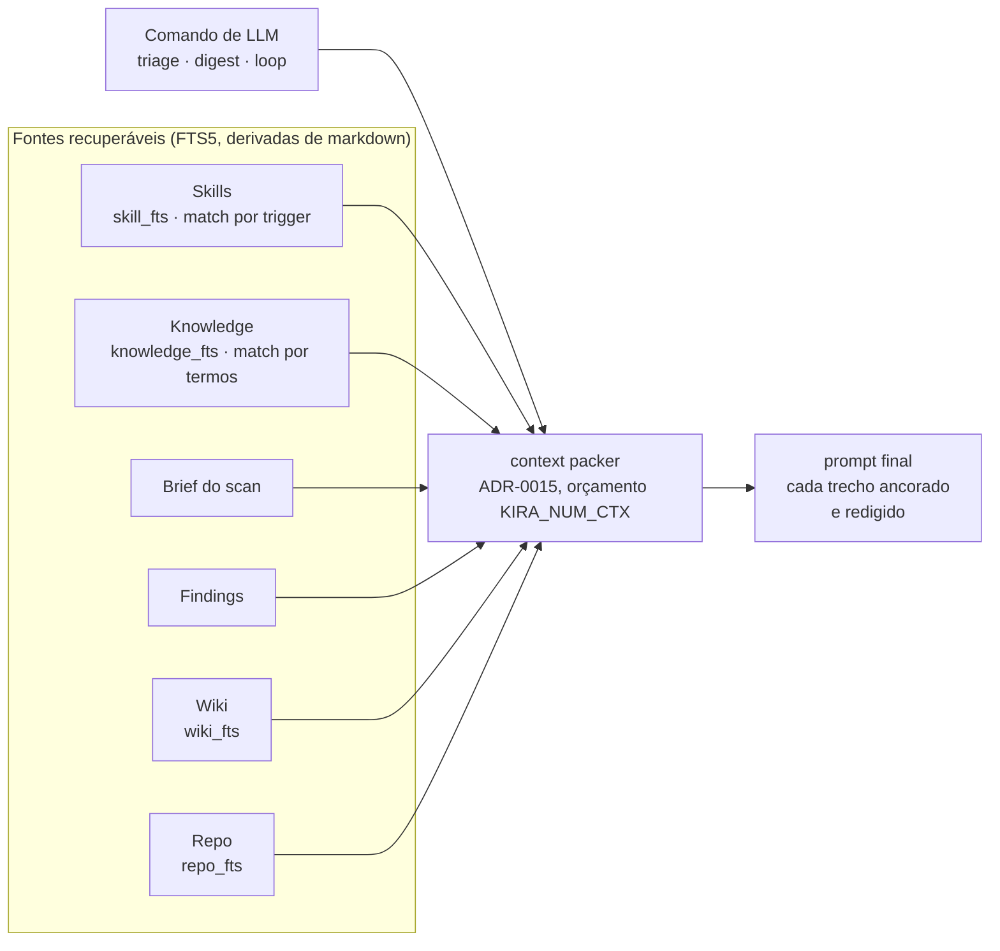

# Plano — Catálogo de skills + RAG de conhecimento pessoal (onda SK)

> **Data**: 13/Nov/2026 · **Pedido do dono**: o KIRA ganha (1) um **catálogo de skills**
> (react, tailwind, tanstack, shadcn, drawio…) usado via prompts + Ollama/LLM, e (2) um
> **RAG** para o conhecimento de livros e artigos que o dono lê. **Sem MCP** (mantido o
> veto do mandato). **Decisões seladas pelo dono nesta rodada**:
>
> 1. **Motor do RAG**: FTS5/bm25 **agora**, embeddings semânticos **depois**.
> 2. **Catálogo**: **bundled** (curado, versionado no repo) + skills do usuário em `.kira/skills/`.
> 3. **Injeção**: em **todos** os comandos de LLM (triage, digest e o futuro loop).

---

## 1. Contexto — o que já existe e o que é novo

O KIRA **já é retrieval-first** (ADR-0015) e **já tem RAG léxico** (ADR-0021): o packer
busca na wiki (`wiki_fts`) e no índice do repo (`repo_fts`) e injeta trechos ancorados no
prompt, com orçamento (`KIRA_NUM_CTX`) e prioridade fixa: *brief → findings → wiki → repo*.

O pedido adiciona **duas fontes novas** de conteúdo recuperável, ambas seguindo o **mesmo
padrão** (markdown como fonte de verdade + FTS5 derivado + redação na escrita + fail-open):

| Fonte | O que é | Onde mora | Índice |
|---|---|---|---|
| **Skills** | cartas de instrução (frontmatter + prompt) | bundled no binário + `.kira/skills/` | `skill` + `skill_fts` |
| **Knowledge** | notas/excertos de livros e artigos | `~/.config/kira/knowledge/` | `knowledge` + `knowledge_fts` |

Nada aqui usa MCP, embeddings ou dependência nova — o FTS5 já está no `store.db`
(`rusqlite` bundled). Embeddings ficam como **SK-4 (backlog)**, atrás da mesma interface de
busca, para a troca ser local e não vazar para o packer.

---

## 2. C4 · Nível 3 — Componente: as duas fontes novas no packer



Prioridade nova (fixa, determinística): **brief → findings → skills → knowledge → wiki → repo**.
Skills e knowledge entram **antes** da wiki porque um skill *casado por trigger* e uma nota
*pessoal curada* valem mais que uma página de wiki genérica; ambos são capados por fonte
(mesma régua de `MAX_PAGES`/`MAX_CODE_EXCERPTS`), e estourar orçamento vira nota, nunca erro.

---

## 3. Domínio `src/skills/` — o catálogo

### 3.1 Formato (fonte de verdade = markdown, como a wiki)

Cada skill é um `.md` com frontmatter e corpo. O frontmatter obrigatório espelha o do
agent-skills (CC-BY-4.0) **reimplementado** — não copiado:

```markdown
---
name: react
description: Use when editing React/JSX components or hooks. Do NOT use for Vue/Svelte.
license: CC-BY-4.0
author: <autor>
version: 1.0.0
---
# React

- estado: preferir hooks ...
```

O `description` carrega **triggers** ("Use when…") e **anti-triggers** ("Do NOT use…") — é
ele que o FTS5 casa, e o `version`+`author` dão a cadeia de custódia (mesmo espírito do
`TRIAGE_PROMPT_VERSION`).

### 3.2 Onde mora

- **Bundled**: diretório `skills/` versionado no repo do KIRA (react, tailwind, tanstack,
  shadcn, drawio…), embutido no binário via `include_str!` + índice gerado por `build.rs`
  (zero instalação, determinístico). Carregado read-only.
- **Usuário**: `<projeto>/.kira/skills/*.md` (local, nunca commitado). Estende/substitui o
  bundled pelo `name` (mesma regra de precedência do compozy: workspace > bundled).

### 3.3 CLI

- `kira skills list` — nome, versão, origem (bundled|user), uma linha de `description`.
- `kira skills show <name>` — o corpo do skill.
- `kira skills add <arquivo.md>` — copia para `.kira/skills/` (valida frontmatter + `redact`).
- `kira skills search <termos>` — FTS5 sobre `description`+corpo, top-k.

### 3.4 Índice e retrieval

- Tabelas `skill(project_id, name, origin, version, path)` + `skill_fts` (FTS5, uma linha
  por `description`/corpo já redigido). Bundled indexa num `project_id` reservado
  (`__bundled__`); user indexa no `project_id` do projeto. `kira skills reindex` reconstrói
  (derivado, descartável — padrão da wiki).
- Retrieval: o packer casa o **resumo do item + stack + findings** contra `description`
  (trigger) via FTS5 → injeta o **corpo** dos top-k casados, ancorado como
  `skill:<name>@<version>`.

---

## 4. Domínio `src/knowledge/` — RAG de livros/artigos

### 4.1 Formato

Notas/excertos em markdown, um `.md` por obra/artigo, com frontmatter:

```markdown
---
title: Título do livro/artigo
author: Autor
source: https://... ou edição/página
tags: [arquitetura, teste]
---
## Notas
- ideia 1 ...
> "citação curta" — capítulo 3
```

### 4.2 Onde mora

`~/.config/kira/knowledge/*.md` (Windows: `%USERPROFILE%\.config\kira\knowledge\`) — é
**pessoal e global**, não por projeto (diferente da wiki/repo, que são do projeto). FTS5 no
`store.db` central, sem `project_id` (ou `project_id = "__personal__"`).

### 4.3 CLI

- `kira knowledge add <arquivo.md>` — valida frontmatter + `redact`, copia para o diretório.
- `kira knowledge list` — título, autor, tags, nº de notas.
- `kira knowledge search <termos>` — FTS5 sobre título+notas+tags, top-k.
- `kira knowledge show <slug>` — a nota inteira.

### 4.4 Retrieval e embeddings (SK-4)

- Retrieval: o packer casa os **termos do item** (mesmas `context::keywords()`) contra o
  `knowledge_fts` → injeta top-k trechos ancorados como `knowledge:<slug>` (com título/autor,
  nunca blob anônimo — mesma regra de ancoragem da wiki).
- **SK-4 (backlog)**: trocar o `knowledge_fts` por embeddings (candle/usearch) **atrás de
  flag/env explícita**, mantendo FTS5 como default. A interface de busca é um trait
  (`KnowledgeSearch`) para a troca ser local; só entra com justificativa de dependência e
  nunca vira fallback silencioso (regra do "backend caro é explícito").

---

## 5. Injeção no packer (todos os comandos de LLM)

- `src/context/mod.rs` ganha duas fontes novas na ordem fixa (seção 2), cada uma com cap
  próprio (proposta: `MAX_SKILLS=3`, `MAX_KNOWLEDGE_EXCERPTS=4`, régua de `MAX_PAGES`).
- Orçamento estourado ⇒ nota no stderr (`contexto: ...`), nunca erro (fail-open por fonte,
  padrão vigente).
- **Determinismo**: ranking = skill casado por trigger primeiro, depois bm25, depois
  `name`/caminho/linha. Mesmo estado ⇒ mesmo prompt (gate M1 estendido).
- **Redação**: todo corpo de skill/nota passa por `crate::redact` antes de entrar no índice
  e no prompt (segredo nunca vai para disco nem para LLM).

---

## 6. Onda SK — itens executáveis (um PR por item)

| # | Item | Arquivos | Aceite |
|---|---|---|---|
| **SK-1** | Domínio `skills`: formato + loader (bundled embutido + `.kira/skills/`) + FTS5 + CLI `skills list/show/add/search/reindex` | `src/skills/` (novo), migração `skill`/`skill_fts`, `src/main.rs` | `skills add` valida frontmatter e redige; `search` retorna top-k determinístico; bundled listado com `origin: bundled`; gates verdes |
| **SK-2** | Domínio `knowledge`: formato + loader (`~/.config/kira/knowledge/`) + FTS5 + CLI `knowledge add/list/search/show/reindex` | `src/knowledge/` (novo), migração `knowledge`/`knowledge_fts`, `src/main.rs` | `add` grava nota redigida; `search` acha por termo/tag; dois `search` ⇒ byte-idêntico; gates verdes |
| **SK-3** | Injeção no packer: skills + knowledge na ordem fixa, caps por fonte, redação, nota de orçamento | `src/context/mod.rs` (+ `mod.rs` dos dois domínios) | prompt ganha `skill:<name>@<versão>` e `knowledge:<slug>` ancorados; orçamento estourado ⇒ nota; `context_e2e` (gate M1) estendido: mesmo estado ⇒ mesmo prompt |
| **SK-4** | *(backlog)* embeddings (candle/usearch) atrás de flag/env, FTS5 default | `src/knowledge/` (trait `KnowledgeSearch`) | só com justificativa de dependência; FTS5 continua default; nunca fallback silencioso |

**Conteúdo do catálogo bundled** (react, tailwind, tanstack, shadcn, drawio…): é um
deliverable **de conteúdo**, não de código — escrito/curado na onda, com `license` +
`author` no frontmatter (MIT próprio ou CC-BY-4.0 com atribuição; **nunca** código/texto
de licença restritiva). Entra junto do SK-1 como `skills/` versionado.

**Ordem**: SK-1 → SK-2 (paralelos, domínios distintos) → SK-3 (depende dos dois) → SK-4
(backlog). SK-1/SK-2/SK-3 **não** dependem do M7 nem do gate M2 — são independentes.

---

## 7. Decisões abertas para o dono (propostas, sem selo)

| # | Item | Proposta default |
|---|---|---|
| **S1** | Caps de injeção | `MAX_SKILLS=3`, `MAX_KNOWLEDGE_EXCERPTS=4` |
| **S2** | Bundled embutido via `include_str!`/build.rs ou diretório `skills/` ao lado do binário | `include_str!` + build.rs (zero instalação) |
| **S3** | Knowledge global (`~/.config/kira/knowledge/`) vs por projeto | **Global** (pessoal) |
| **S4** | Licença do catálogo bundled | MIT próprio; se importar do agent-skills, CC-BY-4.0 com atribuição |
| **S5** | Prioridade no packer | skills/knowledge **antes** da wiki (seção 2) |

---

## 8. Não-objetivos

- **MCP** (veto do mandato, mantido) — skills/knowledge são markdown + FTS5, não servidor.
- **Embeddings agora** (SK-4 é backlog; ADR-0021 segue valendo até lá).
- **Marketplace/registry multi-agente** — o catálogo é do KIRA e do dono, não comunitário.
- **Copiar os 94 SKILL.md do agent-skills** — reimplementamos o *formato* (frontmatter,
  trigger/anti-trigger, semver, autor); conteúdo só com atribuição (S4).

## 9. Reconciliado com as ondas anteriores

- A avaliação `docs/compozy-vale-trazer.md` dizia "catálogo de skills = domínio alheio".
  **Reversão deliberada do dono** (13/Nov): o KIRA deixa de ser só "sustentação ADO" e vira
  agente de codificação com catálogo de skills + conhecimento pessoal. O *mecanismo* que o
  compozy/agent-skills usam (formato + FTS5 + trust) continua valendo como referência.
- `docs/ig-implementacao.md` (ingestão v2) e a onda SK são **independentes** — podem rodar
  em paralelo. A única interseção é o packer (`src/context/mod.rs`), que ambas tocam;
  ordenar IG-3/SK-3 para não rebasear quando as duas entrarem na fila.

---

## 10. Revisão contra `awesome-rag-production` (base do dono)

Base: [`Yigtwxx/awesome-rag-production`](https://github.com/Yigtwxx/awesome-rag-production)
(CC0 — lista curada; `rag-pitfalls.md` com anti-padrões + soluções). Revisado em 13/Nov.

### Já alinhado (o plano segue a base por decisão)

| Princípio da base | Onde o KIRA já segue |
|---|---|
| **"Pure vector search only" é anti-padrão** → use **hybrid (dense + BM25)** | o plano é **FTS5/bm25 agora + embeddings depois** — já é o híbrido, na ordem certa |
| Preservar **metadata** (fonte/author/timestamp) | frontmatter `title/author/source/tags` |
| **Instrução explícita** de usar só o contexto | prompts "use ONLY the facts… never invent" |
| **Não estourar a janela** | `KIRA_NUM_CTX` + `MAX_KNOWLEDGE_EXCERPTS` |
| **Indexação incremental** (não re-embeddar tudo) | FTS5 incremental (padrão ADR-0021) |
| **Fail-open** quando não há resultado | resultado vazio ⇒ nota, nunca erro |

### Ajustes que a revisão pede (aplicar no SK-2/SK-3)

| Gap | Ajuste |
|---|---|
| **"Top-K muito pequeno"** — a base manda *retrieve top-20~50 → rerank top-5* | separar **recuperação** (top-20 no FTS5) da **injeção** (top-4 no prompt). Hoje o `MAX_KNOWLEDGE_EXCERPTS=4` é a injeção; falta explicitar o pool de 20 |
| **Sem dataset de avaliação** | adicionar `kira knowledge --eval` futuro: golden `(query → source esperado)`, medido determinístico (sem LLM como juiz — ADR-0018) |
| **Reranker** (cross-encoder) | só entra junto do SK-4 (embeddings); hoje o bm25 **é** o rank |
| **Query transformation** (HyDE/multi-query) | a base sugere LLM para reescrever a query; o KIRA usa `context::keywords()` determinístico (CLI-first). LLM para expandir query é **opt-in futuro**, nunca no retrieval de agora |
| **Observabilidade** ("quais fontes entraram") | a nota `contexto:` deve listar as fontes injetadas (`knowledge:<slug>` + `skill:<name>@<versão>`) — já previsto, só tornar explícito no aceite do SK-3 |

### Veredito

O plano **não diverge** da base — pelo contrário: a decisão "FTS5 agora, embeddings depois"
é exatamente o anti-padrão #1 dela resolvido. Os ajustes acima são **refinamentos**, não
mudança de direção. Nenhum deles bloqueia SK-1/SK-2; o "retrieve top-20 → inject top-4" e a
nota de observabilidade entram no **SK-3**; eval e reranker ficam no **SK-4 (backlog)**.
