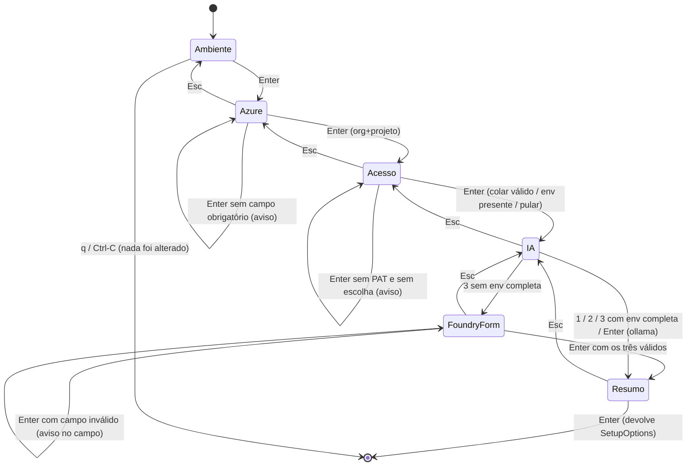

# Jornada de UX do KIRA — `setup`, primeiro uso e uso diário

- **Status**: vigente · **Data**: 12/Nov/2026
- **Decisões que este documento descreve**: ADR-0025 (setup ensina), ADR-0034 (wizard de tela
  cheia), ADR-0035 (Foundry no wizard)
- **Escopo**: o que o dono vê e decide em cada etapa, o que o KIRA faz por trás, o que fica
  gravado, e como cada etapa se conecta ao uso diário (`doctor`, `scan`, `triage`, wiki,
  dashboard).

---

## 1. O problema que a jornada resolve

Instalar o KIRA em três SOs diferentes significava: parede de texto antes de qualquer input,
nenhuma noção de quantas perguntas faltavam, ordem confusa (nome depois do token), promessa de
segurança que o Windows não cumpria, e caminhos sem saída (provedor oferecido no menu que o
sistema não conseguia configurar). Nada disso é falta de funcionalidade — é falta de
**sequência visível** e de **estado honesto**.

O objetivo desta jornada é: **o dono sempre sabe onde está, o que falta, o que já foi decidido
por ele e o que o programa fez com isso.**

## 2. O que aproveitamos do opencode (e o que fica de fora)

O que foi adotado é comportamento, não código: nenhuma dependência nova, nada copiado (o
projeto é Apache-2.0/MIT compatível, mas o critério aqui é outro — o KIRA não importa UI de
terceiros).

| Padrão do opencode | Como aparece no KIRA |
|---|---|
| Trilha fixa de etapas à esquerda com glifo de estado | Coluna `ETAPAS` (`✓ › ·`) com `Ambiente · Azure · Acesso · IA · Resumo` |
| Painel à direita com o conteúdo da etapa e rodapé de ações | `panel::block` (borda dupla, título `| Etapa |`) + rodapé de chips com a tecla e o verbo |
| `esc` sempre visível como saída da camada atual | Rodapé de toda etapa e `Esc` fecha só a camada aberta (formulário → etapa → anterior) |
| Detecção do ambiente antes de perguntar | Etapa `Ambiente` é só leitura; org/projeto/endpoint/deployment já vêm preenchidos com a origem |
| "Pular" como opção explícita, não como erro | `s`/opção 3 do PAT; e o resumo separa `pronto:` de `pulado (dá para fazer depois):` |
| Segredo sem eco e sem largura revelada | Raw mode nos três SOs; máscara de tamanho fixo (`••••`) |
| Sem animação onde ela não informa | Nada de spinner: operação curta termina e o texto muda |

Fica de fora de propósito: animações/shimmer, temas JSON, marketplace de integrações, fluxo
OAuth por navegador, instalador próprio.

## 3. Princípios de interação (valem para qualquer tela do KIRA)

1. **Nenhum passo cego.** Toda tela diz três coisas: onde está, o que se espera dela, o que
   acontece depois.
2. **Detecção antes de pergunta.** O que a máquina pode descobrir (SO, shell, PATH, keyring,
   org/projeto salvos, endpoint no ambiente) é mostrado, não perguntado.
3. **Segredo é mascarado por construção.** O valor nunca entra em buffer de render, em log, em
   `Debug` ou em prompt de LLM; a tela mostra uma máscara de tamanho fixo.
4. **Nada é gravado antes da confirmação.** O resumo diz explicitamente "nada é gravado antes
   do Enter"; validação (PAT, Foundry) acontece depois, e rejeição não grava.
5. **O caro nunca é default.** Ollama é o caminho de omissão; Copilot/Foundry só por escolha
   explícita e nunca com fallback silencioso.
6. **Falha é acionável e não destrói o que já foi feito.** Sem rede grava e manda rodar
   `kira doctor`; 401/403/404 param e dizem exatamente o que corrigir e onde.
7. **Retomada idempotente.** Todo passo pulado tem o comando que o retoma no resumo do próprio
   KIRA (`kira setup --pat`, `kira setup --backend ollama`).

## 4. A jornada do `kira setup`

### 4.1 Entradas

| Situação | Modo | Por quê |
|---|---|---|
| TTY em stdin+stdout, ≥80×24, sem flag | **Wizard** (tela cheia) | é a instalação de verdade |
| `--plain` | **Texto** | terminal restrito, preferência do dono |
| Qualquer flag explícita (`--org`, `--project`, `--pat`, `--backend`, `--skip`, `--yes`, `--reset`) | **Texto** | quem deu flag não quer assistente |
| Sem TTY (pipe, CI) | **Texto** | raw mode não existe em pipe |
| Terminal <80×24 | **Texto** | a casca degrada, e degradar em silêncio é pior que ser simples |

Decisão pura em `setup::wizard::mode(tty, width, height, plain, explicit)`.

Abaixo de 100 colunas o wizard **continua** abrindo, mas a trilha lateral (24 colunas) sai de
cena e vira o contador `etapa 4/5 · IA` na linha de abas: com 80 colunas, manter a trilha
deixaria 54 para o painel e cortaria instrução — instrução cortada é instrução que engana.

### 4.2 Tela

```text
╔═══════════════════════════════════════════════════════════════════════════╗
║ kira setup · windows · x86_64 · PowerShell · config ~/.config/kira/...     ║
║ configure o ambiente · Enter Avança · Esc Volta · q Cancelar               ║
╠════════════╤══════════════════════════════════════════════════════════════╣
║ ETAPAS     │ | Ambiente |                                                 ║
║ › Ambiente │ detectado nesta máquina (sem rede)                           ║
║ · Azure    │  so          windows · x86_64                                ║
║ · Acesso   │  shell       PowerShell                                      ║
║ · IA       │  keyring     Credential Manager                              ║
║ · Resumo   │  config      C:\Users\<dev>\.config\kira\config.toml         ║
║            │  store       C:\Users\<dev>\.config\kira\store.db            ║
║            │  ferramentas                                                 ║
║            │   ✓ dotnet      — pnpm      ✓ ollama      — copilot          ║
║            │                                                              ║
║            │  já configurado (config.toml + keyring)                      ║
║            │   azure        minha-org / Kira                              ║
║            │   dev          Serginho                                      ║
║            │   foundry      https://…openai.azure.com/openai/v1 · gpt-5   ║
║            │   chaves       PAT ✓ · Foundry ✓                             ║
╠════════════╧══════════════════════════════════════════════════════════════╣
║ Enter Avançar   Tab Campo   Esc Voltar   q Cancelar                        ║
╚═══════════════════════════════════════════════════════════════════════════╝
```

A seção **já configurado** é leitura pura: valores públicos vêm do `config.toml`, e das chaves
só aparece a presença (`✓`/`—`). Numa máquina nova ela diz `nada salvo ainda — este é o primeiro
setup`; numa máquina já configurada, o dono vê o que o KIRA vai reaproveitar antes de decidir.

### 4.3 Etapas, uma por uma

| # | Etapa | O que o dono vê | O que ele decide | O que fica gravado |
|---|---|---|---|---|
| 1 | **Ambiente** | SO, arquitetura, shell, keyring, caminhos, ferramentas no PATH — cada `—` com a causa | nada (só Enter) | nada |
| 2 | **Azure** | org e projeto já preenchidos (flag > env > config), campo focado marcado | corrigir/aceitar | `organization`, `project` no `config.toml` |
| 3 | **Acesso** | aula curta (senha descartável, Work Items → Read, 30/90 dias, valor único) + menu colar/ambiente/pular + campo mascarado; se já existe PAT salvo, avisa e `Enter` o mantém | colar PAT, usar env, manter o do keyring ou pular | PAT no keyring (colado e validado, ou sem rede); o salvo é validado e não regravado; pulado ⇒ modo local |
| 4 | **IA** | custo e dados de cada opção; Foundry abre o formulário inline | ollama / copilot / foundry (+ endpoint, deployment, chave) | `backend` na escolha; Foundry: endpoint/deployment no config e chave no keyring, **depois** do teste |
| 5 | **Resumo** | o que será gravado, com PAT mascarado e origem de cada valor | Enter grava / Esc volta | resumo no formato `pronto: / pulado: / próximo passo:  kira scan` |

### 4.4 A etapa de IA com o formulário do Foundry (ADR-0035)

```text
║  › 1) Ollama local (0 custo, nada sai da máquina)                          ║
║    2) Copilot CLI (usa sua assinatura)                                     ║
║  ➤ 3) Microsoft Foundry (BYOK: custo por token)                             ║
║                                                                            ║
║  endpoint/deployment vão para config.toml; a chave vai para o keyring      ║
║                                                                            ║
║  endpoint     https://recurso.openai.azure.com/openai/v1▌                  ║
║  deployment   gpt-5                                                        ║
║  chave        ••••••••••••                                                 ║
║                                                                            ║
║  Tab anda entre os campos · Enter valida e avança · Esc fecha o formulário  ║
```

Regras que o dono sente na pele:

- endpoint e deployment vêm do ambiente quando existem; a chave, nunca;
- endpoint de projeto (`/api/projects/`) é recusado ali mesmo, dizendo para usar o do recurso
  terminando em `/openai/v1` — em vez de virar um 404 incompreensível no `triage`;
- depois de `Enter` válido, **uma** chamada barata confirma o recurso; só então o KIRA grava;
- chave recusada (401/403/404) não grava nada e a IA aparece como pulada no resumo.

### 4.5 Estados e transições



### 4.6 O que acontece depois do Enter no Resumo

O wizard não executa nada: ele devolve `SetupOptions` (`interactive: false`) e o motor de texto
faz, nesta ordem:

1. resolve e valida o PAT (leitura barata) — env > keyring > pulado; 401/403 param, sem rede
   grava e avisa;
2. pergunta/deriva o nome do dev e grava `config.toml` (org, projeto, `dev_name`);
3. verifica a IA escolhida (ollama list, copilot no PATH, ou UMA chamada do Foundry — resolvida
   por env > `config.toml` > keyring);
4. grava o efeito do Foundry quando houve formulário e o teste passou;
5. imprime o resumo `pronto: / pulado: / próximo passo:  kira scan`.

Reaproveitar é a regra: nada é pedido de novo se já está guardado e resolvível. Isso vale para
org/projeto/dev, para o par endpoint/deployment do Foundry e para o PAT (que é validado, não
recopiado). `kira setup --reset` é a saída simétrica: apaga PAT e chave do Foundry do keyring e
o par público do `config.toml`; org/projeto/dev ficam, porque identificam o projeto e não são
credencial.

### 4.7 Falhas, avisos e retomada

| Situação | O que o dono vê | O que fica | Como retomar |
|---|---|---|---|
| PAT 401 | mensagem com a URL da página de tokens | nada | `kira setup` de novo |
| PAT 403 | "autenticou, mas sem escopo Work Items" | nada | editar o token, `kira setup` |
| Sem rede na validação do PAT | aviso de validação pendente | PAT salvo | `kira doctor` |
| Projeto com nome errado | lista de projetos existentes | nada | `kira setup` com o nome exato |
| ollama sem o modelo | `ollama pull qwen3.5:4b (3,3 GB)` | IA pulada | `kira setup --backend ollama` |
| copilot fora do PATH | aviso + pré-requisito de política | IA pulada | `kira setup --backend copilot` |
| Foundry 401/404 | causa específica, sem corpo cru | nada do Foundry | `kira setup` (formulário) |
| Foundry sem keyring | `foundry parcial` + env que falta | endpoint/deployment | exportar `KIRA_FOUNDRY_API_KEY` |

## 5. A jornada depois do setup (o KIRA em uso)

O setup termina apontando para o próximo comando — e cada comando é read-only até alguém pedir
o contrário.

```text
kira setup ──▶ kira scan ───────────▶ .kira/findings.json (determinístico)
   │                │
   │                └─▶ kira dashboard  (Resumo/Achados)
   │                        │
   ├─▶ kira doctor ─────────┤         s → folha de confirmação → scan
   │   (o que falta, por quê)│         t/d → alvo → confirmação → triage/pr draft
   │                        │
   └─▶ kira triage <id> ────▶ store + .kira/wiki/bugs/<id>.md
            │                         │
            └─▶ kira pr draft <id>    └─▶ kira wiki reindex / search / promote
```

| Momento | Comando | Garantia |
|---|---|---|
| "está tudo configurado?" | `kira doctor` | diz a origem de cada valor (env/keyring/config) e o que falta fazer |
| "o que está vulnerável?" | `kira scan` | mesmo estado ⇒ mesmo `findings.json` byte a byte |
| "o que eu faço com o item?" | `kira triage <id>` | prompt com contexto ancorado; nunca escreve no board |
| "quero ver tudo junto" | `kira dashboard` | navegar nunca executa; ação só com `s`/`t`/`d` + `Enter` |
| "quero registrar conhecimento" | `kira wiki decision "..."` | markdown é a fonte de verdade, escrito redigido |

O dashboard é a continuação natural do setup: mesma casca visual (borda dupla, título entre
barras, rodapé de chips), mesma regra de honestidade — dado ausente aparece como `—` com a
causa, nunca inventado.

## 6. Mapa de código

| Peça | Arquivo |
|---|---|
| Decisão do modo (puro) | `src/setup/wizard.rs` (`mode`) |
| Estado, etapas, teclado, validação do Foundry (puro) | `src/setup/wizard.rs` (`WizardState`, `foundry_problem`) |
| Desenho da tela (ratatui/crossterm) | `src/setup/wizard.rs` (`render`), `src/tui/{layout,chrome}.rs`, `src/tui/widgets/{panel,footer}.rs` |
| Efeitos: validação do PAT, gravação, teste de IA, resumo | `src/setup.rs` (`run`, `persist_foundry`, `format_summary`) |
| Chaves de config e entradas do keyring | `src/credentials.rs` |
| Resolução do Foundry (env > config > keyring) | `src/llm/foundry.rs` (`from_sources`, `merge_lookup`) |

## 7. Lacunas conhecidas

- O wizard não tem teste de terminal real (TTY): o que está fixado em teste é o estado puro e
  o desenho em `TestBackend`. O smoke em terminal de verdade é manual.
- O `Ambiente` mostra o que está salvo, mas não deixa apagar nada dali: apagar é `kira setup
  --reset` (fora do wizard).
- A seção "já configurado" lê o keyring uma vez na abertura; em SO com prompt de chaveiro (raro,
  macOS com item restrito) essa leitura pode pedir autorização antes da primeira pergunta.
- Modo texto repete a aula longa do PAT em `--yes`/`--skip pat`; no wizard ela é curta.
- O wizard não mostra o *custo* acumulado do Foundry (só o aviso "custo por token").
