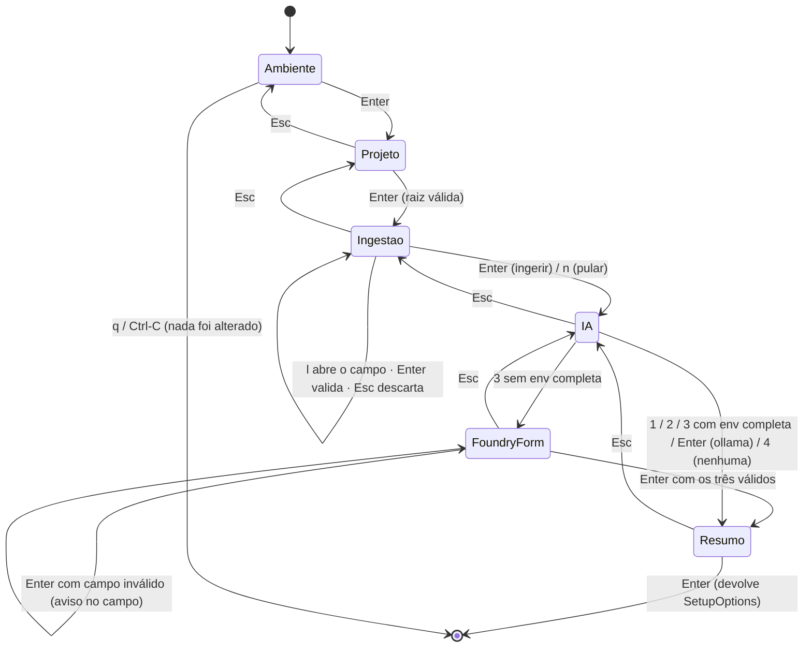

# Jornada de UX do KIRA — `setup`, primeiro uso e uso diário

- **Status**: vigente · **Data**: 13/Nov/2026 (reescrita na onda M; a versão de 12/Nov
  ainda descrevia a trilha antiga com etapa de PAT, removida pelo ADR-0030)
- **Decisões que este documento descreve**: ADR-0025 (setup ensina), ADR-0030
  (local-first, PAT só em `kira connect`), ADR-0034 (wizard de tela cheia), ADR-0035
  (Foundry no wizard), ADR-0038 D1/D4 (etapa Ingestão e `output.lang`)
- **Escopo**: o que o dono vê e decide em cada etapa, o que o KIRA faz por trás, o que fica
  gravado, e como cada etapa se conecta ao uso diário (`doctor`, `scan`, `triage`, ingestão,
  wiki, dashboard).

---

## 1. O problema que a jornada resolve

Instalar o KIRA em três SOs diferentes significava: parede de texto antes de qualquer input,
nenhuma noção de quantas perguntas faltavam, ordem confusa (nome depois do token), promessa de
segurança que o Windows não cumpria, e caminhos sem saída (provedor oferecido no menu que o
sistema não conseguia configurar). Nada disso é falta de funcionalidade — é falta de
**sequência visível** e de **estado honesto**.

O objetivo desta jornada é: **o dono sempre sabe onde está, o que falta, o que já foi decidido
por ele e o que o programa fez com isso.**

Com a onda M entrou mais uma promessa: **no fim do setup o projeto já é conhecido pelo
KIRA** — índice no store e `.kira/digest.md` gravados — sem um único comando digitado pelo
dev e sem rede.

## 2. O que aproveitamos do opencode (e o que fica de fora)

O que foi adotado é comportamento, não código: nenhuma dependência nova, nada copiado (o
projeto é Apache-2.0/MIT compatível, mas o critério aqui é outro — o KIRA não importa UI de
terceiros).

| Padrão do opencode | Como aparece no KIRA |
|---|---|
| Trilha fixa de etapas à esquerda com glifo de estado | Coluna `ETAPAS` (`✓ › ·`) com `Ambiente · Projeto · Ingestão · IA · Resumo`; o `✓` só aparece em etapa **já visitada** cuja condição vale |
| Painel à direita com o conteúdo da etapa e rodapé de ações | `panel::block` (borda dupla, título `\| Etapa \|`) + rodapé de chips com a tecla e o verbo |
| `esc` sempre visível como saída da camada atual | Rodapé de toda etapa e `Esc` fecha só a camada aberta (formulário → etapa → anterior) |
| Detecção do ambiente antes de perguntar | Etapa `Ambiente` é só leitura; raiz, idioma, endpoint/deployment já vêm preenchidos com a origem |
| "Pular" como opção explícita, não como erro | `n` na Ingestão, `--skip pat|ia|ingest`; e o resumo separa `pronto:` das linhas de retomada |
| Segredo sem eco e sem largura revelada | Raw mode nos três SOs; máscara de tamanho fixo (`••••`) — só no formulário do Foundry; PAT não aparece aqui (ADR-0030) |
| Sem animação onde ela não informa | Nada de spinner: operação curta termina e o texto muda |

Fica de fora de propósito: animações/shimmer, temas JSON, marketplace de integrações, fluxo
OAuth por navegador, instalador próprio.

## 3. Princípios de interação (valem para qualquer tela do KIRA)

1. **Nenhum passo cego.** Toda tela diz três coisas: onde está, o que se espera dela, o que
   acontece depois.
2. **Detecção antes de pergunta.** O que a máquina pode descobrir (SO, shell, PATH, keyring,
   raiz do projeto, idioma salvo, endpoint no ambiente) é mostrado, não perguntado.
3. **Segredo é mascarado por construção.** O valor nunca entra em buffer de render, em log, em
   `Debug` ou em prompt de LLM; a tela mostra uma máscara de tamanho fixo.
4. **Nada é gravado antes da confirmação.** O resumo diz explicitamente "nada é gravado antes
   do Enter"; a etapa Ingestão **mostra preview sem escrever nada** — o efeito é do motor,
   depois do Enter final (ADR-0034).
5. **O caro nunca é default.** Ollama é o caminho de omissão; Copilot/Foundry só por escolha
   explícita e nunca com fallback silencioso.
6. **Falha é acionável e não destrói o que já foi feito.** Sem rede grava e manda rodar
   `kira doctor`; 401/403/404 param e dizem exatamente o que corrigir e onde; ingestão que
   não rodou é **nota** com causa e comando, nunca erro do setup.
7. **Retomada idempotente.** Todo passo pulado tem o comando que o retoma impresso no próprio
   resumo (`kira ingest`, `kira setup --backend ollama`).

## 4. A jornada do `kira setup`

### 4.1 Entradas

| Situação | Modo | Por quê |
|---|---|---|
| TTY em stdin+stdout, ≥80×24, sem flag | **Wizard** (tela cheia) | é a instalação de verdade |
| `--plain` | **Texto** | terminal restrito, preferência do dono |
| Qualquer flag explícita (`--org`, `--project`, `--pat`, `--backend`, `--lang`, `--skip`, `--yes`, `--reset`) | **Texto** | quem deu flag não quer assistente |
| Sem TTY (pipe, CI) | **Texto** | raw mode não existe em pipe |
| Terminal <80×24 | **Texto** | a casca degrada, e degradar em silêncio é pior que ser simples |

Decisão pura em `setup::wizard::mode(tty, width, height, plain, explicit)`.

Abaixo de 100 colunas o wizard **continua** abrindo, mas a trilha lateral (24 colunas) sai de
cena e vira o contador `etapa 4/5 · IA` na linha de abas (o divisor vem de `Step::ALL.len()`,
nunca hardcoded): com 80 colunas, manter a trilha deixaria 54 para o painel e cortaria
instrução — instrução cortada é instrução que engana.

### 4.2 Tela

```text
╔═══════════════════════════════════════════════════════════════════════════╗
║ kira setup · windows · x86_64 · PowerShell · config ~/.config/kira/...     ║
║ configure o ambiente · Enter Avança · Esc Volta · q Cancelar               ║
╠════════════╤══════════════════════════════════════════════════════════════╣
║ ETAPAS     │ | Ambiente |                                                 ║
║ › Ambiente │ detectado nesta máquina (sem rede)                           ║
║ · Projeto  │  so          windows · x86_64                                ║
║ · Ingestão │  shell       PowerShell                                      ║
║ · IA       │  keyring     Credential Manager                              ║
║ · Resumo   │  config      C:\Users\<dev>\.config\kira\config.toml         ║
║            │  store       C:\Users\<dev>\.config\kira\store.db            ║
║            │  ferramentas                                                 ║
║            │   ✓ dotnet      — pnpm      ✓ ollama      — copilot          ║
║            │                                                              ║
║            │  já configurado (config.toml + keyring)                      ║
║            │   dev          Serginho                                      ║
║            │   idioma       pt-BR (posts, cards e PR)                     ║
║            │   foundry      https://…openai.azure.com/openai/v1 · gpt-5   ║
║            │   chaves       PAT ✓ · Foundry ✓                             ║
╠════════════╧══════════════════════════════════════════════════════════════╣
║ Enter Avançar   Tab Campo   Esc Voltar   q Cancelar                        ║
╚═══════════════════════════════════════════════════════════════════════════╝
```

A seção **já configurado** é leitura pura: valores públicos vêm do `config.toml`
(inclusive `output_lang`, o idioma salvo), e das chaves só aparece a presença (`✓`/`—`) —
nunca o valor. Numa máquina nova ela diz `nada salvo ainda — este é o primeiro setup`; numa
máquina já configurada, o dono vê o que o KIRA vai reaproveitar antes de decidir. Org/projeto
**não** são etapa do wizard: o board é capacidade, e credencial é assunto de
`kira connect <provider>` (ADR-0030).

### 4.3 Etapas, uma por uma

| # | Etapa | O que o dono vê | O que ele decide | O que fica gravado (pelo motor) |
|---|---|---|---|---|
| 1 | **Ambiente** | SO, arquitetura, shell, keyring, caminhos, ferramentas no PATH — cada `—` com a causa — e o que já está salvo | nada (só Enter) | nada |
| 2 | **Projeto** | **raiz detectada** (mesma regra do store: climb até `.git`/`Cargo.toml`/`package.json`) editável; o nome do dev, quando falta, é perguntado aqui | aceitar/corrigir a raiz | org/dev no `config.toml` seguem as regras de sempre; a raiz decide para onde a ingestão olha |
| 3 | **Ingestão** (M6) | *preview* read-only do `kira ingest`: arquivos ingeridos, bytes, stacks detectadas e notas — **nada é gravado nesta tela** | `Enter` ingere · `n` pula · `l` abre o campo de idioma (`en`, `pt-BR`…; `Esc` descarta o rascunho) | nada — a decisão vira `SetupOptions`; o efeito é do motor, no passo certo |
| 4 | **IA** | custo e dados de cada opção; Foundry abre o formulário inline | ollama / copilot / foundry (+ endpoint, deployment, chave) / nenhuma | escolha; Foundry: endpoint/deployment no config e chave no keyring, **depois** do teste |
| 5 | **Resumo** | o que será gravado, com `idioma:` e a linha de ingestão (feita, pulada ou "não rodou (causa)") | Enter grava / Esc volta | formato § 4.6 |

O campo de idioma valida na hora: `idioma inválido — use algo como en ou pt-BR (letras,
dígitos, hífen)`; Enter com campo inválido **não fecha** o formulário, e Esc **descarta** — o
idioma confirmado volta a ser o anterior, nunca o rascunho. É o mesmo mecanismo do
formulário do Foundry (ADR-0035), inclusive no rodapé `Tab anda entre os campos`.

### 4.4 A etapa de IA com o formulário do Foundry (ADR-0035)

```text
║  › 1) Ollama local (0 custo, nada sai da máquina)                          ║
║    2) Copilot CLI (usa sua assinatura)                                     ║
║  ➤ 3) Microsoft Foundry (BYOK: custo por token)                             ║
║                                                                            ║
║  endpoint/deployment vão para config.toml; a chave vai para o keyring      ║
║                                                                            ║
║  endpoint     https://recurso.openai.azure.com/openai/v1▌                  ║
║  deployment   gpt-5                                                        ║
║  chave        ••••••••••••                                                 ║
║                                                                            ║
║  Tab anda entre os campos · Enter valida e avança · Esc fecha o formulário  ║
```

Regras que o dono sente na pele:

- endpoint e deployment vêm do ambiente quando existem; a chave, nunca;
- endpoint de projeto (`/api/projects/`) é recusado ali mesmo, dizendo para usar o do recurso
  terminando em `/openai/v1` — em vez de virar um 404 incompreensível no `triage`;
- depois de `Enter` válido, **uma** chamada barata confirma o recurso; só então o KIRA grava;
- chave recusada (401/403/404) não grava nada e a IA aparece como pulada no resumo.

### 4.5 Estados e transições



### 4.6 O que acontece depois do Enter no Resumo

O wizard não executa nada: ele devolve `SetupOptions` (`interactive: false`, com as decisões
de ingestão e idioma) e o motor de texto faz, **nesta ordem** — fonte única de efeitos:

1. resolve e valida o nome do dev e a raiz do projeto (org/projeto/`dev_name` no
   `config.toml`);
2. **ingestão** (M6, ADR-0038 D1): se o dono escolheu ingerir (ou `--yes`), roda
   `ingest::run` com `run_scan: false` — o contrato "rede fora do caminho do setup" vale
   desde o M1; `ensure_local_marker` junto (`.kira/.gitignore`). Falha de ingestão é
   `aviso: ingestão não rodou (<causa>) — nada foi perdido; rode kira ingest depois.` no
   resumo, nunca erro; `n`/`--skip ingest` imprime `ingestão pulada — ativar depois: kira
   ingest`;
3. verifica a IA escolhida (`ollama list`, `copilot` no PATH, ou UMA chamada do Foundry —
   resolvida por env > `config.toml` > keyring) e grava o efeito do Foundry **depois** do
   teste;
4. valida o `--lang`/idioma coletado (explícito inválido falha de cara, sem gravar), salva
   `output_lang` no `config.toml`;
5. imprime o resumo, com as linhas novas da onda M:

```text
pronto:
  dev: <nome>
  ia:  <backend ou "nenhuma">
  idioma: en (posts, cards e PR)
  store: <caminho>
  ingestão: 181 arquivo(s), 39 achado(s), digest .kira/digest.md

funciona agora:  scan · wiki · context · pr draft · dashboard
desativado:      judge de item do board · read (board) · publicar PR
ativar depois:   kira connect azure   (leitura de work items)
                 kira setup --backend ollama
próximo passo:   kira connect azure
```

O **próximo passo saiu do `kira scan` hardcoded**: a ingestão já fez a primeira leitura do
projeto, e scan é capacidade de ferramenta, não de setup. Com `board.azure` conectada para a
raiz, o próximo passo é `kira triage <id>`; sem ela, `kira connect azure` (fail-open: a
consulta de capacidade que falha conta como desconectada).

Reaproveitar é a regra: nada é pedido de novo se já está guardado e resolvível — vale para
org/projeto/dev, para o `output_lang`, para o par endpoint/deployment do Foundry e para o PAT
(validado, não recopiado). `kira setup --reset` é a saída simétrica: apaga PAT e chave do
Foundry do keyring e o par público do `config.toml`; org/projeto/dev/idioma ficam, porque
identificam o dono e o projeto e não são credencial.

### 4.7 Falhas, avisos e retomada

| Situação | O que o dono vê | O que fica | Como retomar |
|---|---|---|---|
| `--lang`/campo com código inválido | recusa de cara, com o formato esperado | nada | digitar de novo; Esc descarta |
| Ingestão que falhou no motor | `aviso: ingestão não rodou (<causa>)` no resumo | tudo o que já foi salvo | `kira ingest` |
| Dono pulou a ingestão (`n`/`--skip ingest`) | `ingestão: pulada — ativar depois: kira ingest` | nada ingerido | `kira ingest` |
| PAT 401 (`--pat` explícito) | mensagem com a URL da página de tokens | nada | `kira setup` de novo |
| PAT 403 | "autenticou, mas sem escopo Work Items" | nada | editar o token, `kira setup` |
| Sem rede na validação do PAT | aviso de validação pendente | PAT salvo | `kira doctor` |
| ollama sem o modelo | `ollama pull qwen3.5:4b (3,3 GB)` | IA pulada | `kira setup --backend ollama` |
| copilot fora do PATH | aviso + pré-requisito de política | IA pulada | `kira setup --backend copilot` |
| Foundry 401/404 | causa específica, sem corpo cru | nada do Foundry | `kira setup` (formulário) |
| Foundry sem keyring | `foundry parcial` + env que falta | endpoint/deployment | exportar `KIRA_FOUNDRY_API_KEY` |

## 5. A jornada depois do setup (o KIRA em uso)

O setup termina com o projeto **ingerido** — o caminho ADR-0038 continua daí, e nada dele
acontece sem decisão humana:

```text
kira setup ──▶ .kira/digest.md + índice (sem rede, sem trust)
   │
   ├──▶ kira trust ──▶ aceite do repositório (.kira/trust.json)
   │                       │
   │                       └──▶ kira digest ──▶ rascunhos em .kira/digest/ (Ollama local)
   │                                   │
   │                                   └──▶ kira emit ──▶ .kira/wiki/<slug>.md (gate por hash)
   ├──▶ kira scan ─────────▶ .kira/findings.json (determinístico)
   ├──▶ kira doctor ───────▶ ingestão · trust · fila · posts desatualizados
   └──▶ kira triage <id> ──▶ store + .kira/wiki/bugs/<id>.md   (contexto: o pack agora
        │                                        inclui o perfil do digest)
        └─▶ kira pr draft <id>
```

| Momento | Comando | Garantia |
|---|---|---|
| "está tudo configurado?" | `kira doctor` | diz a origem de cada valor (env/keyring/config) e o que falta fazer |
| "o que está vulnerável?" | `kira scan` | mesmo estado ⇒ mesmo `findings.json` byte a byte |
| "conhece meu projeto?" | `kira ingest` (ou o setup) | árvore + perfil determinísticos; `.gitignore` honrado (M7) |
| "quero os artigos do projeto?" | `kira trust` + `kira digest` | nada sai da máquina sem o aceite; Ollama é o primeiro backend, sempre |
| "e na wiki?" | `kira emit` | post editado à mão é recusado e preservado; `--force` é a única porta |
| "o que eu faço com o item?" | `kira triage <id>` | prompt com contexto ancorado; nunca escreve no board |
| "quero ver tudo junto" | `kira dashboard` | navegar nunca executa; ação só com `s`/`t`/`d` + `Enter` |

O dashboard é a continuação natural do setup: mesma casca visual (borda dupla, título entre
barras, rodapé de chips), mesma regra de honestidade — dado ausente aparece como `—` com a
causa, nunca inventado.

## 6. Mapa de código

| Peça | Arquivo |
|---|---|
| Decisão do modo (puro) | `src/setup/wizard.rs` (`mode`) |
| Estado, etapas, teclado, validação do Foundry e do idioma (puro) | `src/setup/wizard.rs` (`WizardState`, `foundry_problem`, `handle_ingest`, `validate_lang`) |
| Desenho da tela (ratatui/crossterm) | `src/setup/wizard.rs` (`render`), `src/tui/{layout,chrome}.rs`, `src/tui/widgets/{panel,footer}.rs` |
| Efeitos: ingestão, validação da IA, gravação, resumo | `src/setup.rs` (`run`, `persist_foundry`, `format_summary`, `ingest_line`) |
| Ingestão em si (fatos, sem LLM) | `src/ingest/` (via `crate::ingest::run`) |
| Chaves de config (`output_lang` inclusa) e entradas do keyring | `src/credentials.rs` |
| Resolução do Foundry (env > config > keyring) | `src/llm/foundry.rs` (`from_sources`, `merge_lookup`) |
| Política de ingestão (denylist + `.gitignore`) | `src/context/ignore.rs`, `src/context/gitignore.rs` |

## 7. Lacunas conhecidas

- O wizard não tem teste de terminal real (TTY): o que está fixado em teste é o estado puro e
  o desenho em `TestBackend`. O smoke em terminal de verdade é manual.
- O `Ambiente` mostra o que está salvo, mas não deixa apagar nada dali: apagar é `kira setup
  --reset` (fora do wizard).
- A seção "já configurado" lê o keyring uma vez na abertura; em SO com prompt de chaveiro (raro,
  macOS com item restrito) essa leitura pode pedir autorização antes da primeira pergunta.
- O preview da etapa Ingestão é a caminhada do inventário **sem** orçamento de digest: num
  repositório absurdamente grande ele é o custo de leitura da tela (ainda determinístico); o
  efeito real usa o orçamento completo no motor.
- `ollama list` no passo de IA não tem timeout no spawn: daemon ocupado pode travar o
  `--yes` (achado registrado na PR do M6; correção tem issue própria).
- Modo texto repete a aula longa do PAT em `--yes`/`--skip pat`; no wizard ela não existe
  (ADR-0030) — a diferença de superfície é deliberada, mas documentada.
- O wizard não mostra o *custo* acumulado do Foundry (só o aviso "custo por token").
